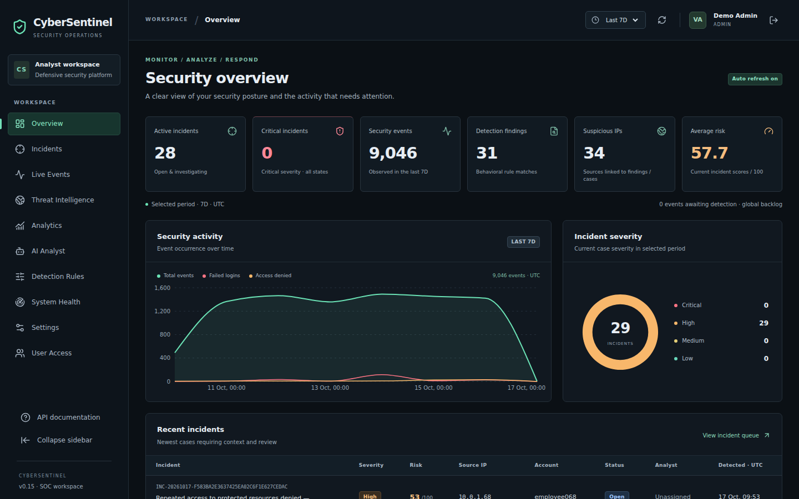
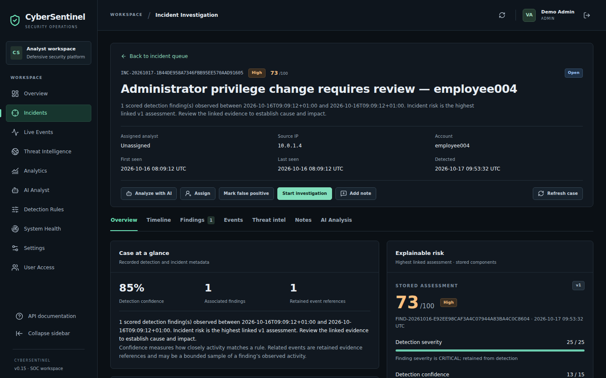
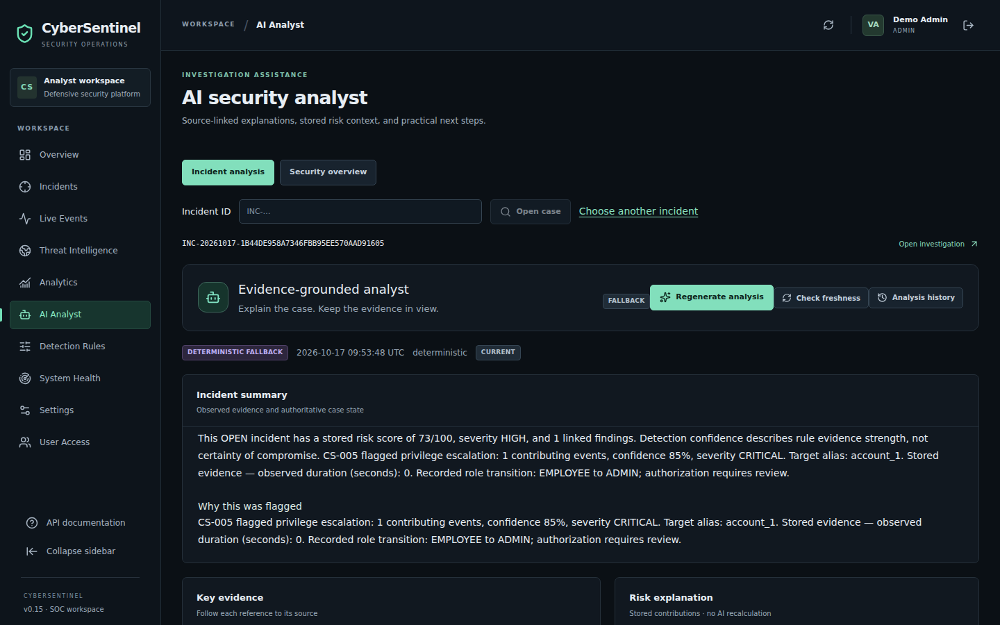
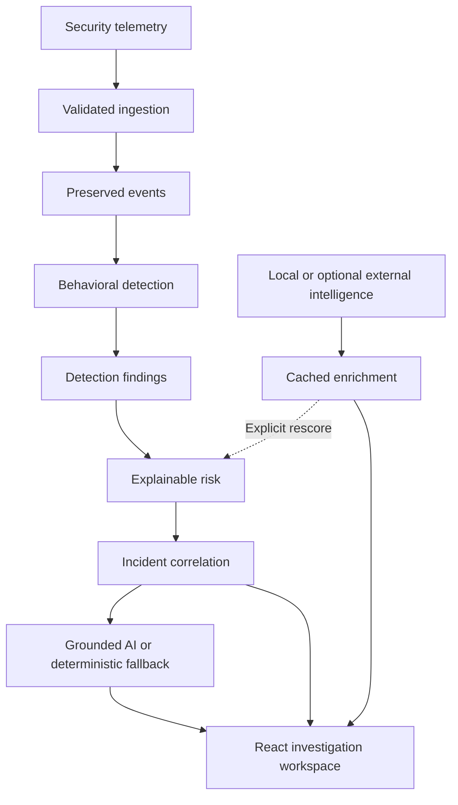

# CyberSentinel

**AI-Powered Cyber Threat Intelligence & Security Analytics Platform**

CyberSentinel is a defensive SOC-style application that turns security telemetry into explainable findings, risk assessments and analyst-managed incidents. It combines a Python detection pipeline with PostgreSQL, a React investigation workspace, optional threat-intelligence providers and evidence-grounded AI assistance.

Built as a portfolio and learning project using synthetic telemetry. It does not prevent attacks, perform network scans or automate remediation. The complete local demo works without paid API keys.

[Quick start](#quick-start) · [Publish to GitHub](docs/GITHUB.md) · [Demo](docs/DEMO.md) · [Architecture](docs/ARCHITECTURE.md) · [API](docs/API.md) · [Testing](docs/TESTING.md) · [Interview guide](docs/INTERVIEW.md)

## See the application







[Screenshot gallery and capture conditions](docs/SCREENSHOTS.md). These are screenshots of the running application, not design mockups. All telemetry and account names shown are synthetic.

## Key features

- Validated single, batch and file ingestion with producer-ID deduplication and preserved raw evidence.
- Ten modular behavioral rules, bounded historical queries, explainable confidence and replay-safe findings.
- Six-component risk scores with stored reasons, policy version and input/configuration hashes.
- Conservative incident correlation, assignment, status transitions, analyst notes and audit history.
- Optional AbuseIPDB, VirusTotal and AlienVault OTX adapters; separate mock/live caches and explicit unknown/error states.
- Incident investigation with evidence, timelines, intelligence, risk breakdowns and grounded analyst assistance.
- Dashboard polling, interactive analytics, JSON/CSV reports and system health.
- JWT authentication, rotating refresh sessions and server-enforced ADMIN / ANALYST / VIEWER permissions.
- Alembic migrations, Docker development/production targets and isolated verification scripts.

## Architecture and data flow



An **event** records an observation. A **finding** records a rule match and its evidence. A **risk assessment** prioritizes a finding. An **incident** is an analyst's case containing eligible findings. Detection never creates incidents directly. [Architecture and design decisions →](docs/ARCHITECTURE.md)

## Detection rules

| Rule | Behavior and fresh-seed default | Severity |
| --- | --- | --- |
| CS-001 · Brute force | ≥5 failed logins per source IP + account in 120 seconds | High |
| CS-002 · Password spraying | ≥8 accounts per source IP in 300 seconds; ≤3 attempts per account | High |
| CS-003 · Impossible travel | Successful logins ≥500 km apart requiring >900 km/h, within 2 hours | High |
| CS-004 · Unusual login time | Outside 08:00–20:00 Asia/Kolkata; use historical hours when sufficient | Medium |
| CS-005 · Privilege escalation | Transition to administrator without the configured approval reference | Critical |
| CS-006 · Suspicious ports | ≥20 distinct destination ports per source + destination IP in 60 seconds | High |
| CS-007 · Excessive sensitive access | ≥500 sensitive records in 20 minutes; optional historical baseline | High |
| CS-008 · Suspicious IP | Independent local synthetic reputation score ≥75 | Critical |
| CS-009 · Repeated access denied | ≥10 denials per account + source IP in 300 seconds | Medium |
| CS-010 · Abnormal API activity | ≥200 requests per source IP in 60 seconds; optional baseline | High |

These are the current seed values, not every historical phase's proposed thresholds. PostgreSQL stores each rule's enabled flag, severity and validated configuration. Seeding preserves existing configuration. Detection uses observed behavior, never simulation scenario labels; labels are used only for synthetic evaluation. [Rule details →](docs/ARCHITECTURE.md#detection-engine)

## Risk, incidents and enrichment

Risk = **severity (25) + confidence (15) + behavioral intensity (20) + frequency (15) + asset sensitivity (15) + reputation (10)**. Component caps sum to 100. Categories are Low 0–24, Medium 25–49, High 50–74 and Critical 75–100. Each component stores its points and reason. Confidence measures strength of a rule match; it is not a calibrated attack probability.

Findings scoring at least 50 are eligible for incident processing by default. Correlation requires multiple matching identity attributes and a bounded time window; a shared IP alone is insufficient. Analysts control assignment, investigation, resolution and false-positive decisions.

Threat enrichment is an explicit step. Failed or missing provider results remain unknown. Mock responses are labeled and stored separately from live responses. Enrichment does not silently change scores; an explicit cached-reputation rescore is available. [Risk and intelligence details →](docs/ARCHITECTURE.md)

## AI analyst

The optional LLM selects from server-authored evidence facts and approved defensive action IDs. Schema, incident identity, context hash and reference validation precede rendering. It cannot invent a new factual field, execute SQL, change case status or block an address. Unsupported output falls back to deterministic analysis. Incident and overview Q&A use controlled database queries, not an autonomous agent. Saved analyses display their mode and whether the source context has changed. [AI boundaries →](docs/SECURITY.md#ai-and-untrusted-content)

## Analytics and reporting

Explore events, findings, risk, incident backlog, targeted entities, geography, provider coverage and AI usage. Reports support paginated JSON and CSV. Analyst workload views require ADMIN; exports require ADMIN or ANALYST. UTC ranges and metric definitions are explicit; current case state is not presented as a historical snapshot. [Metric definitions →](docs/ARCHITECTURE.md#analytics-semantics)

## Technology and repository

| Layer | Technology |
| --- | --- |
| Backend | Python 3.12+, FastAPI, Pydantic v2, SQLAlchemy 2, psycopg, Alembic |
| Database | PostgreSQL 17, JSONB, UUIDs, constraints and query indexes |
| Frontend | React, Vite, Tailwind CSS, React Router, TanStack Query, Axios, Recharts, Lucide |
| Security | bcrypt, JWT access tokens, rotating refresh sessions, RBAC |
| Runtime | Docker Compose, multi-stage builds, Nginx reverse proxy |
| Verification | pytest, Ruff, Vitest, optional Playwright and JMeter |

| Directory | Responsibility |
| --- | --- |
| `backend/app/models`, `schemas`, `routes` | Persistence, validation and HTTP contracts |
| `backend/app/detection`, `risk`, `incidents` | Independent domain engines |
| `backend/app/threat_intelligence`, `ai` | Provider boundaries and grounded assistance |
| `backend/app/repositories`, `services`, `security` | Queries, orchestration and access control |
| `backend/alembic`, `backend/scripts`, `backend/tests` | Migrations, CLI workflows and tests |
| `frontend/src` | Authenticated SOC and investigation UI |
| `scripts`, `docs` | PowerShell operations, verification and documentation |

## Quick start

Prerequisites: Docker Desktop running Linux containers, Docker Compose v2 and Windows PowerShell 5.1 or 7. Open the existing project in VS Code. Keep your existing `.env` and database volume when applying updates.

From the project root:

```powershell
powershell -NoProfile -ExecutionPolicy Bypass -File .\scripts\Initialize-Environment.ps1
if ($LASTEXITCODE -ne 0) { throw 'Environment initialization failed.' }
docker compose up --build -d --wait --wait-timeout 180
if ($LASTEXITCODE -ne 0) { throw 'Container startup failed.' }
docker compose exec backend alembic upgrade head
if ($LASTEXITCODE -ne 0) { throw 'Database migration failed.' }
docker compose exec backend python -m scripts.seed_detection_rules
if ($LASTEXITCODE -ne 0) { throw 'Rule seed failed.' }
docker compose exec backend python -m scripts.create_admin
if ($LASTEXITCODE -ne 0) { throw 'Administrator creation failed.' }
docker compose ps
Invoke-RestMethod http://localhost:5173/api/system/ready
Start-Process http://localhost:5173
Start-Process http://localhost:5173/docs
```

Create the administrator once, using the interactive prompts; on an already initialized installation, skip that command and sign in with your existing **username**, not an assumed demo email. There is no shared default password. Registration creates VIEWER accounts.

Expected: three healthy containers, readiness `ready`, a login page and Swagger when `API_DOCS_ENABLED=true`. The backend health check tests liveness; readiness also requires migrations. The default stack exposes frontend 5173 and backend 8000 on loopback, with PostgreSQL internal on 5432. Development mode publishes PostgreSQL on host port 15432. [Configuration, host setup and troubleshooting →](docs/SETUP.md)

## Populate and demonstrate

[DEMO.md](docs/DEMO.md) contains exact PowerShell commands for **generate 10,000 events → ingest → detect → score → correlate → mock enrich**, using seed 42 and dates relative to today. It also includes a four-minute presentation script and safe screenshot/recording checklist. Select the seven-day range to inspect the generated week. Polling shows newly ingested data; it does not generate traffic itself.

## API overview

| Operation | Route | Permission |
| --- | --- | --- |
| Authenticate | `POST /api/auth/login` | Credentials + browser guard |
| Ingest | `POST /api/events/ingest/batch` | ADMIN / ANALYST |
| Detect / score / correlate | `POST /api/detection/run`, `/api/risk/run`, `/api/incidents/process` | ADMIN / ANALYST |
| Investigate | `GET /api/incidents/{incident_id}` | Authenticated |
| Enrich / explain | `POST /api/threats/lookup`, `/api/ai/incidents/{incident_id}/analyze` | ADMIN / ANALYST |
| Analytics | `GET /api/analytics/overview` | Authenticated |

[API reference, complete route inventory and request examples →](docs/API.md)

## Testing and measured results

The recorded Phase 16 run passed **799 backend tests with one native-concurrency skip**, plus **86 frontend tests**. An isolated 10,000-event synthetic pipeline produced 36 findings and 29 incidents, preserved raw-event hashes and passed replay/integrity checks. These were embedded PostgreSQL-compatible runtime measurements, not native Docker or production-capacity results. Native Docker restart/recovery and a full PostgreSQL backup/restore still require workstation verification.

```powershell
powershell -NoProfile -ExecutionPolicy Bypass -File .\scripts\Verify-Phase16.ps1
```

[Testing and native commands](docs/TESTING.md) · [Recorded measurements and limitations](docs/PHASE16_VALIDATION.md) · [Phase 17 documentation/browser verification](docs/PHASE17_VALIDATION.md)

## Repository and local demo

GitHub is the source-code and portfolio destination. Run the complete application locally with Docker Compose using the quick start above; no Render account or cloud subscription is required. The screenshots show the local application with synthetic data. No live hosted application is claimed.

[GitHub upload instructions](docs/GITHUB.md) include Windows PowerShell commands, repository setup, and suggested description/topics. GitHub Pages is not required for this repository.

Prior cloud-deployment preparation remains available as optional reference: [deployment guide](docs/DEPLOYMENT.md), [dated local verification](docs/PHASE18_VALIDATION.md) and [file list](docs/PHASE18_FILES.md). Those utilities and `render.yaml` do not run when code is uploaded to GitHub.

## Security, limitations and next steps

The application uses input validation, parameterized queries, expiring/revocable sessions, role checks, bounded operations and audit records. Secrets are environment-only; the initializer generates local values. [Security design and threat model →](docs/SECURITY.md)

Current limits: synthetic data and hand-tuned rules; no real-world accuracy claim; single API worker with process-local rate limits; no autonomous response; polling rather than WebSockets; IP provider lookup only; no multi-tenant isolation, SSO/MFA or completed cloud deployment. Risk rescoring may replace an assessment within a version. Live provider availability and model quality require separate validation.

Future work: native operational acceptance, managed PostgreSQL and HTTPS deployment, SSO/MFA, shared rate limiting before multi-worker scaling, retention/partitioning for measured volume, additional telemetry adapters and broader detection evaluation. None is claimed as implemented. Healthcare-style record-access examples contain no patient data or compliance certification.

## Portfolio summary

**CyberSentinel | Python, FastAPI, React, PostgreSQL, Docker, Threat Intelligence, GenAI**

Developed a SOC-style application that ingests synthetic telemetry, detects suspicious behavior through ten modular rules, calculates explainable risk and correlates findings into auditable investigation cases with optional intelligence and grounded analyst assistance.

[Resume bullets, interview answers and GitHub presentation](docs/INTERVIEW.md) · [Contributing](CONTRIBUTING.md) · [Changelog](CHANGELOG.md)

## License

No project-wide open-source license has been selected. The repository owner must choose one before offering open-source reuse; dependency licenses remain separate. This update does not assign a license or invent a copyright holder.
