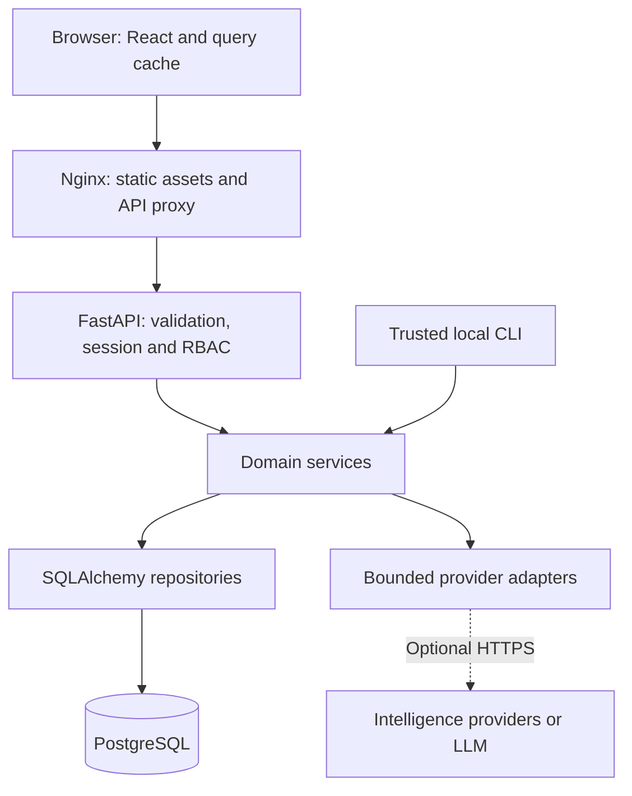
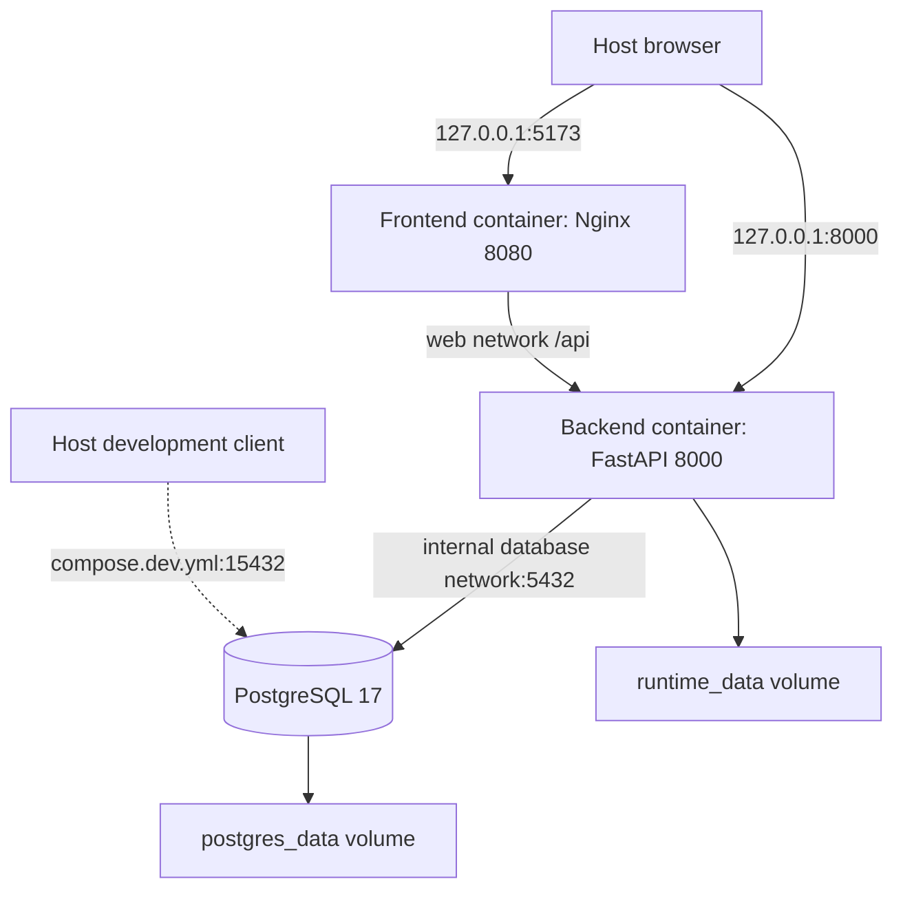
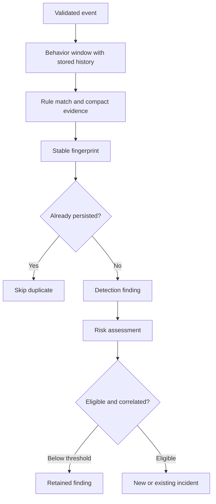

# Architecture and design decisions

[Documentation index](README.md) · [Database](DATABASE.md) · [API](API.md) · [Security](SECURITY.md)

This describes the implemented application through Phase 17. Earlier phase documents are historical implementation records, not the current configuration reference. Domain code remains unchanged in this documentation phase.

## Component boundaries

Routes translate requests and enforce authorization; services orchestrate transactions; repositories define bounded queries. Detection, risk and incident engines are separate modules. CLI tools use the same services without HTTP authentication and therefore require trusted host/database access. FastAPI's OpenAPI schema is generated from actual route/request/response types.

## Docker topology

Default builds use a bundled React build and Nginx; development overrides use Vite and source mounts. Backend/frontend containers run without root, drop capabilities, use read-only filesystems and writable temporary mounts. PostgreSQL has no default host port. `compose.dev.yml` explicitly publishes the configurable host port while retaining internal `db:5432`.

`/api/system/live` tests the API process. `/api/system/ready` checks database access and Alembic head. `docker compose --wait` can succeed before migrations because container health is liveness-based. Migrations are a separate explicit command. Deployment, TLS termination and managed cloud resources are Phase 18 work.

## Security data lifecycle

Original event fields are never rewritten by detection. Only `processed` changes after successful rule evaluation. JSONB evidence stores metrics and references rather than copies of complete raw logs. Finding evidence IDs are producer `event_id` strings checked in the application; primary-event and case-evidence relationships additionally have database foreign keys.

## Detection engine

| Rule | Behavior and fresh-seed default | Severity |
| --- | --- | --- |
| CS-001 · Brute force | ≥5 failed logins per source IP + account in 120 seconds | High |
| CS-002 · Password spraying | ≥8 accounts per source IP in 300 seconds; ≤3 attempts per account | High |
| CS-003 · Impossible travel | Successful logins ≥500 km apart requiring >900 km/h, within 2 hours | High |
| CS-004 · Unusual login time | Outside 08:00–20:00 Asia/Kolkata; use historical hours when sufficient | Medium |
| CS-005 · Privilege escalation | Transition to administrator without the configured approval reference | Critical |
| CS-006 · Suspicious ports | ≥20 distinct destination ports per source + destination IP in 60 seconds | High |
| CS-007 · Excessive sensitive access | ≥500 sensitive records in 20 minutes; optional historical baseline | High |
| CS-008 · Suspicious IP | Independent local synthetic reputation score ≥75 | Critical |
| CS-009 · Repeated access denied | ≥10 denials per account + source IP in 300 seconds | Medium |
| CS-010 · Abnormal API activity | ≥200 requests per source IP in 60 seconds; optional baseline | High |

Implementation: [engine](../backend/app/detection/engine.py), [rule modules](../backend/app/detection/rules), [typed configuration](../backend/app/detection/configuration.py), [seed defaults](../backend/scripts/seed_detection_rules.py).

- Load enabled definitions from PostgreSQL. Invalid configurations fail explicitly; ADMIN updates are schema-validated.
- Evaluate bounded batches ordered by `(timestamp, id)`. Previously processed events remain eligible historical context, including when late events arrive.
- A PostgreSQL advisory transaction lock serializes detection writers. A failed rule rolls back its batch; events are not marked evaluated prematurely. Successfully committed prior batches remain committed.
- Fingerprint SHA-256 of canonical JSON containing `detection-v1`, rule ID, entity tuple and stable anchor event ID. The database uniqueness constraint is the final duplicate guard. The anchor keeps fingerprints independent of batch size.
- The default batch is 500; evidence defaults to at most 100 IDs with an explicit truncation marker and complete aggregate counts. Historical-context bounds fail explicitly rather than silently accepting partial evaluation.
- Dry runs do not persist findings or change `processed`. Rule-specific evaluation cannot mean all enabled rules have run. Replay examines processed history while retaining the fingerprint guard.
- Confidence rises with evidence strength using documented deterministic rules. Severity starts from the stored rule; neither value is an incident decision or a calibrated likelihood.

CS-003 uses supplied geographic metadata and Haversine distance; missing/invalid coordinates are skipped. CS-004 uses sufficient preceding login history (minimum 20 over 30 days) or organization hours in Asia/Kolkata, with explicit timezone conversion. CS-007 counts records, including `record_count` in sensitive `FILE_ACCESS` telemetry, and supports `SENSITIVE_RECORD_ACCESS`. CS-007/010 can compare sufficient historical baselines. CS-008's local documentation-address set is independent of simulation labels and performs no network call.

Simulation labels are read only by evaluation tooling, never the detector. A successful match means suspicious behavior merits review, not that a compromise is proven. Replay does not mutate existing findings when configuration changes.

## Explainable risk

Implementation: [policy](../backend/app/risk/config.py), [components](../backend/app/risk/components.py), [calculator](../backend/app/risk/calculator.py).

| Component | Maximum | Current policy |
| --- | ---: | --- |
| Severity | 25 | LOW 5, MEDIUM 12, HIGH 20, CRITICAL 25 |
| Confidence | 15 | Round-half-up of confidence × 15 / 100 |
| Behavioral intensity | 20 | Rule-specific threshold exceedance; logarithmic growth for volume, default full at 10×; bounded contextual bonuses |
| Frequency | 15 | Time compression or distinct rule-specific signal; avoid simply recounting the same volume |
| Asset sensitivity | 15 | Highest applicable service/resource/account/destination classification, not a sum of all matching tags |
| Reputation | 10 | ≥25 gives 4; ≥75 gives 7; ≥90 gives 10; lower/unknown adds zero with an explicit reason |

For window compression, the basic term is `15 × (1 − observed_span / configured_window)` where meaningful; fewer than two events or nonpositive span adds zero. API scoring splits compression (10) from HTTP errors (5); denied-resource breadth provides a separate signal for access-denied findings. Rule-specific behavior avoids manufacturing threshold ratios for privilege changes or reputation matches. Bounds and component-sum/category constraints also exist in PostgreSQL.

Scores map to LOW 0–24, MEDIUM 25–49, HIGH 50–74 and CRITICAL 75–100. Assessments persist the version, input/configuration hashes and reasons. The unique `(finding, score_version)` row is **deliberately replaceable on explicit rescore**; this is not an immutable history of every scoring attempt. A new version can coexist. Case risk uses linked current assessments and is not a sum of all finding scores.

For example, the captured synthetic privilege-change case stores 25 severity + 13 confidence + 20 behavior + 0 frequency + 15 sensitivity + 0 reputation = **73 / High**, while its underlying rule severity is Critical. These are observed stored components, not an LLM judgment. See the [risk screenshot](SCREENSHOTS.md#explainable-risk).

## Incident correlation and workflow

Default eligibility is risk ≥50. Candidate cases must fit a full 60-minute span and a minimum correlation score of 8. At least two identity attributes must match: username (3), source IP (3), device (2); related rules (2) and time (2) contribute context. Conflicting usernames reject a candidate. A shared NAT/VPN address alone cannot merge users into one case. Related authentication rules, the same rule and CS-008 can provide rule-family context.

Tie breaking is deterministic. A finding links to one case via a uniqueness constraint; evidence links preserve the source. Current case risk follows the maximum linked current assessment. OPEN and INVESTIGATING are active states. Resolved-case automatic reopening is disabled by default; FALSE_POSITIVE cases are not automatically reopened. Assignment, status changes, resolution details and comments are audited. AI recommendations have no authority to execute these actions.

## Intelligence and AI boundaries

IP lookup uses a provider interface. Mock and live result bundles are distinct; cache validity includes expiry and configuration policy. Defaults: successful cache 24 hours, error cache 300 seconds, request timeout 10 seconds, at most one retry. Provider cooldowns and credential fingerprints coordinate repeated calls. Public-IP validation and fixed provider hosts prevent an arbitrary URL-fetch API. Unsupported/private/documentation indicators are not submitted as real public reputation lookups. DOMAIN exists in the model for future use; the current lookup API accepts IPs.

Reading a stored incident or intelligence result does not contact a provider. Explicit lookup/enrichment may do so when live mode is configured. Intelligence enrichment neither modifies raw telemetry nor automatically rewrites risk. An explicit cached-reputation rescore, followed by incident processing, updates that layer deliberately.

The AI context builder uses stored cases, findings, risk and approved intelligence facts. Raw log text, free-form notes and provider text are not instructions. Optional LLM output selects validated fact/action IDs; factual sentences are rendered from server-authored material. Failures return a labeled deterministic fallback. Context/configuration hashes identify stale saved analyses; old analyses remain in `ai_analyses`. Controlled Q&A maps supported intents to bounded queries and cannot execute model-supplied SQL. Analysis writes its own history/audit/metrics, but cannot mutate security evidence, risk or case workflow.

## Analytics semantics

- UTC ranges are start-inclusive/end-exclusive. Event charts use occurrence time; finding charts use last-seen; incident cohorts use creation time.
- Current status/risk describes a cohort's present state, not its state at every historic bucket.
- MTTA uses the first audited human transition to INVESTIGATING. MTTR uses currently RESOLVED incidents with valid resolution times. FALSE_POSITIVE is not counted as a resolved incident for MTTR.
- False-positive rate is FALSE_POSITIVE / (RESOLVED + FALSE_POSITIVE), with null when no decisions exist.
- Report pagination is explicit. CSV text is neutralized against spreadsheet formula execution.
- Synthetic evaluation measures scenario/rule coverage and label agreement; it does not establish operational precision on real logs.

## Design decisions and trade-offs

| Decision | Reason | Trade-off |
| --- | --- | --- |
| FastAPI + Pydantic | Typed request contracts and generated OpenAPI | Domain rules still require explicit tests |
| SQLAlchemy + PostgreSQL | Transactions, FK/check constraints, JSONB and selective indexes | Native database needed for final concurrency/operations checks |
| Independent findings, risk and cases | Evidence remains explainable and processing stages replayable | More explicit orchestration steps |
| Deterministic rule modules | Inspectable behavior and threshold tests | Tuned rules may miss unknown behavior and produce false positives |
| Bounded synchronous batches | Simple local operation without a queue cluster | Long runs need CLI; capacity is intentionally limited |
| Local mock and deterministic fallback | Repeatable offline demos without API costs | Mock outputs are not real reputation or LLM-quality evidence |
| One API worker | Matches process-local rate-limit semantics | Shared limits/coordination required before horizontal scaling |
| Polling with cursor and query cache | Reliable incremental UI updates with existing HTTP stack | Not sub-second streaming; WebSockets are future work |

Scaling proposals—partitioning after measured need, shared rate limiting, durable job orchestration and managed database operations—remain future work. Native Docker recovery gates are listed in [Testing](TESTING.md).
