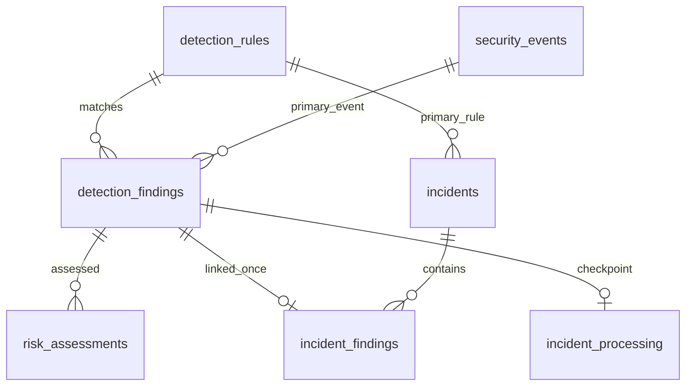
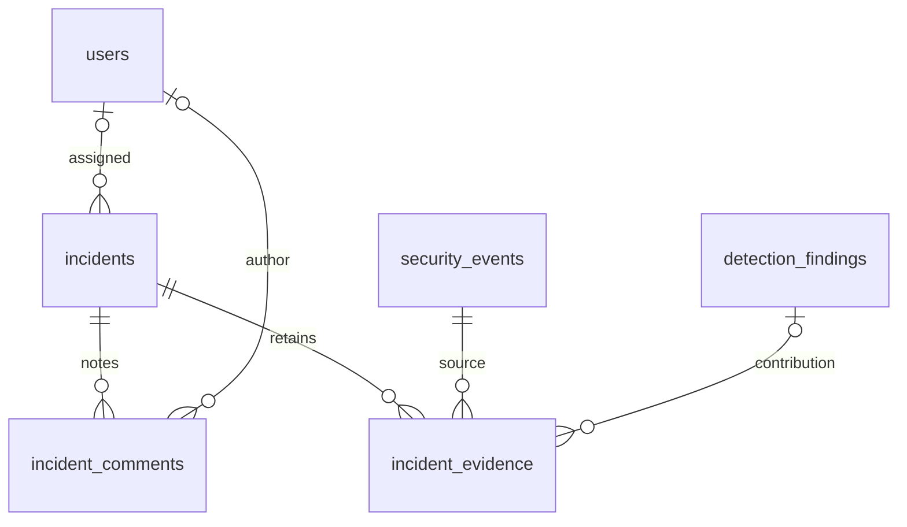
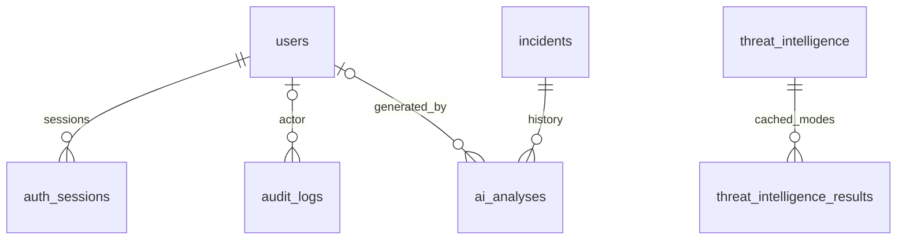

# Database reference

[Architecture](ARCHITECTURE.md) · [API](API.md) · [Demo queries](DEMO.md#verify-the-stored-evidence)

PostgreSQL is the persistence source of truth. SQLAlchemy 2 models define relationships; Alembic migrations own schema changes. The application has **17 domain tables** plus `alembic_version`; Phase 17 adds no table or migration. Head remains `0008_ai_analyses`.

## Terminology and integrity

An event is an observation; a finding is a behavioral match; an assessment is a prioritization calculation; an incident is a case. This separation preserves the evidence behind decisions. Detection never writes incidents directly. Audit entries record operator changes, while system metrics summarize runs.

Identifiers use UUID primary keys and readable producer/finding/incident IDs where applicable. PostgreSQL stores timezone-aware timestamps, INET address values, native enums and JSONB documents. Rule configuration and compact evidence use JSONB because their shape varies by rule; core relationships remain relational.

Reusable enum values include ADMIN/ANALYST/VIEWER; OPEN/INVESTIGATING/RESOLVED/FALSE_POSITIVE; LOW/MEDIUM/HIGH/CRITICAL; IP/DOMAIN. `FindingStatus` is intentionally simpler than incident workflow. Confidence/risk/port ranges, component sums and uniqueness are database-constrained in addition to request validation. Exact DDL is in [migrations](../backend/alembic/versions).

## Enforced relationships

These diagrams show actual FK relationships. JSON arrays of evidence IDs and generic audit entity IDs are not invented foreign keys.







`system_metrics` and `threat_provider_state` are independent tables. Result bundles currently have uniqueness on indicator and mode, not an unbounded row per provider request. Case/finding relationships use RESTRICT where removing evidence provenance would be unsafe. Comment/evidence child rows can cascade with a deleted case, but referenced events do not cascade. No event-retention deletion job is implemented.

## Table reference

The following field/index/FK inventory was extracted from current SQLAlchemy metadata and compiled using the PostgreSQL dialect. Native enum names refer to the reusable values above; timestamps explicitly include timezone information. Nullable indicates optionality, not that a field is omitted from every response.

### `users`

Identity, bcrypt hash, current role and activation state. Username/email are unique; responses omit password hashes.

| Field | Type | Nullable |
| --- | --- | --- |
| `username` | `VARCHAR(64)` | No |
| `email` | `VARCHAR(254)` | No |
| `hashed_password` | `VARCHAR(255)` | No |
| `full_name` | `VARCHAR(150)` | Yes |
| `role` | `user_role` | No |
| `is_active` | `BOOLEAN` | No |
| `last_login` | `TIMESTAMP WITH TIME ZONE` | Yes |
| `id` (PK) | `UUID` | No |
| `updated_at` | `TIMESTAMP WITH TIME ZONE` | No |
| `created_at` | `TIMESTAMP WITH TIME ZONE` | No |

Uniqueness: `["username"]`; `["email"]`.

### `auth_sessions`

Revocable refresh-session hashes and token/session expiry. Session rows are removed with their user; plain refresh tokens are not stored.

| Field | Type | Nullable |
| --- | --- | --- |
| `user_id` | `UUID` | No |
| `refresh_token_hash` | `VARCHAR(64)` | No |
| `expires_at` | `TIMESTAMP WITH TIME ZONE` | No |
| `last_used_at` | `TIMESTAMP WITH TIME ZONE` | No |
| `revoked_at` | `TIMESTAMP WITH TIME ZONE` | Yes |
| `id` (PK) | `UUID` | No |
| `created_at` | `TIMESTAMP WITH TIME ZONE` | No |

Foreign keys:

- `user_id` → `users.id`; on delete `CASCADE`.

Indexes: `{"name":"ix_auth_sessions_expires_at","columns":["expires_at"]}`; `{"name":"ix_auth_sessions_user_id","columns":["user_id"]}`.

### `security_events`

Normalized immutable observations plus JSONB raw_data. Producer event_id prevents duplicate ingestion. ingest_sequence supports incremental polling; processed is detection bookkeeping only.

| Field | Type | Nullable |
| --- | --- | --- |
| `event_id` | `VARCHAR(128)` | No |
| `ingestion_sequence` | `BIGINT` | No |
| `timestamp` | `TIMESTAMP WITH TIME ZONE` | No |
| `source_ip` | `INET` | No |
| `destination_ip` | `INET` | Yes |
| `username` | `VARCHAR(255)` | Yes |
| `event_type` | `VARCHAR(64)` | No |
| `service` | `VARCHAR(100)` | Yes |
| `source_port` | `INTEGER` | Yes |
| `destination_port` | `INTEGER` | Yes |
| `country` | `VARCHAR(100)` | Yes |
| `device` | `VARCHAR(255)` | Yes |
| `user_agent` | `TEXT` | Yes |
| `status` | `VARCHAR(64)` | No |
| `raw_data` | `JSONB` | No |
| `processed` | `BOOLEAN` | No |
| `id` (PK) | `UUID` | No |
| `created_at` | `TIMESTAMP WITH TIME ZONE` | No |

Uniqueness: `["event_id"]`; `["ingestion_sequence"]`.

Indexes: `{"name":"ix_security_events_processed","columns":["processed"]}`; `{"name":"ix_security_events_username","columns":["username"]}`; `{"name":"ix_security_events_pending_order","columns":["processed","timestamp","id"]}`; `{"name":"ix_security_events_source_time","columns":["source_ip","timestamp"]}`; `{"name":"ix_security_events_event_type","columns":["event_type"]}`; `{"name":"ix_security_events_user_time","columns":["username","timestamp"]}`; `{"name":"ix_security_events_source_ip","columns":["source_ip"]}`; `{"name":"ix_security_events_type_time","columns":["event_type","timestamp"]}`; `{"name":"ix_security_events_timestamp","columns":["timestamp"]}`.

### `detection_rules`

Stable CS rule IDs, severity, enabled flag and JSONB configuration. Seed updates insert missing rules without overwriting tuned values.

| Field | Type | Nullable |
| --- | --- | --- |
| `rule_id` | `VARCHAR(32)` | No |
| `name` | `VARCHAR(150)` | No |
| `description` | `TEXT` | No |
| `severity` | `severity_level` | No |
| `enabled` | `BOOLEAN` | No |
| `configuration` | `JSONB` | No |
| `id` (PK) | `UUID` | No |
| `updated_at` | `TIMESTAMP WITH TIME ZONE` | No |
| `created_at` | `TIMESTAMP WITH TIME ZONE` | No |

Uniqueness: `["rule_id"]`.

### `detection_findings`

Deterministic rule matches: primary event, compact JSONB evidence, confidence, window, entity and unique fingerprint. No final incident risk is stored here.

| Field | Type | Nullable |
| --- | --- | --- |
| `finding_id` | `VARCHAR(64)` | No |
| `detection_rule_id` | `UUID` | No |
| `title` | `VARCHAR(200)` | No |
| `description` | `TEXT` | No |
| `severity` | `severity_level` | No |
| `confidence` | `INTEGER` | No |
| `source_ip` | `INET` | Yes |
| `username` | `VARCHAR(255)` | Yes |
| `primary_event_id` | `UUID` | No |
| `evidence_event_ids` | `JSONB` | No |
| `evidence_data` | `JSONB` | No |
| `first_seen` | `TIMESTAMP WITH TIME ZONE` | No |
| `last_seen` | `TIMESTAMP WITH TIME ZONE` | No |
| `event_count` | `INTEGER` | No |
| `entity_key` | `VARCHAR(640)` | No |
| `fingerprint` | `VARCHAR(64)` | No |
| `id` (PK) | `UUID` | No |
| `created_at` | `TIMESTAMP WITH TIME ZONE` | No |

Foreign keys:

- `detection_rule_id` → `detection_rules.id`; on delete `RESTRICT`.
- `primary_event_id` → `security_events.id`; on delete `RESTRICT`.

Uniqueness: `["fingerprint"]`; `["finding_id"]`.

Indexes: `{"name":"ix_detection_findings_rule_seen","columns":["detection_rule_id","last_seen"]}`; `{"name":"ix_detection_findings_username","columns":["username"]}`; `{"name":"ix_detection_findings_severity","columns":["severity"]}`; `{"name":"ix_detection_findings_source_ip","columns":["source_ip"]}`; `{"name":"ix_detection_findings_last_seen","columns":["last_seen"]}`.

### `risk_assessments`

One assessment per finding/version, with six contributions, input/configuration hashes and explanatory JSONB breakdown. Explicit rescoring replaces that version row.

| Field | Type | Nullable |
| --- | --- | --- |
| `assessment_id` | `VARCHAR(64)` | No |
| `detection_finding_id` | `UUID` | No |
| `risk_score` | `INTEGER` | No |
| `risk_level` | `severity_level` | No |
| `score_version` | `VARCHAR(32)` | No |
| `severity_score` | `INTEGER` | No |
| `confidence_score` | `INTEGER` | No |
| `behavioural_score` | `INTEGER` | No |
| `frequency_score` | `INTEGER` | No |
| `asset_sensitivity_score` | `INTEGER` | No |
| `reputation_score` | `INTEGER` | No |
| `breakdown` | `JSONB` | No |
| `config_hash` | `VARCHAR(64)` | No |
| `input_hash` | `VARCHAR(64)` | No |
| `calculated_at` | `TIMESTAMP WITH TIME ZONE` | No |
| `id` (PK) | `UUID` | No |
| `created_at` | `TIMESTAMP WITH TIME ZONE` | No |

Foreign keys:

- `detection_finding_id` → `detection_findings.id`; on delete `RESTRICT`.

Uniqueness: `["detection_finding_id","score_version"]`; `["assessment_id"]`.

Indexes: `{"name":"ix_risk_level","columns":["risk_level"]}`; `{"name":"ix_risk_version_score_time","columns":["score_version","risk_score","calculated_at"]}`; `{"name":"ix_risk_calculated_at","columns":["calculated_at"]}`.

### `incidents`

Analyst cases with current risk/severity, assigned analyst, status, correlation span and resolution fields. Reserved legacy ai_analysis/recommended_actions fields are not the active analysis-history store.

| Field | Type | Nullable |
| --- | --- | --- |
| `incident_id` | `VARCHAR(64)` | No |
| `title` | `VARCHAR(255)` | No |
| `description` | `TEXT` | No |
| `detection_rule_id` | `UUID` | No |
| `source_ip` | `INET` | Yes |
| `username` | `VARCHAR(255)` | Yes |
| `risk_score` | `INTEGER` | No |
| `severity` | `severity_level` | No |
| `confidence` | `NUMERIC(5, 2)` | No |
| `status` | `incident_status` | No |
| `assigned_analyst_id` | `UUID` | Yes |
| `detected_at` | `TIMESTAMP WITH TIME ZONE` | No |
| `first_seen` | `TIMESTAMP WITH TIME ZONE` | No |
| `last_seen` | `TIMESTAMP WITH TIME ZONE` | No |
| `resolved_at` | `TIMESTAMP WITH TIME ZONE` | Yes |
| `resolution_summary` | `TEXT` | Yes |
| `risk_score_version` | `VARCHAR(32)` | Yes |
| `risk_updated_at` | `TIMESTAMP WITH TIME ZONE` | Yes |
| `ai_analysis` | `JSONB` | Yes |
| `recommended_actions` | `JSONB` | No |
| `id` (PK) | `UUID` | No |
| `updated_at` | `TIMESTAMP WITH TIME ZONE` | No |
| `created_at` | `TIMESTAMP WITH TIME ZONE` | No |

Foreign keys:

- `detection_rule_id` → `detection_rules.id`; on delete `RESTRICT`.
- `assigned_analyst_id` → `users.id`; on delete `SET NULL`.

Uniqueness: `["incident_id"]`.

Indexes: `{"name":"ix_incidents_severity","columns":["severity"]}`; `{"name":"ix_incidents_detection_rule_id","columns":["detection_rule_id"]}`; `{"name":"ix_incidents_source_ip","columns":["source_ip"]}`; `{"name":"ix_incidents_detected_at","columns":["detected_at"]}`; `{"name":"ix_incidents_username","columns":["username"]}`; `{"name":"ix_incidents_created_at","columns":["created_at"]}`; `{"name":"ix_incidents_status","columns":["status"]}`; `{"name":"ix_incidents_risk_score","columns":["risk_score"]}`; `{"name":"ix_incidents_assigned_analyst_id","columns":["assigned_analyst_id"]}`.

### `incident_findings`

A finding-to-case association with correlation rationale. A finding is uniquely linked to at most one case.

| Field | Type | Nullable |
| --- | --- | --- |
| `incident_id` | `UUID` | No |
| `detection_finding_id` | `UUID` | No |
| `added_at` | `TIMESTAMP WITH TIME ZONE` | No |
| `relationship_reason` | `TEXT` | No |
| `correlation_data` | `JSONB` | No |
| `id` (PK) | `UUID` | No |

Foreign keys:

- `incident_id` → `incidents.id`; on delete `RESTRICT`.
- `detection_finding_id` → `detection_findings.id`; on delete `RESTRICT`.

Uniqueness: `["incident_id","detection_finding_id"]`; `["detection_finding_id"]`.

### `incident_evidence`

Case evidence referencing original event and, when present, contributing finding. Deleting a case must not delete original events.

| Field | Type | Nullable |
| --- | --- | --- |
| `incident_id` | `UUID` | No |
| `security_event_id` | `UUID` | No |
| `detection_finding_id` | `UUID` | Yes |
| `evidence_type` | `VARCHAR(100)` | No |
| `description` | `TEXT` | No |
| `evidence_data` | `JSONB` | No |
| `id` (PK) | `UUID` | No |
| `created_at` | `TIMESTAMP WITH TIME ZONE` | No |

Foreign keys:

- `incident_id` → `incidents.id`; on delete `CASCADE`.
- `detection_finding_id` → `detection_findings.id`; on delete `RESTRICT`.
- `security_event_id` → `security_events.id`; on delete `RESTRICT`.

Uniqueness: `["incident_id","security_event_id","evidence_type"]`.

Indexes: `{"name":"ix_incident_evidence_incident_id","columns":["incident_id"]}`; `{"name":"ix_incident_evidence_detection_finding_id","columns":["detection_finding_id"]}`; `{"name":"ix_incident_evidence_security_event_id","columns":["security_event_id"]}`.

### `incident_comments`

Analyst notes and timestamps, retained under the case. User deletion clears authorship FK rather than deleting the note.

| Field | Type | Nullable |
| --- | --- | --- |
| `incident_id` | `UUID` | No |
| `user_id` | `UUID` | Yes |
| `comment` | `TEXT` | No |
| `id` (PK) | `UUID` | No |
| `updated_at` | `TIMESTAMP WITH TIME ZONE` | No |
| `created_at` | `TIMESTAMP WITH TIME ZONE` | No |

Foreign keys:

- `user_id` → `users.id`; on delete `SET NULL`.
- `incident_id` → `incidents.id`; on delete `CASCADE`.

Indexes: `{"name":"ix_incident_comments_incident_id","columns":["incident_id"]}`; `{"name":"ix_incident_comments_user_id","columns":["user_id"]}`.

### `incident_processing`

Per-finding processing checkpoint and policy/input hashes; tracks decisions/deferred work so orchestration is repeatable.

| Field | Type | Nullable |
| --- | --- | --- |
| `detection_finding_id` (PK) | `UUID` | No |
| `risk_input_hash` | `VARCHAR(64)` | No |
| `policy_hash` | `VARCHAR(64)` | No |
| `outcome` | `VARCHAR(16)` | No |
| `evaluated_at` | `TIMESTAMP WITH TIME ZONE` | No |
| `context_updated_at` | `TIMESTAMP WITH TIME ZONE` | Yes |

Foreign keys:

- `detection_finding_id` → `detection_findings.id`; on delete `RESTRICT`.

### `threat_intelligence`

Unique indicator/type identity and legacy compatibility projection. IP and DOMAIN enum values exist; current lookup API supports IP only.

| Field | Type | Nullable |
| --- | --- | --- |
| `indicator` | `VARCHAR(253)` | No |
| `indicator_type` | `indicator_type` | No |
| `malicious` | `BOOLEAN` | Yes |
| `abuse_score` | `INTEGER` | Yes |
| `confidence_score` | `NUMERIC(5, 2)` | Yes |
| `reports` | `INTEGER` | Yes |
| `country` | `VARCHAR(100)` | Yes |
| `isp` | `VARCHAR(255)` | Yes |
| `source` | `JSONB` | No |
| `raw_response` | `JSONB` | No |
| `first_seen` | `TIMESTAMP WITH TIME ZONE` | No |
| `last_checked` | `TIMESTAMP WITH TIME ZONE` | No |
| `expires_at` | `TIMESTAMP WITH TIME ZONE` | No |
| `id` (PK) | `UUID` | No |

Uniqueness: `["indicator_type","indicator"]`.

Indexes: `{"name":"ix_threat_intelligence_indicator","columns":["indicator"]}`; `{"name":"ix_threat_intelligence_expires_at","columns":["expires_at"]}`.

### `threat_intelligence_results`

Mode-specific cached result bundle with provider payload, expiry and policy identity. One indicator can have separate mock/live results.

| Field | Type | Nullable |
| --- | --- | --- |
| `indicator_id` | `UUID` | No |
| `mode` | `VARCHAR(8)` | No |
| `reputation_level` | `VARCHAR(24)` | No |
| `normalized_score` | `INTEGER` | Yes |
| `malicious` | `BOOLEAN` | Yes |
| `policy_hash` | `VARCHAR(64)` | No |
| `payload` | `JSONB` | No |
| `checked_at` | `TIMESTAMP WITH TIME ZONE` | No |
| `expires_at` | `TIMESTAMP WITH TIME ZONE` | No |
| `id` (PK) | `UUID` | No |

Foreign keys:

- `indicator_id` → `threat_intelligence.id`; on delete `CASCADE`.

Uniqueness: `["indicator_id","mode"]`.

Indexes: `{"name":"ix_threat_intelligence_results_expires_at","columns":["expires_at"]}`.

### `threat_provider_state`

Provider cooldown/last-status state and credential fingerprint. Fingerprints are not raw API keys.

| Field | Type | Nullable |
| --- | --- | --- |
| `provider` (PK) | `VARCHAR(64)` | No |
| `credential_hash` | `VARCHAR(64)` | No |
| `next_allowed_at` | `TIMESTAMP WITH TIME ZONE` | No |
| `last_status` | `VARCHAR(32)` | No |

### `ai_analyses`

Saved structured analysis history with mode, incident/context/configuration identity and optional generating user. Stale-context detection is explicit.

| Field | Type | Nullable |
| --- | --- | --- |
| `analysis_id` | `VARCHAR(64)` | No |
| `incident_id` | `UUID` | No |
| `provider` | `VARCHAR(32)` | No |
| `model` | `VARCHAR(100)` | Yes |
| `analysis_mode` | `VARCHAR(16)` | No |
| `context_version` | `VARCHAR(16)` | No |
| `context_hash` | `VARCHAR(64)` | No |
| `config_hash` | `VARCHAR(64)` | No |
| `response` | `JSONB` | No |
| `generated_at` | `TIMESTAMP WITH TIME ZONE` | No |
| `generated_by_user_id` | `UUID` | Yes |
| `id` (PK) | `UUID` | No |

Foreign keys:

- `incident_id` → `incidents.id`; on delete `RESTRICT`.
- `generated_by_user_id` → `users.id`; on delete `SET NULL`.

Uniqueness: `["analysis_id"]`.

Indexes: `{"name":"ix_ai_analyses_cache","columns":["incident_id","context_hash","config_hash"]}`; `{"name":"ix_ai_analyses_incident_generated","columns":["incident_id","generated_at"]}`.

### `audit_logs`

Selected workflow/operator changes with old/new JSONB values. entity_id is a generic reference, not a foreign key to every possible entity.

| Field | Type | Nullable |
| --- | --- | --- |
| `user_id` | `UUID` | Yes |
| `action` | `VARCHAR(100)` | No |
| `entity_type` | `VARCHAR(100)` | No |
| `entity_id` | `VARCHAR(128)` | No |
| `old_value` | `JSONB` | Yes |
| `new_value` | `JSONB` | Yes |
| `timestamp` | `TIMESTAMP WITH TIME ZONE` | No |
| `ip_address` | `INET` | Yes |
| `id` (PK) | `UUID` | No |

Foreign keys:

- `user_id` → `users.id`; on delete `SET NULL`.

Indexes: `{"name":"ix_audit_logs_entity","columns":["entity_type","entity_id"]}`; `{"name":"ix_audit_logs_timestamp","columns":["timestamp"]}`; `{"name":"ix_audit_logs_user_id","columns":["user_id"]}`.

### `system_metrics`

Summary-level metrics, timestamps, unit and JSONB metadata. This is not one metrics row per event.

| Field | Type | Nullable |
| --- | --- | --- |
| `metric_name` | `VARCHAR(100)` | No |
| `metric_value` | `NUMERIC(20, 6)` | No |
| `unit` | `VARCHAR(32)` | No |
| `timestamp` | `TIMESTAMP WITH TIME ZONE` | No |
| `metadata` | `JSONB` | No |
| `id` (PK) | `UUID` | No |

Indexes: `{"name":"ix_system_metrics_name_timestamp","columns":["metric_name","timestamp"]}`.

## Query design and evidence references

Indexes support timestamp/type/source/user windows, chronological pending detection, incident status/severity/risk and indicator lookups. Compound/partial indexes follow actual query predicates rather than indexing every JSON key. `ingest_sequence` supports event polling independent of event occurrence time. Review measured query plans before adding more indexes or partitioning.

`detection_findings.evidence_event_ids` stores producer event IDs in JSONB; these are application-validated references with a bounded retained sample. `primary_event_id` and `incident_evidence.security_event_id` refer to UUID rows through FKs. Evidence metrics may describe more observations than the retained ID sample; truncation is explicit. Generic `audit_logs.entity_id` may reference different entity types and is not FK-enforced. `system_metrics.metadata` is mapped through a nonreserved ORM attribute because declarative `metadata` has another meaning in SQLAlchemy.

## Migrations and inspection

From the project root:

```powershell
docker compose exec backend alembic upgrade head
docker compose exec backend alembic current
docker compose exec backend alembic check
docker compose exec db sh -c 'psql -U "$POSTGRES_USER" -d "$POSTGRES_DB"'
```

Expected head: `0008_ai_analyses`; `alembic check` reports no new upgrade operations. For development model changes only, use the dev target and review the generated revision before applying it:

```powershell
docker compose -f docker-compose.yml -f compose.dev.yml exec backend alembic revision --autogenerate -m 'describe intended schema change'
```

Do not run autogeneration merely to install Phase 17. No `Base.metadata.create_all()` startup shortcut is used. Tests use a generated test database and random schemas; they must never reset the development `public` schema. Backup/restore verification targets a new database and remains a native acceptance gate; see [Testing](TESTING.md).
