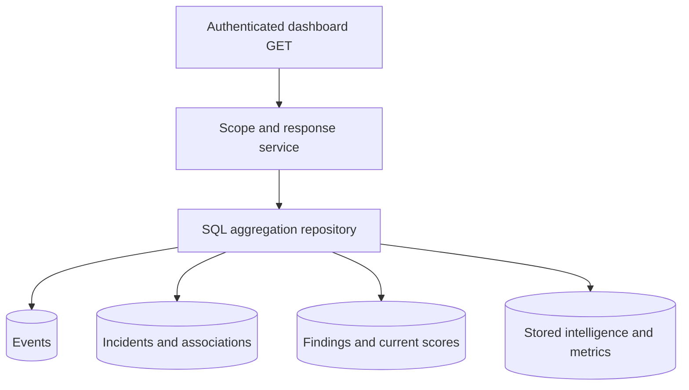

# Phase 10 — Dashboard APIs and security analytics

This update adds authenticated, read-only dashboard APIs to the existing Phase 9 backend. Merge the complete files listed in [PHASE10_FILES.md](PHASE10_FILES.md) into the existing project. Preserve your actual `.env`, custom Docker settings, database volume and host port (including `15432` if that is your working PostgreSQL port).

No frontend changes or new dependencies are required. Existing ingestion, detection, scoring, incident and intelligence operations remain in their own services. Dashboard GETs do not invoke them. See [PHASE10_VALIDATION.md](PHASE10_VALIDATION.md) for measured results and remaining environment-specific checks.

## Architecture and files

| File | Responsibility |
| --- | --- |
| `backend/app/routes/dashboard.py` | Fifteen typed GET routes; existing JWT/session authentication for every role |
| `backend/app/schemas/dashboard.py` | Bounded queries, timezone-aware scopes and compact response models |
| `backend/app/services/analytics_service.py` | UTC range resolution, bucket selection and bounded zero filling |
| `backend/app/services/dashboard_service.py` | Metric contracts, response composition and sanitized duration/error logging |
| `backend/app/repositories/dashboard_repository.py` | Parameterized PostgreSQL aggregates and explicit column projections |
| `backend/alembic/versions/0007_dashboard_polling.py` | Backfilled, unique insertion cursor and transaction-safe allocation trigger |
| `backend/tests/test_dashboard.py` | Counts, associations, ranges, distributions, permissions, cache semantics and read-only behavior |
| `backend/tests/test_dashboard_polling.py` | Late logs, ties, gaps, cursor immutability, migrations and concurrent writers |



Existing sessions, models, enums and authorization dependencies are reused. Aggregates run in PostgreSQL; Python receives aggregate rows or at most 100 preview records. Rule statistics contain one row per stored rule. Timeline zero filling is bounded by the allowed date range, not the event population.

## Upgrade an existing installation — Windows PowerShell

Run from the existing `cybersentinel` root after merging the archive's files. Stop ingestion workers and scheduled imports during migration; the schema change takes a table lock. The commands below stop the local API/frontend, leave PostgreSQL data intact, migrate, then restart.

```powershell
Set-Location 'C:\Users\saiya\OneDrive\Documents\Projects\cybersentinel'
docker compose stop backend frontend
docker compose up -d --wait --wait-timeout 180 db
docker compose build backend
docker compose run --rm --no-deps backend alembic upgrade head
docker compose run --rm --no-deps backend alembic current
docker compose run --rm --no-deps backend alembic check
docker compose up --build -d --wait --wait-timeout 180
docker compose ps
```

Stop if any Docker command exits with a nonzero `$LASTEXITCODE`. Expected migration head: **`0007_dashboard_polling`**. Expected drift check: **`No new upgrade operations detected.`** All three services should become healthy. Do not generate a second migration for this delivery and do not remove the PostgreSQL volume.

The migration adds `security_events.ingestion_sequence` without changing event IDs, UUID primary keys, timestamps, payloads, findings or case links. Existing rows receive deterministic positions ordered by `(created_at, id)`; this does not reconstruct historical commit order. New rows receive positions from a database trigger. The only new index is the unique B-tree supporting that cursor. The migration sets a transaction-local 60-second statement budget for backfill. Larger databases may need a planned migration window and a reviewed budget increase.

Optional settings, with defaults already provided by `Settings`:

```dotenv
DASHBOARD_MAX_RANGE_DAYS=90
DASHBOARD_SLOW_QUERY_MS=250
```

The maximum range accepts 30–366 days; the slow-query threshold accepts 1–10,000 milliseconds. No secrets or frontend environment variables are added. Container-to-database traffic still uses `db:5432`, independently of your published host port.

For native Python development, stop the backend container, start `db`, and run from `backend` using the existing virtual environment:

```powershell
.\.venv\Scripts\python.exe -m alembic upgrade head
.\.venv\Scripts\python.exe -m alembic current
.\.venv\Scripts\python.exe -m alembic check
.\.venv\Scripts\python.exe -m uvicorn app.main:app --reload --host 127.0.0.1 --port 8000
```

Keep the existing native database host/port settings. Substitute your configured backend port for `8000` if different. There are no new pip/npm installation commands; a new environment still uses `backend/requirements-dev.txt` from previous phases.

## Endpoint contracts

Every path below begins with `/api/dashboard`. ADMIN, ANALYST and VIEWER can read all endpoints. Missing, expired or revoked credentials return 401; existing disabled-account handling is preserved. GET responses have `Cache-Control: no-store`. There are no dashboard mutation endpoints.

| GET suffix | Result | Extra query options |
| --- | --- | --- |
| `/overview` | Event totals, selected incident/finding counts, suspicious IPs, average case risk | Common time scope |
| `/events/timeline` | Chronological, zero-filled event counts and failed-login/denial/API series | Common time scope |
| `/events/types` | Observed event types sorted by count descending, then type | Common time scope |
| `/events/recent` | Compact previews ordered by timestamp DESC, UUID DESC; polling watermark | `limit=20`, maximum 100 |
| `/events/updates` | New insertions ordered by insertion cursor ASC | `after_id`, `limit=20`, maximum 100; no time filters |
| `/incidents/severity` | Current stored severities; four categories including zeros | Common time scope |
| `/incidents/status` | Four current statuses including zeros | Common time scope |
| `/incidents/recent` | Compact cases and safe analyst reference, newest detection time first | `limit=20`, maximum 100 |
| `/threats/top-ips` | Distinct associated case/finding counts, current scores and cached reputation | `limit=10`, maximum 20; `mode=mock` or `live` |
| `/threats/summary` | Stored intelligence coverage, freshness, cache-hit metrics and provider configuration | `mode=mock` or `live` |
| `/users/targeted` | Accounts with observed failures/denials or associated findings/cases | `limit=10`, maximum 20 |
| `/detection/rules` | Every stored rule, including disabled and zero-match rules | Common time scope |
| `/risk/distribution` | Current incident-score distribution and average | Common time scope |
| `/activity/summary` | Successful/failed logins, denials, API requests, sensitive-access events and privilege changes | Common time scope |
| `/system/health` | Current API/database readiness, processing backlog, last recorded detection duration, provider configuration | No time filters |

All endpoints except updates and health accept a common time scope. Ranked/recent responses are bounded previews; use existing `/api/events`, `/api/incidents`, and `/api/detections` list/detail routes for investigation and full pagination. Unknown query fields are rejected on typed query models rather than silently changing scope.

Preview schemas omit raw event payloads, user agents, analyst comments, provider raw responses, password hashes and credentials. `assigned_analyst` reuses the existing safe reference schema, or is null. `latest_event_timestamp`, missing analyst references and averages of empty populations are null. Empty counters are zero, recent lists are empty, and severity/status/risk categories remain explicit zero rows.

## Time scopes and metric definitions

Use `?range=1h`, `6h`, `24h`, `7d` or `30d`; omitted range defaults to a rolling 24 hours. Alternatively supply **both** `start` and `end` as ISO timestamps with `Z` or an explicit offset. Do not mix a preset and custom dates. Naive timestamps, reversed/empty ranges, unsupported presets and ranges over the configured maximum return 422.

Every scoped response contains normalized UTC `scope.start`, `scope.end`, `scope.as_of`, `scope.preset` and `boundary: "[start,end)"`. Start is inclusive, end exclusive. `as_of` records when the request resolved its scope; it is not a historical database snapshot. Comparing endpoints during ingestion or case updates can legitimately produce different current counts. Use the same explicit start/end and quiescent data for exact verification.

| Metric family | Timestamp/filter | Population |
| --- | --- | --- |
| Event timeline, event types, recent events, activity, `events_in_range` | `security_events.timestamp` | Event occurrence time |
| Finding totals, per-rule counts, finding contributions to IP/user lists | `detection_findings.last_seen` | Latest evidence time for the finding |
| Incident totals/distributions/recent rows and associated entities | `incidents.detected_at` | Cases first promoted in the interval, using their **current** status and score |
| Intelligence summary classifications | `threat_intelligence_results.checked_at`, selected mode | Current stored bundle per indicator/mode checked in the interval |
| Intelligence cache hits | `system_metrics.timestamp`, selected mode | Sum of recorded `threat_cache_hits` metrics in the interval |
| Overview `total_events`, `unprocessed_events`, `latest_event_timestamp`; health | No time filter | Global stored-event totals/backlog |
| Event updates | `ingestion_sequence` | New insertions, even when occurrence time is old |

Phase 8 stamps `detected_at` at promotion time. Therefore importing old logs today can produce zero events in the last 24 hours alongside newly detected cases. This is intentional and is not missing data. The integration scope includes both the synthetic event interval and promotion/enrichment time.

Overview definitions:

- `total_incidents`: all cases in the selected incident cohort, including RESOLVED and FALSE_POSITIVE.
- `active_incidents`: OPEN or INVESTIGATING cases in that cohort.
- `critical_incidents`: stored severity CRITICAL in that cohort, regardless of current status.
- `high_risk_incidents`: stored case score at least 50, including critical scores.
- `average_risk_score`: arithmetic mean of current stored incident scores, rounded to two decimals; null when no cases exist.
- `total_findings`: findings with `last_seen` in the range, regardless of case promotion.
- `suspicious_ips`: distinct non-null source IPs from scoped findings and scoped incidents' primary/linked finding identities. It is an association count, not a claim that each address is malicious or blocked.

Risk distribution uses the unchanged Phase 7 boundaries: 0–24 LOW, 25–49 MEDIUM, 50–74 HIGH, 75–100 CRITICAL. It does not aggregate historical assessment rows or calculate new scores. Top IPs expose both `highest_risk_score` from current associated incidents and `highest_finding_risk_score` from the existing current finding-score version (`v1`); null means no corresponding score.

IP and account associations use a distinct `(entity, incident_id)` union of primary case identity and all linked findings. Thus a case linked to three findings for one IP counts as **one incident** for that IP. A case involving two IPs legitimately contributes once to each IP; summing per-IP incident counts is not the global incident count. Linked identities remain part of the incident cohort even if their own finding timestamp falls outside the finding cohort.

Top IP ordering is case risk descending (null last), case count, finding count, latest evidence activity descending, then IP text ascending. Latest activity is the maximum corresponding finding/case `last_seen`. Targeted-account ordering is finding count, case count, observed failed logins plus denials descending, then username ascending. Account names describe monitored systems and need not exist in the analyst `users` table. Activity counts describe log rows; sensitive-access rows are not a count of records inside a batch payload.

## Timeline buckets

PostgreSQL `date_bin` uses a UTC epoch origin. Filtering happens before grouping. No raw event rows are loaded to build charts.

| Range duration | Bucket |
| --- | --- |
| Up to 1 hour | 1 minute |
| Over 1 hour, up to 6 hours | 15 minutes |
| Over 6 hours, up to 24 hours | 1 hour |
| Over 24 hours | 1 day |

Missing buckets are zero-filled. A partial first bucket can start before `scope.start`, but its count includes only events inside the requested scope. The last bucket ends at the request boundary for counting purposes. Timeline totals and event-type totals equal `overview.events_in_range` for the same stable scope/population.

## Reliable insertion polling

Event UUIDs and producer event IDs do not encode insertion order. Occurrence timestamps can arrive late, and transaction-start `created_at` timestamps also cannot serve as reliable commit-order watermarks. Phase 10 adds a separate immutable BigInt cursor without replacing those identities.

The database trigger obtains a transaction advisory lock **before** allocating a sequence number; the sequence uses `CACHE 1`. Competing insertion transactions therefore cannot commit later cursor positions ahead of an earlier writer. The lock lasts until commit/rollback. Duplicate `ON CONFLICT` inserts and rollbacks can consume sequence numbers; gaps are normal and polling uses `>` rather than expecting consecutive numbers. Updates to `processed` do not move the cursor.

This design serializes event insertion transactions. Keep ingestion batches short; a long transaction holding the writer lock delays other insertions. It is deliberately appropriate for the current application, not a distributed ingestion broker. A native PostgreSQL concurrent-writer test is included; this environment could execute PostgreSQL SQL via an embedded adapter but could not validate independent backend concurrency.

Client protocol for Phase 11:

1. Fetch `/events/recent?limit=20`. Keep `polling_cursor` and deduplicate displayed rows by UUID. The server captures the watermark before fetching previews, so a concurrent arrival can repeat but is not omitted.
2. Request `/events/updates?after_id=<cursor>&limit=100` about every five seconds.
3. Process returned `items`, then store `next_cursor`. While `has_more` is true, drain another page immediately.
4. Empty pages retain the cursor. Retries can replay rows; deduplicate by UUID. Do not advance to `head_cursor` while pages remain.

Omitting `after_id` initializes at the current committed head and returns no historical rows. `after_id=0` drains all retained events. Cursors are **decimal strings in JSON** to preserve BigInt precision in JavaScript; pass the string directly as the query value. Negative/oversized cursors and cursors ahead of the current database return 422. Reinitialize clients after database restores or replacement; cursors belong to one database history. No offset pagination or occurrence-time cutoff is used for updates.

## Cached intelligence and health

Dashboard reads never call providers, refresh caches, change cooldowns or increment cache-hit metrics. The selected intelligence mode defaults to the existing Phase 9 configuration and can be overridden on the two threat endpoints. Mock data is explicitly marked `simulation: true` and remains separate from live data.

Fresh bundles whose policy hash matches current configuration contribute their stored reputation. Expired or incompatible bundles become effective UNKNOWN; top IPs retain `cached_reputation_level` alongside `intelligence_status` for explanation. Missing cache entries also mean UNKNOWN, never safe. Summary malicious/suspicious/no-adverse-signal/unknown categories are mutually exclusive and sum to `cached_indicators`. Expired and incompatible counts are overlays and may overlap; do not add them to those four categories. Cache-hit counts come from recorded lookup activity, not dashboard reads.

Health reports successful API/database queries, current event backlog, and the latest stored `detection_duration_ms` summary metric when available. Detection is `available_on_demand`, not claimed to be running continuously. Provider status is configured/enabled/cooldown information, not an active network health probe. AI is `not_implemented`.

## Login, API verification and Swagger — PowerShell

Use your existing active account; VIEWER is sufficient. The following commands read the configured API port and keep the token in memory. Login/logout create normal authentication records; the dashboard GETs themselves are read-only.

```powershell
$port = 8000
$portLine = Select-String -Path .\.env -Pattern '^BACKEND_PORT=(\d+)\s*$' | Select-Object -First 1
if ($portLine) { $port = [int]$portLine.Matches[0].Groups[1].Value }
$Base = "http://localhost:$port"
$Username = Read-Host 'Existing username (not email)'
$Secret = Read-Host 'Password' -AsSecureString
$Credential = New-Object System.Management.Automation.PSCredential($Username, $Secret)
$Session = New-Object Microsoft.PowerShell.Commands.WebRequestSession
$Guard = @{ 'X-CSRF-Guard' = '1' }
$Body = @{ username = $Username; password = $Credential.GetNetworkCredential().Password } | ConvertTo-Json
try {
    $Login = Invoke-RestMethod -Method Post -Uri "$Base/api/auth/login" -Headers $Guard -WebSession $Session -ContentType 'application/json' -Body $Body
} finally {
    $Body = $null
    $Credential = $null
    $Secret.Dispose()
}
$Headers = @{ Authorization = "Bearer $($Login.access_token)" }
Invoke-RestMethod "$Base/api/system/health"
Invoke-RestMethod "$Base/api/database/status"
Invoke-RestMethod "$Base/api/dashboard/overview?range=24h" -Headers $Headers
Start-Process "$Base/docs"
$Api = Invoke-RestMethod "$Base/openapi.json"
$Api.paths.PSObject.Properties.Name | Where-Object { $_ -like '/api/dashboard/*' }
```

Expect healthy system/database responses and exactly 15 dashboard paths. Swagger lists the **Dashboard analytics** tag, typed responses, query parameters and bearer security for each operation. In Swagger's Authorize dialog enter the access token; never paste it into source files or screenshots. Unauthenticated dashboard requests should return 401.

Example scoped requests after defining `$Start` and `$End` below:

```powershell
$Scope = 'start=' + [Uri]::EscapeDataString($Start) + '&end=' + [Uri]::EscapeDataString($End)
$Overview = Invoke-RestMethod "$Base/api/dashboard/overview?$Scope" -Headers $Headers
$Overview | ConvertTo-Json -Depth 6
Invoke-RestMethod "$Base/api/dashboard/events/timeline?$Scope" -Headers $Headers | ConvertTo-Json -Depth 6
Invoke-RestMethod "$Base/api/dashboard/threats/top-ips?$Scope&limit=10&mode=mock" -Headers $Headers | ConvertTo-Json -Depth 6
$Page = Invoke-RestMethod "$Base/api/dashboard/events/recent?$Scope&limit=20" -Headers $Headers
$Cursor = $Page.polling_cursor
Invoke-RestMethod "$Base/api/dashboard/events/updates?after_id=$Cursor&limit=100" -Headers $Headers | ConvertTo-Json -Depth 6
```

## Reproduce the complete pipeline

Run existing CLIs from the project root. This deliberately populates the development database; it does not reset it. Existing rows remain and deterministic duplicate event IDs are skipped. For exact fresh-dataset counts, use a separate development/test database. Existing rule changes, thresholds and event populations affect findings and case correlation.

For a demo near the current date, generate the preceding seven complete UTC days. For the exact recorded fixture replace `$StartDate` with `'2026-09-26'`; the measured run used the generator's unchanged default interval and seed 42. Its date range and results are recorded in the validation JSON.

```powershell
$StartDate = [DateTime]::UtcNow.AddDays(-7).ToString('yyyy-MM-dd')
docker compose exec backend python scripts/seed_detection_rules.py
docker compose exec backend python scripts/generate_demo_data.py --count 10000 --seed 42 --scenario mixed --start-date $StartDate --output data/dashboard_test.jsonl --overwrite
docker compose exec backend python scripts/ingest_events.py --file data/dashboard_test.jsonl
docker compose exec backend python scripts/run_detection.py --until-empty
docker compose exec backend python scripts/run_risk_scoring.py --until-empty
docker compose exec backend python scripts/run_incident_processing.py --until-empty
docker compose exec backend python scripts/run_threat_enrichment.py --mock --all --limit 50
docker compose exec backend python scripts/run_detection.py --until-empty
$Start = $StartDate + 'T00:00:00Z'
$End = [DateTime]::UtcNow.AddSeconds(1).ToString('o')
```

The repeat detection run should create no additional findings without new events. The exact recorded fixture produced 10,000 processed events, 36 findings, 36 risk assessments and 29 cases. All ten rules executed; nine produced matches. The default 95% normal mixed fixture did not cross CS-010's configured 300-request threshold. That rule remains covered by its existing positive/negative tests; no thresholds were changed to manufacture a match.

For native Python, run the same `python scripts/...` commands from `backend` using `.\.venv\Scripts\python.exe` and omit `docker compose exec backend`.

## Tests and performance

```powershell
docker compose exec backend python -m scripts.run_database_tests
docker compose exec backend ruff check .
docker compose exec backend ruff format --check app/routes/dashboard.py app/schemas/dashboard.py app/services/analytics_service.py app/services/dashboard_service.py app/repositories/dashboard_repository.py tests/test_dashboard.py tests/test_dashboard_polling.py alembic/versions/0007_dashboard_polling.py
```

The existing database-test runner creates and removes its own isolated database; it does not destroy your development data. Native PostgreSQL also executes the concurrent-writer test skipped by this workspace's single-backend adapter. Plain `pytest` without `TEST_DATABASE_URL` skips integration tests, so use the database runner for the full check.

After login and setting a fixed `$Scope`, measure actual HTTP times:

```powershell
$Endpoints = 'overview', 'events/timeline', 'events/recent', 'incidents/severity', 'threats/top-ips'
foreach ($Endpoint in $Endpoints) {
    $Uri = "$Base/api/dashboard/${Endpoint}?$Scope"
    $null = Invoke-RestMethod $Uri -Headers $Headers
    $Times = @(1..10 | ForEach-Object {
        $Timer = [Diagnostics.Stopwatch]::StartNew()
        $null = Invoke-RestMethod $Uri -Headers $Headers
        $Timer.Stop()
        $Timer.Elapsed.TotalMilliseconds
    } | Sort-Object)
    [PSCustomObject]@{
        Endpoint = $Endpoint
        Samples = $Times.Count
        MedianMs = [Math]::Round(($Times[4] + $Times[5]) / 2, 3)
        P95NearestRankMs = [Math]::Round($Times[9], 3)
    }
}
```

The 10-sample nearest-rank p95 is the largest sample; it is not a strong tail-latency estimate. Local TCP/PowerShell timings include costs absent from in-process TestClient timings. Do not compare these as identical benchmarks.

To reproduce the 100,000-event **storage/aggregation** check after a fresh 10,000-event run:

```powershell
docker compose exec backend python scripts/generate_demo_data.py --count 90000 --seed 43 --scenario normal --start-date $StartDate --output data/dashboard_growth.jsonl --overwrite
docker compose exec backend python scripts/ingest_events.py --file data/dashboard_growth.jsonl
```

Then repeat the API measurements with the same explicit scope. The measured growth fixture has 90,000 additional pending normal events; it intentionally retains the 36 findings and 29 cases from the complete 10,000-event pipeline. It verifies event aggregation growth, not high-volume case analytics or a complete 100,000-event detection run.

No dashboard cache or Redis was introduced. Existing timestamp, finding, case, association and risk-version indexes support the queries. The new unique insertion index supports keyset updates. Query plans and measured 10k/100k timings are in the validation report. Summary aggregates necessarily examine their selected population; future growth may justify pre-aggregation after profiling. Slow operations log their operation name and measured duration, while errors log only safe type/status information.

After verification, revoke the temporary login session:

```powershell
$LogoutHeaders = @{ Authorization = "Bearer $($Login.access_token)"; 'X-CSRF-Guard' = '1' }
$null = Invoke-WebRequest -UseBasicParsing -Method Post -Uri "$Base/api/auth/logout" -Headers $LogoutHeaders -WebSession $Session
$Login = $null
$Headers = $null
$LogoutHeaders = $null
```

## Independent PostgreSQL checks

Use your existing database user/name. With the standard configured names:

```powershell
docker compose exec db psql -U cybersentinel -d cybersentinel
```

Copy the **exact** `scope.start` and `scope.end` from the API response into these variables. The dates below are the recorded validation scope; change them for your run.

```sql
\set start '2026-09-26T03:05:12Z'
\set end '2026-10-08T16:07:53.636145Z'
SELECT version_num FROM alembic_version;
SELECT count(*) AS total_events,
       count(*) FILTER (WHERE processed = false) AS unprocessed_events,
       max(timestamp) AS latest_event_timestamp
FROM security_events;

SELECT event_type, count(*) AS count
FROM security_events
WHERE timestamp >= :'start'::timestamptz AND timestamp < :'end'::timestamptz
GROUP BY event_type ORDER BY count DESC, event_type;

SELECT count(*) AS total_incidents,
       count(*) FILTER (WHERE status IN ('OPEN','INVESTIGATING')) AS active_incidents,
       count(*) FILTER (WHERE severity = 'CRITICAL') AS critical_incidents,
       count(*) FILTER (WHERE risk_score >= 50) AS high_risk_incidents,
       round(avg(risk_score), 2) AS average_risk_score
FROM incidents
WHERE detected_at >= :'start'::timestamptz AND detected_at < :'end'::timestamptz;

SELECT severity, count(*) FROM incidents
WHERE detected_at >= :'start'::timestamptz AND detected_at < :'end'::timestamptz
GROUP BY severity;
SELECT status, count(*) FROM incidents
WHERE detected_at >= :'start'::timestamptz AND detected_at < :'end'::timestamptz
GROUP BY status;

SELECT r.rule_id, count(f.id) AS findings
FROM detection_rules r LEFT JOIN detection_findings f
  ON f.detection_rule_id = r.id
 AND f.last_seen >= :'start'::timestamptz AND f.last_seen < :'end'::timestamptz
GROUP BY r.rule_id ORDER BY r.rule_id;

WITH scoped_cases AS (
    SELECT id, source_ip FROM incidents
    WHERE detected_at >= :'start'::timestamptz AND detected_at < :'end'::timestamptz
), associated_ips AS (
    SELECT source_ip FROM detection_findings
    WHERE last_seen >= :'start'::timestamptz AND last_seen < :'end'::timestamptz
    UNION SELECT source_ip FROM scoped_cases
    UNION SELECT f.source_ip FROM scoped_cases i
          JOIN incident_findings j ON j.incident_id = i.id
          JOIN detection_findings f ON f.id = j.detection_finding_id
)
SELECT count(*) AS suspicious_ips FROM associated_ips WHERE source_ip IS NOT NULL;

SELECT processed, count(*) FROM security_events GROUP BY processed;
SELECT count(*) AS invalid_evidence
FROM incident_evidence ie LEFT JOIN security_events e ON e.id = ie.security_event_id
WHERE e.id IS NULL;
SELECT min(ingestion_sequence), max(ingestion_sequence),
       count(*), count(DISTINCT ingestion_sequence)
FROM security_events;
\q
```

## Boundaries and troubleshooting

- Empty last-24-hour event charts after importing older fixtures: select the fixture's occurrence-time range. Cases may have a different promotion-time range.
- Missing `ingestion_sequence` column: apply the supplied migration before using dashboard event previews/polling. Do not rewrite the Phase 2 migration.
- Cursor ahead of the database after a restore: initialize a new cursor and refresh recent rows.
- Expired cache shown as UNKNOWN: inspect freshness/mode; an explicit existing Phase 9 enrichment operation refreshes it. Dashboard reads do not refresh data.
- Docker/PowerShell and native multi-backend locking could not be run in this workspace. The native verification commands and concurrency test are supplied for your environment. All SQL migration/query/integration checks and measured pipelines ran on embedded PostgreSQL 17.5 through Psycopg.

Phase 10 stops at backend analytics. Phase 11 can consume these contracts, with suggested refresh intervals of 5 seconds for events, 10 seconds for overview/recent cases, 30–60 seconds for charts and 60 seconds for intelligence. No browser timers or dashboard UI were added.

## SQL references

- [PostgreSQL 17 date/time functions and date_bin](https://www.postgresql.org/docs/17/functions-datetime.html)
- [PostgreSQL sequences and gaps](https://www.postgresql.org/docs/17/functions-sequence.html)
- [PostgreSQL transaction-level advisory locks](https://www.postgresql.org/docs/17/explicit-locking.html)
