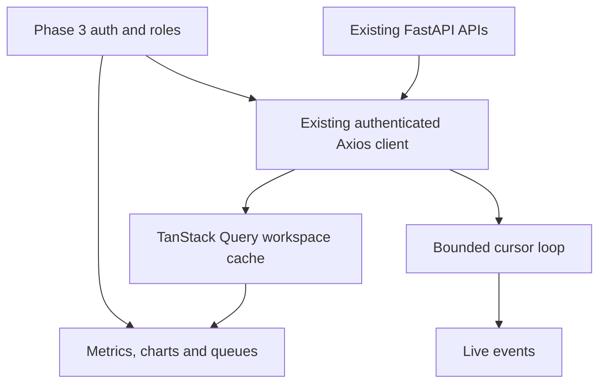

# Phase 11 — React SOC Dashboard

This is an incremental update to the verified Phase 10 project. Complete changed files are included; existing PostgreSQL data, authentication, pipelines, Docker configuration, ports and `.env` are preserved. Do not create a second project or initialize the environment again.

## Apply the update in Windows PowerShell

Extract `CyberSentinel-Phase11-Update.zip` to a temporary folder. Copy the contents of its `cybersentinel` folder into your existing project, replacing the matching files. The archive contains no `.env`, credentials, database volumes, generated event files or `node_modules`.

For the project path shown in your screenshots:

```powershell
Set-Location 'C:\Users\saiya\OneDrive\Documents\Projects\cybersentinel'
# After merging the update files:
docker compose up --build -d --wait --wait-timeout 180
docker compose exec backend alembic upgrade head
docker compose exec backend alembic current
docker compose ps
```

Keep your working `POSTGRES_PORT=15432` if that is what you configured previously. PostgreSQL still uses port 5432 inside Compose. Phase 11 requires **no new migration**: `0007_dashboard_polling` remains the head. Backend changes add the existing nullable `destination_ip` column to event preview responses only.

Rebuild both application images: the backend preview contract and frontend dependencies changed. A Vite hot reload alone does not install new packages or copy the root test configuration into an existing image.

Verify the build and tests:

```powershell
docker compose exec frontend npm test
docker compose exec frontend npm run build
docker compose exec backend python -m scripts.run_database_tests
```

The database test runner creates and removes its own uniquely named test database. It must not be replaced with a command that drops development tables. If your configured PostgreSQL role cannot create a test database, use the separate test-database setup in the existing Phase 2 guide.

Open the existing ports (defaults below; substitute your `.env` values if different):

```powershell
Start-Process 'http://localhost:5173'
Start-Process 'http://localhost:8000/docs'
Invoke-RestMethod 'http://localhost:8000/api/system/health'
powershell -NoProfile -ExecutionPolicy Bypass -File .\scripts\Verify-Phase11.ps1
```

The verifier reads only your configured ports and prompts for an existing account. It performs authenticated read-only checks and closes its temporary login session without printing tokens.

Expected: frontend login appears, the backend health response is healthy, Swagger is accessible, and `docker compose ps` shows three healthy containers. Sign in using an existing account. The overview is real API data; an empty database or a range without events produces intentional empty states.

If startup fails, inspect the actual container error before changing configuration:

```powershell
docker compose ps
docker compose logs --tail=80 frontend backend db
```

## Local frontend development

Use Node 24 LTS to match the existing frontend Dockerfile. Keep FastAPI and PostgreSQL in Docker while running Vite in VS Code:

```powershell
# Project root; stop the container occupying the frontend port only.
docker compose stop frontend
docker compose up -d db backend
Set-Location .\frontend
npm ci
npm run dev
```

The existing Vite configuration reads the root `FRONTEND_PORT` and `BACKEND_PORT` and proxies `/api`, `/docs`, `/openapi.json` and `/redoc` to the backend. Requests remain same-origin. Do not add a browser URL containing the Docker hostname `backend`; only Vite's server-side Compose environment uses `BACKEND_PROXY_TARGET=http://backend:8000`.

For tests and a production bundle in another terminal:

```powershell
Set-Location 'C:\Users\saiya\OneDrive\Documents\Projects\cybersentinel\frontend'
npm test
npm run build
```

To restore the Docker frontend, stop local Vite with Ctrl+C and run `docker compose up -d frontend` from the project root. For a custom browser origin, update the existing `CORS_ORIGINS`/trusted-origin settings accurately; never disable the CSRF guard.

## Routes and behavior

| Route | Phase 11 behavior |
| --- | --- |
| `/` | Six metrics; security timeline; severity donut; risk distribution; recent cases/events; suspicious IPs; targeted accounts |
| `/incidents` | Server-filtered, paginated incident queue, 20 rows/page |
| `/incidents/:incident_id` | Read-only basic case summary; dedicated investigation remains Phase 12 |
| `/events` | Cursor-based live feed, pause/resume, clear display, local bounded filters |
| `/threat-intelligence` | Cached records, provider configuration, permitted explicit lookup, simulated/stale/unknown labels |
| `/rules` | All stored rules and configurations; scoped finding counts; ADMIN enable/disable |
| `/health` | Current authenticated readiness, processing backlog, last run and intelligence mode |
| `/system-health` | Compatibility redirect to `/health` |
| `/analytics` | Existing aggregate event, rule, severity, status and activity charts |
| `/ai-analyst` | Honest Phase 13 placeholder; no chat or generated answers |
| `/settings` | Profile and account-scoped browser-local preferences |
| `/admin` | Existing Phase 3 user administration, ADMIN only |
| `/login`, `/register` | Existing Phase 3 sign-in and registration |

The sidebar collapses on desktop, becomes compact on tablet, and opens as a focus-contained drawer on mobile. Escape closes it and returns focus to the menu button. Tables scroll within their panels; headings and badges include text, not color alone. All dates are displayed in UTC; detailed timestamps are available on hover. Reduced-motion preferences disable UI motion.

## Frontend architecture

- `services/api.js` and `services/auth.js`: **unchanged** Phase 3 Axios and authentication implementations. Access JWTs stay in memory; rotating refresh tokens stay in HTTP-only cookies. A 401 uses the existing refresh/retry flow; a 403 reports permission denial without logging out.
- Domain services: `dashboardApi.js`, `incidentsApi.js`, `threatsApi.js`, `rulesApi.js`. All use the existing protected Axios instance and cancellation signals.
- `contracts.js`: validates rendered response fields. A malformed response shows a recoverable component error rather than inventing zero values.
- `DashboardContext.jsx`: one TanStack Query client per authenticated user/role workspace; clears/cancels on teardown. Preferences are scoped by user ID in local storage. No credentials or fetched security data go into Web Storage.
- `useDashboardQuery.js`: stable endpoint/parameter keys, preset forwarding and controlled polling.
- `useLiveEvents.js`: a separate single cursor loop for the mounted event stream. It never downloads all historical logs for analytics.
- Shared UI: skeletons, errors, empty states, table, pagination, badges, metrics and UTC timestamps.
- Dashboard components: timeline, donut, distribution bars, shared incident/event/IP/account tables. Recharts receives the aggregate response directly; chart formatting does not recreate detection or scoring logic.
- Lazy page imports split the dashboard and chart bundles away from the login entry path.



Dependencies added: `@tanstack/react-query`. Test-only dependencies: `vitest`, `@testing-library/react`, `@testing-library/jest-dom`, `jsdom`. Exact versions are in the supplied package and lock files. No backend dependency changes.

## API connections

| UI | Existing API |
| --- | --- |
| Metric cards | `GET /api/dashboard/overview` |
| Activity timeline | `GET /api/dashboard/events/timeline` |
| Severity, risk | `GET /api/dashboard/incidents/severity`, `GET /api/dashboard/risk/distribution` |
| Recent rows | `GET /api/dashboard/incidents/recent`, `GET /api/dashboard/events/recent` |
| IP and account rankings | `GET /api/dashboard/threats/top-ips`, `GET /api/dashboard/users/targeted` |
| Queue/summary | `GET /api/incidents`, `GET /api/incidents/{incident_id}` |
| Live feed | `GET /api/dashboard/events/updates?after_id=...&limit=100` |
| Intelligence | `GET /api/threats`, `GET /api/threats/providers/status`, explicit `POST /api/threats/lookup` |
| Intelligence summary | `GET /api/dashboard/threats/summary` |
| Rules | `GET /api/detection-rules`, `GET /api/dashboard/detection/rules`, ADMIN `PATCH /api/detection-rules/{rule_id}` |
| Health | `GET /api/dashboard/system/health` |
| Basic analytics | `GET /api/dashboard/events/types`, `/incidents/status`, `/activity/summary` and the chart APIs above |

Cached intelligence details use the safe fields already returned in the paginated cache response, without an extra detail fetch. Provider raw responses, API keys and backend configuration values are not rendered.

## Scope, caching and polling

Preset range strings `1h`, `6h`, `24h`, `7d`, `30d` are sent unchanged to Phase 10. Default is 24h; selection persists across client-side navigation. The configured default range takes effect on the next workspace visit. The current preset is not falsely applied to unscoped health or the independent incident queue.

- Event metrics use occurrence time. Findings use `last_seen`; incident aggregates use `detected_at` and current status/risk. Global backlog is explicitly labeled.
- Incident queue date inputs are explicitly **UTC evidence-overlap** filters, matching the Phase 8 API. They are not the Phase 10 detection-time cohort.
- Overview metrics and recent rows refresh every 10 seconds; overview charts/rankings every 30 seconds; analytics every 60 seconds; health every 30 seconds.
- Queries are fresh for 8 seconds and inactive cache entries expire after 2 minutes. Background tabs do not poll. One active observer owns each endpoint on a page; unmount cancels its request. Transient errors retry once; permanent 400/401/403/404/422 and malformed contracts are not retried automatically.
- Automatic polling can be disabled in Settings. Manual refresh remains available. Health and provider readiness cards disappear on fetch failure so old data is never presented as current healthy status; other retained data is labeled when a background refresh fails.

The live feed starts with up to 50 recent events from 24h and the accompanying insertion watermark. It then requests new rows every 5 seconds using a **decimal string** cursor. `BigInt` comparisons preserve values above JavaScript's safe integer limit. UUID deduplication handles snapshot overlap. `has_more` is drained in bounded 100-row pages, with a short yield between pages. Cursor advancement occurs only after accepting a validated page. No overlapping requests are scheduled.

At most 500 rows are retained, newest arrival first. Old timestamps on newly ingested events still appear. Pause/visibility/unmount abort pending requests and cancel timers. Resume continues from the retained cursor and enables browser-local automatic refresh if it was off. Clear only empties the local array and preserves that cursor; it never deletes database events. Local filters search the retained rows only. Navigating away and back starts a fresh 24h snapshot; this is not a historical log search or durable event-consumer checkpoint. A cursor rejected after a database reset displays an error; reopen the page to take a fresh snapshot.

## Roles and intelligence

All three roles can read dashboard data, cases, rules and cached intelligence. ADMIN and ANALYST can explicitly run a lookup. ADMIN alone can enable/disable rules and use the existing user-admin page. The backend still authorizes every operation.

A page load or poll does not trigger ingestion, detection, scoring, incident processing or external intelligence calls. Rule toggles take effect on future processing runs; they do not rerun detection. Mock reputation is visibly **Simulated**. Expired/configuration-incompatible observations show UNKNOWN for the current verdict and score; provider rows remain labeled stored observations. Unknown never means safe. Provider status indicates configuration and stored cooldown, not an external availability probe.

## Refresh demo data when old dates leave your selected range

Existing data is not deleted. First try 7D or 30D. For a fresh **additional** synthetic run, use a new run ID and file. Commands reuse the earlier pipeline:

```powershell
Set-Location 'C:\Users\saiya\OneDrive\Documents\Projects\cybersentinel'
$DemoStart = (Get-Date).ToUniversalTime().AddDays(-6).ToString('yyyy-MM-dd')
$DemoRun = 'phase11-' + (Get-Date).ToUniversalTime().ToString('yyyyMMdd-HHmmss')
$DemoFile = 'data/' + $DemoRun + '.jsonl'
docker compose exec backend python scripts/generate_demo_data.py --count 10000 --seed 42 --scenario mixed --start-date $DemoStart --days 7 --run-id $DemoRun --output $DemoFile
docker compose exec backend python scripts/ingest_events.py --file $DemoFile
docker compose exec backend python scripts/run_detection.py --until-empty
docker compose exec backend python scripts/run_risk_scoring.py --until-empty
docker compose exec backend python scripts/run_incident_processing.py --until-empty
docker compose exec backend python scripts/run_threat_enrichment.py --all --limit 50 --mock
```

Enrichment processes a bounded page: follow `next_offset` if the summary reports more pages. At the default 95% normal ratio, the 10,000-event seed-42 mixed budget does not include the abnormal-API scenario. Zero CS-010 findings on that fixture is expected, not fabricated into a positive result. Older or combined datasets can produce different finding/case counts.

## Manual acceptance check

1. Sign in as ADMIN. Switch 24H → 7D and confirm aggregate requests carry `range=7d`.
2. Open the incident queue; apply HIGH and a minimum risk. Next requests `offset=20`. Open a case: only the summary appears.
3. Open Live Events. Ingest additional synthetic logs, including an old timestamp. Confirm new arrivals appear once, pause/resume works, and Clear leaves database counts intact.
4. View intelligence. Look up `198.51.100.73` in the default mock mode. Confirm simulated labeling and no provider keys/raw payloads.
5. Disable and re-enable CS-001 as ADMIN. Sign in as ANALYST/VIEWER and confirm switches are absent. VIEWER must not have Run lookup.
6. View System Health. Detection is available on demand; AI is not implemented. Stop the backend temporarily and refresh: a connection error must replace the healthy cards.
7. Reload an authenticated page to exercise cookie refresh. A denied operation must not force logout. Sign out and ensure the workspace is no longer accessible.
8. Check widths 1366, 1440, 1920 and a 390px phone. Tables may scroll internally; the document must not overflow. Use keyboard navigation and Escape in the mobile drawer.

## Screenshots and measured validation

See [PHASE11_VALIDATION.md](PHASE11_VALIDATION.md) for actual measured results and environment limits, and [PHASE11_FILES.md](PHASE11_FILES.md) for the complete file list. Captured screenshots use synthetic pipeline data and are included in `docs/screenshots/phase11/`.

Phase 12 incident investigation, Phase 13 AI and Phase 14 advanced reporting remain intentionally unimplemented.
