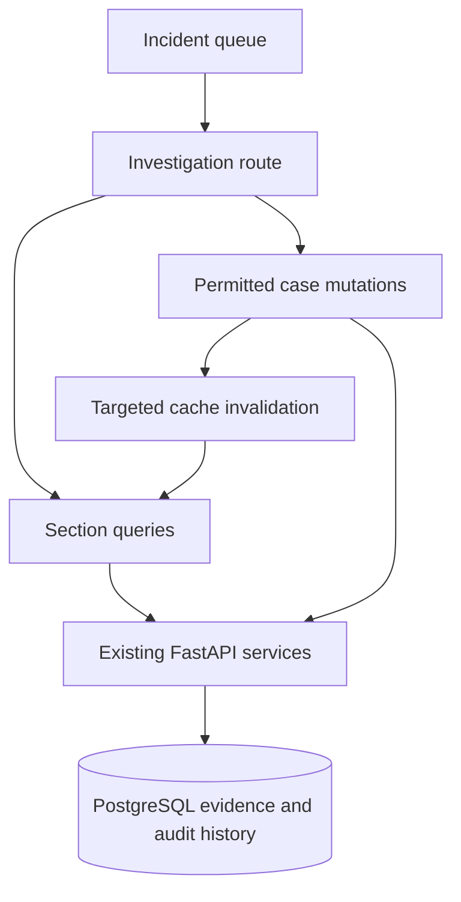

# Phase 12 — Incident Investigation Workspace

This incremental update extends the existing Phase 11 application. Merge its `cybersentinel` folder into your existing project. The archive contains complete new/modified files, not a second installation. Preserve `.env`, your Docker volumes, all migrations and the working PostgreSQL host port. There are **no new dependencies, tables, migrations, or changes to detection, scoring, authentication, or incident workflow policy**.

## Start on Windows with Docker

Open Docker Desktop. After merging the update into the project shown in your screenshots, run in VS Code PowerShell:

```powershell
Set-Location 'C:\Users\saiya\OneDrive\Documents\Projects\cybersentinel'
docker compose up --build -d --wait --wait-timeout 180
docker compose exec backend alembic upgrade head
docker compose exec backend alembic current
docker compose ps
Start-Process 'http://localhost:5173'
Start-Process 'http://localhost:8000/docs'
Invoke-RestMethod 'http://localhost:8000/api/system/health'
```

Expected: three healthy containers; migration head `0007_dashboard_polling`; frontend sign-in page; Swagger accessible; readiness `healthy`. Substitute configured frontend/backend ports if different. Keep your existing `POSTGRES_PORT=15432` if used; the internal PostgreSQL port remains 5432. No environment reinitialization or volume deletion is needed. Rebuild both app images so the new response projections and React code match.

Use an existing username and the password you set. The standard setup username is `admin`; seeded demo accounts are `admin`, `analyst`, and `viewer`, if you created them. Passwords are not supplied or reset by this update.

```powershell
# Authenticated read-only verification. Prompts for your existing credentials.
powershell -NoProfile -ExecutionPolicy Bypass -File .\scripts\Verify-Phase12.ps1

# Tests and production frontend build:
docker compose exec frontend npm test
docker compose exec frontend npm run build
docker compose exec backend python -m scripts.run_database_tests

# Focus only on the new backend projections and existing workflow:
docker compose exec backend python -m scripts.run_database_tests tests/test_investigation_api.py tests/test_incident_api.py

# Diagnose startup errors without discarding your data:
docker compose logs --tail=80 backend frontend db
```

The database test runner uses its own temporary database and isolated schema, not your development tables. See the Phase 2 guide if the configured role lacks permission to create test databases. Docker Desktop and PowerShell were unavailable in the build workspace; run these checks on Windows. Actual executed test/browser results and their limits are in `PHASE12_VALIDATION.md`.

For local Vite development, retain the existing Docker backend/database:

```powershell
Set-Location 'C:\Users\saiya\OneDrive\Documents\Projects\cybersentinel'
docker compose stop frontend
docker compose up -d db backend
Set-Location .\frontend
npm ci
npm run dev
# In another frontend terminal:
npm test
npm run build
```

Stop local Vite with Ctrl+C before restarting the frontend container. The existing Vite proxy handles `/api`; the browser never talks directly to PostgreSQL or Docker service hostnames.

## Route and architecture

The existing `/incidents/:incident_id` route now opens `IncidentInvestigation.jsx`, inside the unchanged authenticated workspace/provider hierarchy. It works from direct URLs and after reload. The older `IncidentSummary.jsx` exports the new page for compatibility. Queue filters and offset are stored in the queue URL. Links carry a validated local `returnTo` query; returning from a case preserves those filters. Tab selection is also URL-addressable, for example `/incidents/INC-...?...&tab=events` (use an actual incident ID and `?tab=events` when there are no other parameters).



The page coordinates the header, accessible tabs and dialogs. Modular components in `components/incidents/` own overview/risk, finding evidence, timeline, event drawer, intelligence, notes, assignment and status confirmation. `services/incidentsApi.js` uses the original Axios instance, bearer access token and HTTP-only refresh-cookie behavior. `hooks/useIncident.js` owns query keys, polling and mutation invalidation. Shared badges, table, pagination, skeletons, errors and reputation rendering are reused. `components/threats/IntelligenceResult.jsx` contains the original shared reputation/detail rendering; the Phase 11 threat page still uses it.

## Investigation sections

| Section | Actual behavior |
| --- | --- |
| Header | Incident ID/title/description, stored severity/risk/status, source/account, assigned analyst, first/last seen and detected timestamps. Permitted actions plus refresh. |
| Overview | Backend finding/evidence counts, confidence, deterministic case description, first three stored correlation decisions with a link to all findings, cached intelligence, investigation status and resolution text. Risk follows the case summary on mobile. |
| Risk | Highest linked stored assessment for the case's scoring version, chosen in SQL. Six component points/maxima, reasons, category, assessment/finding IDs and time. No calculation in React. |
| Findings | Ten linked findings per page, rule/severity/confidence/risk/entity/window/event count. Expand on demand to retrieve structured detection evidence, retained event IDs, stored correlation details and that finding's risk assessment. |
| Timeline | SQL-unioned security events, findings, current-version risk assessments, notes, incident audit and explicit case enrichment activity. Twenty entries per page; oldest/newest ordering is applied before server pagination. Actor username and whitelisted audit context accompany entries. |
| Events | Twenty linked events per page, time/type/source/destination/account/service/ports/status. Exact backend filters for event type, source IP, username, service and status. Full producer `event_id` opens the existing event API in a read-only drawer. |
| Threat intel | Related source/destination indicators from existing case/finding/event links, ten per page. Cached reputation, score, observation times, missing/expired/unknown results, explicit simulated/real labels, provider-specific available fields. |
| Notes | Paginated existing analyst notes with author/role/time, safely rendered as text. Writers can submit trimmed nonempty notes up to 4,000 characters; confirmation appears only after a successful response. |

Risk is not confidence. The incident processor uses the maximum linked assessment; the UI displays that policy rather than averaging scores. If a finding has been rescored since case processing last ran, its current assessment may differ from the stored case score. The UI labels the mismatch and retains both numbers. It never rewrites case risk on a read or an intelligence refresh. A missing stored assessment is shown as unavailable.

Event evidence is a retained, bounded sample. A finding's `event_count` may exceed the number of retained IDs; these numbers are labeled separately. Raw events and raw evidence are secondary collapsed JSON views. React text rendering escapes content; no raw HTML, external provider HTML, shell commands or SQL are executed by the browser.

## Assignment and status workflow

| Current status | Permitted target | Required input |
| --- | --- | --- |
| OPEN | INVESTIGATING | Confirmation; optional investigation note |
| OPEN | FALSE_POSITIVE | Reason |
| INVESTIGATING | RESOLVED | Resolution summary |
| INVESTIGATING | FALSE_POSITIVE | Reason |
| RESOLVED | INVESTIGATING | Reopen confirmation; optional reason |
| FALSE_POSITIVE | INVESTIGATING | Reopen confirmation; optional reason |

The backend's existing `TRANSITIONS` policy is returned as `allowed_transitions`; the UI does not duplicate a workflow map. An OPEN case cannot skip directly to RESOLVED. The backend remains authoritative if another analyst changes the case while a form is open; a conflict is shown without claiming success. Existing audit records preserve prior status, resolution and actor.

Assignment uses a searchable, paginated directory of active ADMIN/ANALYST accounts. It returns only ID, username, full name, role and active state, never email or password fields. Both permitted roles can select an eligible operator, assign themselves, or unassign under the existing Phase 8 policy. The backend validates the target again when saving.

Resolving or marking a false positive changes only case workflow metadata and audit records. Linked findings, risk assessments, comments and original event evidence remain intact. No block-IP, disable-account or other unimplemented remediation buttons are added.

| Role | Read investigation/evidence | Assign/status/notes | Explicit intelligence refresh | Eligible analyst directory |
| --- | --- | --- | --- | --- |
| ADMIN | Yes | Yes | Yes | Yes |
| ANALYST | Yes | Yes | Yes | Yes |
| VIEWER | Yes | No | No | No |

## API reuse and compatible backend additions

| Endpoint | Phase 12 change/use |
| --- | --- |
| `GET /api/incidents/eligible-analysts` | New writer-only compact directory, `q`, `limit`, `offset`; literal substring search, active operators only. Static route registered before incident IDs. |
| `GET /api/incidents/{incident_id}` | Existing response plus `allowed_transitions` and nullable stored `risk_assessment`. Existing response fields retained. |
| `GET /api/incidents/{incident_id}/findings` | Existing paginated projection adds `event_count`. Full evidence uses the existing `/api/detections/{finding_id}`. |
| `GET /api/incidents/{incident_id}/events` | Adds source/destination ports and optional exact filters. Queries remain bounded to this case's evidence. |
| `GET /api/incidents/{incident_id}/timeline` | Adds `order=asc|desc`, nullable actor username and explicit context fields. Includes existing case-specific enrichment audit rows; no duplicate audit mechanism. |
| `GET /api/incidents/{incident_id}/comments` | Reused, unchanged. |
| `GET /api/incidents/{incident_id}/threat-intelligence` | Reused, cached reads only. |
| `PATCH /api/incidents/{incident_id}/assign` | Reused with `{ "analyst_id": "UUID or null" }`. |
| `PATCH /api/incidents/{incident_id}/status` | Reused with status and required resolution summary/reason. |
| `POST /api/incidents/{incident_id}/comments` | Reused with `{ "comment": "text" }`. |
| `GET /api/events/{event_id}` | Reused for producer event ID details; read-only. |
| `GET /api/detections/{finding_id}` | Reused for structured evidence. |
| `GET /api/risk/{assessment_id}` | Reused for a finding's stored assessment. |
| `POST /api/threats/enrich/incidents` | Reused with this case ID, `limit=1`, `force_refresh=true`; auditable and provider cooldowns still apply. |

No model or migration changes. The risk selector reads the current retained assessment for the incident's score version, ordered by score descending and assessment ID for a stable tie. Timeline audit context is a whitelist, not a dump of the audit table. Timeline actor names reflect the current account name; deleted users have a retained actor ID where available and no fabricated name.

Intelligence refresh is explicit, with a pending state and server-limited duration. Provider rate limits, failed/partial/unknown results and next retry times are displayed. Missing provider-specific metrics are omitted, not converted to zeros. Loading a tab, background polling, and manual “Refresh case” perform only GET requests. They never trigger provider lookups, detection or scoring.

## Queries, mutations and error handling

Keys use `["incident", id]` and `["incident", id, section, params]`. Finding/event/risk detail keys use their exact identifiers. All requests use cancellation signals. Authentication identity or role changes replace the existing workspace QueryClient, cancel its requests, and clear its cache.

Details, findings, events and notes poll every 15 seconds while mounted and automatic refresh is enabled. Timeline polls at 30 seconds. Intelligence does not poll or refetch on window focus. Hidden-window polling is disabled by the existing QueryClient. Leaving a tab removes its timer; leaving the case removes all case timers. Notes and open-dialog input are local draft state and are not overwritten by refreshed server data. Drafts remain in memory while switching tabs on the same case; they are not saved across a browser reload or case navigation.

After successful assignment/status changes, invalidate the exact case, its timeline, incident queues, dashboard overview/recent cases/status aggregates. Notes invalidate case/timeline/comments. Intelligence refresh invalidates case/timeline/intelligence, cached threat queries and threat summaries. No mutation clears the full app cache. A failed write refreshes authoritative case data and leaves the error/draft visible; mutations are never automatically retried. For a network timeout, inspect the refreshed notes before retrying because the server may already have committed the request.

Mutation keys contain the case ID and operation. Pending controls remain disabled across tab unmount/remount, preventing a second note or enrichment submission while the first is still in progress. This is browser-side duplicate protection; it does not turn the existing note API into an idempotent network protocol.

Each secondary section has independent skeleton/error/empty states and Retry. A threat-intelligence failure does not hide risk or case metadata. 404 shows “Incident not found” and a queue link. 401 uses the existing refresh flow; 403 displays denial without logging out. Simulated and stale intelligence remains clearly labeled.

Tabs support Left/Right/Home/End keys with roving focus. Dialogs trap keyboard focus, close on Escape when no write is pending, and return focus to the trigger when it remains mounted. Forms have labels; badges contain text; numeric risk bars have accessible names. Raw JSON and wide event tables scroll within their containers. Layout stacks on smaller screens and preserves usable actions.

## Swagger and database inspection

Open `/docs`, authenticate with an existing access token, and inspect the operations above. The directory rejects VIEWER requests with 403. Existing reads permit all active roles. Do not print or commit bearer tokens.

```powershell
docker compose exec db psql -U cybersentinel -d cybersentinel
```

Use the username/database configured in your existing `.env` if different.

```sql
SELECT incident_id, status, assigned_analyst_id, risk_score, severity,
       first_seen, last_seen, resolved_at, resolution_summary
FROM incidents ORDER BY updated_at DESC LIMIT 10;

SELECT i.incident_id, f.finding_id, r.assessment_id, r.risk_score,
       r.score_version, l.relationship_reason
FROM incidents i
JOIN incident_findings l ON l.incident_id = i.id
JOIN detection_findings f ON f.id = l.detection_finding_id
LEFT JOIN risk_assessments r
  ON r.detection_finding_id = f.id AND r.score_version = i.risk_score_version
ORDER BY i.updated_at DESC, r.risk_score DESC LIMIT 30;

SELECT a.action, a.timestamp, a.old_value, a.new_value
FROM audit_logs a JOIN incidents i
  ON (a.entity_type = 'incident' AND a.entity_id = i.id::text)
  OR (a.entity_type = 'threat_enrichment' AND a.entity_id = i.incident_id)
WHERE i.incident_id = 'REPLACE_WITH_AN_ACTUAL_INCIDENT_ID'
ORDER BY a.timestamp DESC;

SELECT COUNT(*) FROM security_events;
SELECT COUNT(*) FROM detection_findings;
SELECT COUNT(*) FROM incident_evidence;
\q
```

The update does not seed or overwrite development data. If your database has no incidents, run the documented Phase 4–9 generator → ingest → detect → score → incident → mock-enrichment workflow before investigating. Not every default synthetic dataset contains a CRITICAL case; thresholds and scores must not be changed just to color a demo.

## Manual acceptance workflow

1. Sign in as ANALYST. Filter the queue, open a case, and return to verify retained filters/page. Reload a direct case URL.
2. Review the six stored risk components; expand a finding and correlation evidence. Open a related event's drawer and raw JSON. Test Escape and keyboard focus.
3. Switch timeline ordering, inspect provider results, and explicitly refresh intelligence. Confirm the simulation label in mock mode and the enrichment audit action.
4. Assign to yourself. Start investigation. Type a note, refresh the case, and confirm the draft survives; save it and confirm persistence.
5. Resolve: an empty summary must prevent submission. Enter a summary, confirm RESOLVED and the audit/timeline entry. The queue and overview reflect the current status on their next read.
6. Reopen with confirmation. Mark false positive with a required reason. Verify event/finding/evidence totals are unchanged.
7. Sign in as VIEWER. Confirm read access to all tabs and no assignment/status/note/intelligence-write controls. Direct unauthorized mutations must receive 403.
8. Check 1366×768, 1440×900, 1920×1080 and a narrow mobile viewport. Scroll tables internally; inspect the console/network for errors and duplicate writes.

Actual results, test commands, runtime limitations and measured browser timings are recorded in `PHASE12_VALIDATION.md`; the complete file list is in `PHASE12_FILES.md`. Phase 13 AI and Phase 14 advanced reporting remain unimplemented.
