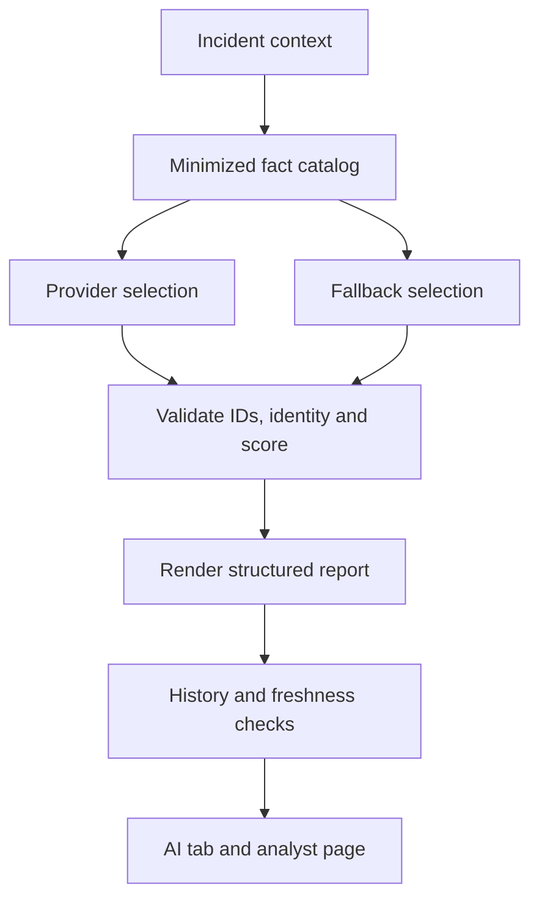

# Phase 13 — Evidence-Grounded AI Security Analyst

This incremental update extends the existing Phase 12 project. It adds advisory analysis; it does not change detection, scoring, correlation, incident transitions, authentication, Docker ports, or existing development data. Stop at Phase 13.

## Install in Windows PowerShell

Extract `CyberSentinel-Phase13-Update.zip` and merge its `cybersentinel` folder into the existing project. Each supplied source file is complete. See `PHASE13_FILES.md` for the exact manifest. Keep your real `.env`; the archive contains only `.env.example`.

```powershell
Set-Location 'C:\Users\saiya\OneDrive\Documents\Projects\cybersentinel'

docker compose up --build -d --wait --wait-timeout 180
if ($LASTEXITCODE -ne 0) { throw 'Docker startup failed. Inspect docker compose logs.' }

docker compose exec backend alembic upgrade head
if ($LASTEXITCODE -ne 0) { throw 'Migration failed.' }

docker compose exec backend alembic current
docker compose exec backend alembic check
docker compose ps
```

Expected: `0008_ai_analyses (head)`, no pending model changes, and healthy database/backend/frontend containers. The migration adds only `ai_analyses`; it does not delete events, findings, incidents or users. Do not create a second autogenerated initial migration.

The existing `.env` works without any added values: deterministic fallback is enabled by default. Keep your working `POSTGRES_PORT=15432` host mapping if configured. Docker's backend still connects to `db:5432`; it does not use the host-mapped database port. Do not rerun environment initialization or reset the database volume to install this update.

```powershell
Invoke-RestMethod 'http://localhost:8000/api/system/health'
Start-Process 'http://localhost:5173'
Start-Process 'http://localhost:8000/docs'

# Prompts for an existing username/password; reads saved analysis without generating it.
powershell -NoProfile -ExecutionPolicy Bypass -File .\scripts\Verify-Phase13.ps1

# Explicitly requests one analysis and a scoped question; ADMIN or ANALYST required.
# May call the external provider if you have configured one.
powershell -NoProfile -ExecutionPolicy Bypass -File .\scripts\Verify-Phase13.ps1 -Generate
```

The verifier reads custom frontend/backend ports from `.env`; it also accepts `-FrontendPort` and `-BackendPort`. Update the browser URLs above if your ports differ. It exits 2 if startup works but no incident exists, and exits 1 on a failed check. It does not change incident status, assignment, risk, or evidence. `-Generate` stores analysis/audit/metric rows and may use the cached report.

Use your existing account. This update does not create or reset usernames/passwords.

## Tests

```powershell
# All backend tests in a newly created, isolated test database; development data is preserved.
docker compose exec backend python -m scripts.run_database_tests

# Focused Phase 13 tests, also in an isolated test database.
docker compose exec backend python -m scripts.run_database_tests tests/test_ai_analyst.py

docker compose exec frontend npm test
docker compose exec frontend npm run build
```

The existing development database role needs `CREATEDB` for the isolated runner. Plain `pytest` without `TEST_DATABASE_URL` intentionally skips database integration tests; it is not an equivalent full verification. The test runner creates a random test database and drops only that database. Alembic is used for schema setup and migration round-trip checks; `create_all()` is not the migration mechanism.

If running the backend outside Docker, activate the existing Python environment, then:

```powershell
Set-Location .\backend
python -m pip install -r requirements-dev.txt
alembic upgrade head
python -m scripts.run_database_tests
python -m uvicorn app.main:app --host 127.0.0.1 --port 8000 --reload
```

In a second PowerShell terminal:

```powershell
Set-Location 'C:\Users\saiya\OneDrive\Documents\Projects\cybersentinel\frontend'
npm ci
npm run dev -- --host 127.0.0.1
```

No new dependencies were added. The provider adapter uses the existing pinned `httpx`; SQLAlchemy, Pydantic, React Query, Axios and existing UI primitives are reused. The frontend package version becomes `0.13.0` without dependency upgrades.

## Optional provider configuration

Only a deliberately configured OpenAI Responses adapter makes external AI calls. Blank/incomplete configuration and `AI_PROVIDER=fallback` use deterministic analysis. A key alone does not enable external generation.

| Variable | Default | Meaning |
| --- | --- | --- |
| `AI_ANALYST_ENABLED` | `true` | Enables generation, scoped questions and overview; saved reports remain readable when disabled |
| `AI_PROVIDER` | blank | `openai` or `fallback`; blank selects fallback |
| `AI_API_KEY` | blank | Secret backend-only key |
| `AI_MODEL` | blank | Provider model identifier supporting Responses structured outputs; no model is hardcoded |
| `AI_REQUEST_TIMEOUT_SECONDS` | `30` | Request/retry time budget, 1–60 seconds |
| `AI_MAX_CONTEXT_EVENTS` | `50` | 2–100 representative linked event records |
| `AI_MAX_CONTEXT_FINDINGS` | `20` | 1–50 highest-priority linked findings |
| `AI_MAX_RESPONSE_TOKENS` | `1500` | 256–4000 output tokens |
| `AI_ANALYSIS_CACHE_ENABLED` | `true` | Reuses latest compatible analysis unless explicitly regenerated |
| `AI_RATE_LIMIT_PER_MINUTE` | `10` | Per-user shared limit across generation, questions and overview, 1–60 |
| `AI_FALLBACK_CACHE_SECONDS` | `60` | Retry interval after provider failure; provider Retry-After can extend it |

Add only the desired entries to your existing `.env`, then recreate the backend:

```powershell
docker compose up -d --force-recreate backend
```

`LLM_API_KEY`, if retained from the Phase 1 template, is reserved legacy configuration and is not consumed by Phase 13. Keys never reach the browser, stored response, audit snapshot, metric, or prompt. No real provider key is included in the update. Choose a compatible model for your own provider account; the project intentionally avoids assumptions about model access or current pricing.

The adapter follows the official [OpenAI structured output documentation](https://developers.openai.com/api/docs/guides/structured-outputs?api-mode=responses). It uses the fixed HTTPS Responses endpoint, `store: false`, strict JSON schema, no redirects and no tools. Disabling response storage does not override the provider's separate data-retention policies.

## Architecture and boundaries

`AIContextBuilder` reads only the requested incident's linked evidence through the existing incident and cached-intelligence repositories. `EvidenceCatalog` turns selected evidence into server-authored facts and approved conditional defensive actions. `AIProvider` abstracts selection: `LLMProvider` returns a validated evidence plan, while `FallbackAnalyst` chooses deterministically. `AIAnalystService` validates the plan again, renders `AnalysisContent`, records history, audits and metrics, and exposes read-only explanations to React.



The model is constrained to selecting and ordering **existing fact IDs and action IDs**. It cannot author unsupported factual prose, add a reference, calculate a score or invent recommendations. This is an intentional implementation of structured evidence-grounded assistance. `AI GENERATED` means AI-assisted selection/prioritization followed by server rendering; it does not claim that every sentence was freely generated. `DETERMINISTIC FALLBACK` means no model selected that report.

Incident Q&A and Security Overview are deterministic in this phase, even when the report provider is configured. They are explicitly labelled fallback and never send user question text to an external model.

## Evidence and privacy

Context includes stored incident status, severity, confidence and risk; bounded findings with actual observed metrics and evaluated rule configuration; current leading risk contributions; representative events; cached reputation with simulation/freshness flags; selected workflow actions; and note count/change time.

Events are selected from the earliest and latest boundaries with event-type representatives where the configured bound permits. Findings prioritize the highest stored assessment, then chronological order. The default report selects a representative finding for each included rule to avoid repeated identical rule explanations. It never assumes that the bounded sample is complete; coverage totals are returned.

Only safe numeric evidence, allowlisted role transitions and validated timezone/timestamp attributes enter the fact catalog. Rule window values come from the **configuration stored with the finding**, not today's edited detection rule. Current score contributions are explained without recalculation. If the current finding assessment disagrees with the stored case score, both are preserved and uncertainty calls out the mismatch.

Account names are replaced with local aliases. Provider input omits original event/finding/risk IDs, IP addresses, raw event contents, user agents, account names/emails, secrets, analyst-note text, provider descriptions/tags and free-text risk reasons. The server restores actual evidence references for the report/UI. The generated incident ID and context hash identify the requested scope. No real patient data is generated or included.

The dedicated system prompt treats evidence as untrusted data and disallows embedded instructions. Filtering prevents untrusted log/comment/filename text from becoming prompt instructions. Output validation is independent of the prompt: Pydantic enforces structure and rejects extra fields; every chosen ID must exist in the current catalog; incident ID, context hash and risk score must exactly match; approved actions must be appropriate to the included rule types. The UI renders strings as text, never raw HTML.

SQLAlchemy queries remain parameterized. No provider response or question becomes SQL, a shell command, an external search, a detection rule or a remediation action. AI writes are limited to analysis history and summary audit/metric records.

## Structured report

The primary report includes:

- Summary and why flagged, using actual finding metrics and thresholds when present.
- Existing risk contributions, evidence statements and validated source references.
- Conditional potential impact, investigation steps and defensive considerations.
- Explicit uncertainty, context coverage, mode, provider/model, generated time and requester ID.
- Current/stale status, cache indicator and actual context/provider/request timing fields.

References are typed: incident, finding, event, risk, indicator or timeline audit. Finding/event/risk references open the existing evidence projections in a drawer. Indicator and timeline references navigate to the appropriate investigation tab. Historical reports link to the currently retained source records; risk assessment rows in Phase 7 are replaceable, so historical prose is retained but a risk drawer can show a newer assessment. Check freshness and generation time before comparing them.

## Persistence, caching and staleness

Migration `0008_ai_analyses`, after `0007_dashboard_polling`, creates:

| Field | Purpose |
| --- | --- |
| `id`, `analysis_id` | UUID primary key and unique readable `AI-YYYYMMDD-<UUID>` identifier |
| `incident_id` | Incident foreign key, deletion restricted while analysis history exists |
| `provider`, `model`, `analysis_mode` | Honest generation provenance; mode constrained to AI/FALLBACK |
| `context_version`, `context_hash`, `config_hash` | Context/prompt/configuration compatibility |
| `response` | Validated structured JSONB, timings and optional provider retry deadline |
| `generated_at` | Timezone-aware database generation timestamp |
| `generated_by_user_id` | Requester FK, SET NULL on user deletion |

Indexes support incident/time history and incident/context/config cache queries. JSON-object and SHA-256-format constraints are enforced. The pre-existing reserved `incidents.ai_analysis` and `incidents.recommended_actions` columns remain unused: **`ai_analyses` is the single active analysis source**, chosen to preserve history without silently overwriting reports or modifying case timestamps.

The context hash includes deterministic SQL SHA-256 digests of linked findings, evidence events, risk assessments, correlation links, notes, workflow audits and related intelligence bundles, plus the minimized context. It covers records beyond the displayed sample. Event `processed` changes do not invalidate analysis; changes to original event fields do. Intelligence expiry is also considered. Configuration hashes include prompt/context version, provider/model, enabled/configured state and context/output limits; secrets themselves are excluded.

A before/after revision check avoids accepting a mixed snapshot; repeated concurrent changes return 409. Context is checked again after generation so evidence that changes during provider latency makes the saved result stale. Freshness is evaluated as of each read; it is not a permanent guarantee against a subsequent concurrent change.

Only the latest report can be current. A latest report is reusable when its evidence and configuration hashes still match and its failure retry interval has not expired. `force_refresh=true` creates a new report. Earlier reports remain accessible through paginated history. No automatic generation runs on page load or polling. While mounted, the tab reads freshness every 15 seconds if auto-refresh is enabled; Check freshness also performs an explicit read.

A PostgreSQL advisory transaction lock prevents duplicate simultaneous generation for the same incident. The shared user rate limiter is process-local; use a shared limiter and job coordination before horizontally scaling. No Redis, Celery or new queue is introduced.

## Failure policy and health

At most two adapter attempts occur. Timeouts, transient unavailability, malformed output and invalid evidence may retry once within the configured budget. Invalid credentials, permissions, rejected requests and rate limits are not blindly retried. Retry-After hints produce a persisted provider cooldown shared across incidents for that configuration, including forced regeneration. Provider responses are size-bounded. Errors are mapped to safe categories; credentials and raw provider error bodies are not returned.

If external generation fails, the report falls back deterministically and says why. The workspace remains usable. Database errors still return an error; the application does not pretend that an unsaved report was persisted.

`GET /api/ai/status` and authenticated dashboard health report:

| Status | Meaning |
| --- | --- |
| `DISABLED` | Generation disabled; saved reports remain readable |
| `FALLBACK` | Deterministic mode, or the last recent provider request fell back |
| `CONFIGURED` | Provider configured but no validated recent success establishes readiness |
| `READY` | Last saved result for this configuration within 24 hours was validated AI output |

READY is a recorded successful request, not an active provider probe. Public `/api/system/health` exposes only configuration-level AI availability; database readiness still requires a real SELECT 1. A key alone is never reported healthy.

## API and roles

All AI endpoints require the existing JWT bearer session; responses are `Cache-Control: no-store`.

| Method / path | ADMIN | ANALYST | VIEWER |
| --- | --- | --- | --- |
| `GET /api/ai/status` | Read | Read | Read |
| `POST /api/ai/incidents/{incident_id}/analyze` | Generate | Generate | Forbidden |
| `GET /api/ai/incidents/{incident_id}/analysis` | Read latest | Read latest | Read latest |
| `GET /api/ai/incidents/{incident_id}/history?limit=5&offset=0` | Read history | Read history | Read history |
| `POST /api/ai/incidents/{incident_id}/ask` | Ask | Ask | Forbidden |
| `POST /api/ai/overview/ask` | Query | Query | Forbidden |

Analyze accepts an optional `{"force_refresh":false}` body. Read returns `{"analysis":null}` before the first report. History is paginated, maximum 25 versions/request. Questions require 3–800 characters. Missing cases return 404, invalid input 422, unauthenticated requests 401, forbidden operations 403, generation conflicts 409 and application rate limits 429 with Retry-After. Disabled generation returns 503. `/docs` documents all request/response schemas and bearer authentication.

Example requests after signing into Swagger:

```json
{"force_refresh": false}
```

```json
{"question": "Was there a successful login after failures?"}
```

Q&A checks chronology and matching local account aliases before saying that a success followed a failure. A positive answer references both real events. If a sequence is absent from the sample, it says the available evidence does not establish it; it does not claim no successful login occurred. Confidence labels describe support for the returned answer, not compromise probability. Unknown questions receive an insufficient-evidence response. Q&A is single-turn and does not store an unrestricted conversational memory.

Overview supports current critical cases, highest-risk active cases, top rules by distinct linked incidents, accounts with multiple findings, and security activity over the last 24 UTC hours. These are fixed read-only SQLAlchemy queries, with explicit scope, top-20 bounds and truncation labels. They have no connection to arbitrary model-generated SQL. The global dashboard range does not alter their documented scope.

Audit actions include AI_ANALYSIS_REQUESTED, AI_ANALYSIS_GENERATED, AI_ANALYSIS_REGENERATED, AI_ANALYSIS_FAILED and AI_QUESTION_ASKED. They record actor, entity, mode/outcome and identifiers; question text and prompts are not stored. Metrics summarize requests, success/fallback/failure, cache hits, questions and measured duration; no metric is inserted per evidence event.

## Browser acceptance check

1. Sign in as ANALYST; open a case and choose **Analyze with AI** / **AI Analysis**.
2. Confirm no report is generated merely by opening the tab. Click **Analyze incident**.
3. Check mode, summary, why flagged, the six stored risk contributions, conditional guidance and uncertainty.
4. Open a finding reference; inspect the original detection evidence. Ask “Was there a successful login after failures?” and inspect referenced events.
5. Add an investigation note through the Notes tab, return to AI Analysis, and confirm the report is stale. Regenerate; verify a new current report and the earlier stale version in history.
6. Open `/ai-analyst`, select an incident, then try **Security overview** and a supported starter question.
7. Sign in as VIEWER: saved reports/history and references remain readable; generation and question controls are absent. Backend requests still enforce 403.
8. Inspect System Health and `/docs`. Confirm the authoritative case score/status/assignment did not change because of analysis.

A synthetic success event is evidence of a logged login, not proof that an attacker compromised an account.

## Database inspection

The command below uses container environment variables, so no database password or assumed username is printed. Keep PowerShell single quotes around the shell argument:

```powershell
docker compose exec db sh -c 'psql -U "$POSTGRES_USER" -d "$POSTGRES_DB"'
```

Then in psql:

```sql
\dt
\d ai_analyses
SELECT version_num FROM alembic_version;
SELECT a.analysis_id, i.incident_id, a.analysis_mode, a.provider,
       a.model, a.generated_at, a.generated_by_user_id
FROM ai_analyses a
JOIN incidents i ON i.id = a.incident_id
ORDER BY a.generated_at DESC
LIMIT 20;

SELECT action, entity_id, timestamp
FROM audit_logs
WHERE entity_type = 'ai_analysis'
ORDER BY timestamp DESC LIMIT 20;

SELECT metric_name, metric_value, unit, timestamp
FROM system_metrics
WHERE metric_name LIKE 'ai_%'
ORDER BY timestamp DESC LIMIT 20;
\q
```

Freshness is computed against current evidence by the API, so a SQL listing alone must not be labelled current/stale from generation time.

## Existing pipeline demo

These commands add synthetic demo data to your development database. They do not replace existing data. Choose a new output filename if that file already exists; existing generator overwrite protection remains active.

```powershell
docker compose exec backend python scripts/generate_demo_data.py --count 10000 --seed 42 --scenario mixed --start-date 2026-10-06 --days 7 --output data/phase13_demo.jsonl
docker compose exec backend python scripts/ingest_events.py --file data/phase13_demo.jsonl
docker compose exec backend python scripts/run_detection.py --until-empty
docker compose exec backend python scripts/run_risk_scoring.py --until-empty
docker compose exec backend python scripts/run_incident_processing.py --until-empty
docker compose exec backend python scripts/run_threat_enrichment.py --all --limit 50 --mock
```

The default mixed budget does not guarantee every scenario or a critical incident. Do not change scores to force a red demo card. The executed validation used an additional labelled synthetic authentication fixture, processed by the existing engines, to exercise a critical case. See `PHASE13_VALIDATION.md` for exact observations and limits.

## Verification limits

Docker Desktop/PowerShell and live AI credentials are unavailable in the build runtime. Native Docker/Windows execution and real external model latency were not verified here. The actual embedded PostgreSQL-compatible integration tests, migration checks, complete pipeline, real browser workflow and measured local/mock timings are documented separately. Run the provided native commands on Windows to complete those environment-specific gates.
