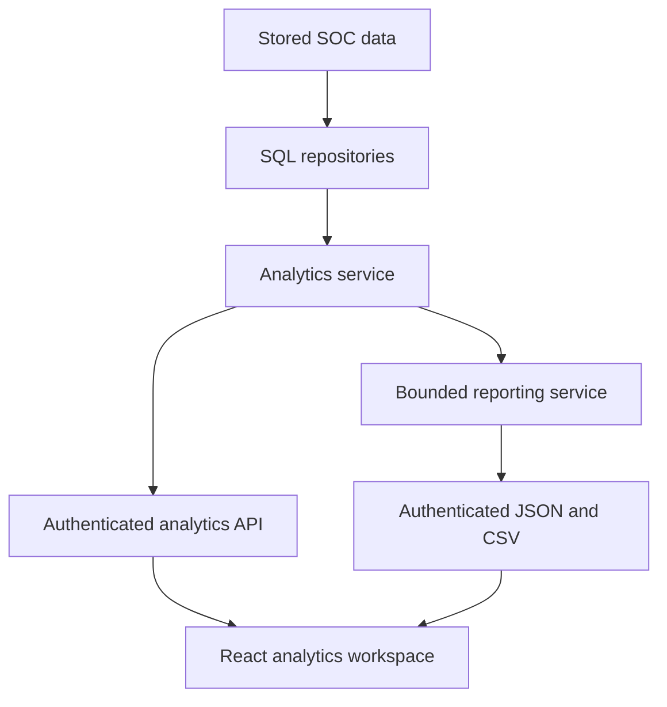

# Phase 14 — Advanced Security Analytics & Reporting

This incremental update extends the existing application. It adds read-only SQL analytics, a dedicated `/analytics` workspace and authenticated JSON/CSV reports. It does not change detection, scoring, incident workflow, enrichment or AI generation. Complete changed files are listed in [PHASE14_FILES.md](PHASE14_FILES.md); measured results and environment limits are in [PHASE14_VALIDATION.md](PHASE14_VALIDATION.md).

## Apply the update on Windows

Extract `CyberSentinel-Phase14-Update.zip` into a temporary folder. Merge the **contents of its `cybersentinel` folder** into your existing project. Replace only the listed files, retaining your own edits where applicable. The archive is an incremental update requiring Phases 1–13, not a standalone fresh installation. Preserve your actual `.env`, working Docker configuration, database volume and host port 15432.

In the VS Code PowerShell terminal:

```powershell
Set-Location 'C:\Users\saiya\OneDrive\Documents\Projects\cybersentinel'
docker compose up --build -d --wait --wait-timeout 180
docker compose exec backend alembic upgrade head
docker compose exec backend alembic current
docker compose exec backend alembic check
docker compose ps
powershell -NoProfile -ExecutionPolicy Bypass -File .\scripts\Verify-Phase14.ps1
Start-Process 'http://localhost:5173/analytics'
Start-Process 'http://localhost:8000/docs'
```

Use your existing username/password when prompted. The verifier reads configured frontend/backend ports from `.env`; override with `-FrontendPort` or `-BackendPort` if needed. Adjust the two browser URLs to your working ports. Expected: healthy containers, Alembic head `0008_ai_analyses`, no pending schema changes, all 15 analytics routes in Swagger, authenticated analytics responses, and permitted reports. An empty database returns valid zero/null analytics and passes verification.

**No new migration, tables, indexes, dependencies, environment variables or seed operation is required.** `alembic upgrade head` ensures earlier migrations are applied. Phase 14 never creates tables at application startup. Do not use `docker compose down -v` or reset your environment to install this update.

## Architecture and file responsibilities



- `repositories/analytics_repository.py`: cohorts, filtered aggregates, percentiles, rule/case deduplication, audit transitions, workload and AI metadata.
- `repositories/analytics_entities.py`: independent event/finding/case aggregates, deduplicated entity associations and current cached reputation.
- `repositories/synthetic_analytics.py`: separately labelled development evaluation. No production detector imports it.
- `services/security_analytics.py`: extends Phase 10 UTC scope/window helpers and intelligence summaries, adds zero filling, metric definitions and typed responses.
- `services/reporting_service.py`: allowlisted projections, bounded rows, executive report sections and CSV sanitization.
- `routes/analytics.py`, `routes/reports.py`: existing authentication/RBAC, query validation and response contracts.
- Frontend `pages/Analytics.jsx`, `components/analytics`, `hooks/useAnalytics.js`, `services/analyticsApi.js`: scoped query caching, charts, tables, reports and consistent error/empty/loading states.

Database queries return aggregate rows or limited projections, never whole raw-event tables. The layer does not invoke processing engines, write incident state, refresh intelligence or generate AI text. Authentication continues to use the existing session/audit behavior. SQL statements use the existing connection timeout and parameterized SQLAlchemy expressions. Responses use the existing no-store policy.

## Time and state semantics

Every response includes `scope.start`, `scope.end`, `scope.as_of`, `boundary` and a metric `definition`. Ranges are UTC **[start, end)**. API presets are `24h`, `7d`, `30d`, `90d`; omission defaults to 24h. Custom requests supply both timezone-aware `start` and `end`, without `range`. The default maximum is 90 days through the existing `DASHBOARD_MAX_RANGE_DAYS`. The UI caps custom periods at 90 days; a lower server setting is enforced by the API.

| Data | Selected-period timestamp | State being counted |
| --- | --- | --- |
| Security events | `timestamp` | Stored observed events |
| Detection findings | `last_seen` | Stored findings |
| Incidents | `created_at` | Creation cohort, current status/severity/score |
| Finding risk | Finding `last_seen` | One assessment with current `SCORE_VERSION` |
| Intelligence | Latest cached `checked_at` | Current cache bundle, separated mock/live |
| Saved AI explanations | `generated_at` | Saved AI/FALLBACK records |
| Workflow activity / system metrics | Audit/metric `timestamp` | Recorded activity in the selected period |

Phase 10 `/api/dashboard/*` retains its **incident `detected_at`** semantics. The new creation-cohort metrics can therefore differ legitimately from the Overview dashboard, especially when historical events are processed today. API timelines use UTC buckets and zero-fill empty buckets; average/median/maximum risk remains null in buckets with no scored records. A risk profile shows **current scores grouped by cohort time**, not historical score changes.

The frontend anchors one start/end pair for all sections. Tab changes preserve `period`, custom dates and `section` in the URL. The refresh button advances rolling ranges. Queries cache for 30 seconds; this workspace does not continuously poll. A custom date entry labelled UTC is interpreted as UTC even on a Windows computer using IST.

## Executive and response metric definitions

| Metric | Formula / source |
| --- | --- |
| Incidents / critical / resolved / false positives | Distinct creation-cohort cases, current state |
| Average / median risk | Current case risk scores; PostgreSQL AVG / percentile_cont(0.5) |
| Associated IPs / accounts | Distinct direct and retained evidence associations to cohort findings/cases; not a malicious-person verdict |
| MTTA | Mean seconds from case creation to the **first audited human `INCIDENT_STATUS_CHANGED` to INVESTIGATING** |
| MTTR | Mean `resolved_at - created_at` for **currently RESOLVED** cases with nonnegative duration and `resolved_at <= as_of` |
| P90 resolution time | PostgreSQL percentile_cont(0.9) of those valid resolution durations |
| Resolution rate | `100 * RESOLVED / all creation-cohort cases` |
| False-positive rate | `100 * FALSE_POSITIVE / (RESOLVED + FALSE_POSITIVE)` |

MTTA does not infer acknowledgement from assignment or current status; automatic transitions and invalid timestamps are excluded. `acknowledged_incidents` and `measured_resolutions` expose sample counts. No eligible sample or zero denominator returns null, displayed as an em dash. Reopened cases are excluded from current MTTR until resolved again. These durations measure lifecycle timing, not individual analyst effectiveness or production performance.

Incident trend `created` uses creation time and `critical` current severity. `resolved`, `false_positive` and `reopened` count canonical **audited transitions occurring in the period**, which may involve older cases and repeat closures. Auxiliary audit actions are excluded to avoid double counts. These transition series are not the same as distinct currently closed-case totals.

`incidents/status-history` reconstructs bucket-end states only for creation-cohort cases with a retained `INCIDENT_CREATED` audit. It starts from OPEN and applies canonical status transitions up to `min(bucket_end, end, as_of)`; cases without creation audits are explicitly excluded and counted. Missing audit history or out-of-band database edits can differ from the current backlog. This is retained workflow history, not a universal point-in-time database snapshot.

Current backlog uses OPEN/INVESTIGATING cases **created in the selected period**. Age runs to `as_of`, not the selected end. Buckets are `[0,1h)`, `[1h,4h)`, `[4h,24h)`, `[1d,3d]`, and `>3d`. The oldest case links to the existing investigation workspace.

## Detection, risk, entity and workload calculations

Each rule's findings use `last_seen`. Case associations union the primary case rule with linked finding rules, then deduplicate `(rule, case)`. A case can belong to multiple rules/categories, so totals across them are not additive. Rule average risk uses one current-version assessment per finding; old algorithm versions do not multiply counts. Per-rule false-positive rate uses the same closed-case denominator as the executive metric. Closure outcomes are not detection accuracy.

Fixed categories map CS-001..004 to Authentication Abuse, CS-009 to Access Control, CS-005 to Privilege Activity, CS-006 to Network Activity, CS-010 to API Abuse, CS-007 to Sensitive Data Access and CS-008 to Reputation-Based. Unknown future rule IDs fall into Other.

Risk histogram buckets are 0–9 through 80–89 and **90–100**, including 100. Select incidents or current-version finding assessments. Missing assessments are excluded. Current scores are read unchanged; analytics does not rescore data.

Entity counts are independently aggregated before joining. Each account/IP/service/device appears once; finding and case evidence associations are deduplicated. Accounts/IPs require a case or finding association; services/devices may also have event-only rows. Average risk uses current case scores; highest risk includes current finding assessments. `suspicious_event_count` counts distinct retained finding-linked events within the period, not confirmed malicious events. Evidence sampling limits coverage. Repeated-source mode requires at least two associated cases. IP reputation uses a current compatible, unexpired cache; absent/expired evidence is UNKNOWN. No live lookup occurs. Observed Source Geography uses supplied nonempty evidence country values, explicitly unverified; it is not geolocation or attribution to a country.

Workload is ADMIN-only and lists active ADMIN/ANALYST accounts alphabetically, including zero-load accounts. Counts use **current assignments** for the case creation cohort; unassigned and inactive/ineligible assignments are reported separately. Resolution duration is a case lifecycle measure, not attribution to the person who resolved it. Recorded assignment/comment/status/resolution activity uses human audit actions in the period. No analyst rankings or performance score are produced.

## Intelligence, AI usage and synthetic evaluation

Mock and live cache bundles are separate. Latest checks in the selected period contribute to counts. Expired or policy-incompatible bundles are UNKNOWN. Provider usage counts provider entries in retained bundles, **not lifetime provider calls**. Lookups, cache hits and errors use recorded system metrics. Intelligence report rows include `cache_status` and suppress stale scores. No secrets, raw provider responses or API keys are exported.

AI usage counts saved explanations by generation mode and existing duration/cache/failure metrics. Recorded provider-failure fallback counts do not infer unrecorded database failures. Exact global stale-analysis count is null: Phase 13 computes freshness per incident from evidence; rebuilding every context for an aggregate would be expensive. Analysis prompts/context are never exposed here.

Synthetic Evaluation Only reads generator-labelled retained evidence in an isolated analytics module. Expected units are distinct `(expected rule, scenario_id)` with labelled events in range; evaluated findings must have `last_seen` and retained synthetic evidence in range. Recall is covered expected units / all expected units. Unexpected findings lack matching scenario-rule labels in their retained evidence. Label agreement is agreeing findings / evaluated findings. **Precision remains null** because overlapping behavior and sampled evidence cannot establish true false positives. Boundary-truncated scenarios and current rule configurations affect coverage. These results do not establish real-world accuracy.

## API reference and RBAC

All routes below are authenticated GETs. Query parameters use the common UTC scope above.

| Route under `/api/analytics` | Additional query parameters | Access |
| --- | --- | --- |
| `/overview` | — | All roles |
| `/events/trend` | `event_type`, `service`, `status`, `source_ip`, `username` | All roles |
| `/incidents/trend` | — | All roles |
| `/incidents/status-history` | — | All roles |
| `/detections/rules` | — | All roles |
| `/risk/trend`, `/risk/histogram` | `population=incidents|findings` | All roles |
| `/entities/high-risk` | `kind=username|source_ip|service|device`, `limit=1..100`, `recurring_only`, `mode=mock|live` | All roles |
| `/incidents/backlog` | — | All roles |
| `/analysts/workload` | `limit=1..5000` (default 100), `offset=0..1000000` | ADMIN |
| `/threat-intelligence`, `/categories`, `/geography` | — | All roles |
| `/ai/usage`, `/detections/evaluation` | — | All roles |

Event filters combine with AND. Source IP is validated before database comparison. Entity rows default to top 20 ordered by highest risk, case count, finding count, then identity; `has_more` signals truncation. Geography returns top 30 plus `has_more`. Workload is paginated in username order.

`GET /api/reports/{report_type}` permits ADMIN/ANALYST, with **ADMIN-only analyst-workload**. VIEWER exports return 403. Types: `security-summary`, `incidents`, `detection-findings`, `risk-assessments`, `threat-indicators`, `detection-rules`, `analyst-workload`. Query: `format=json|csv` (default JSON), `limit=1..5000` (default 1000), `offset=0..1000000`, and common UTC scope. A signed-out request returns 401; invalid filters/ranges return 422. Report pages use stable ordering, but concurrent changes can move offset pages; they are not persistent snapshots.

JSON includes scope, definition, generated time, columns, rows, returned count, paging information and executive `sections`. CSV includes UTF-8 BOM, quoted headers/cells and CRLF rows; headers `X-Export-Rows`, `X-Export-Has-More`, `X-Export-Next-Offset`, `X-Report-Start`, `X-Report-End` describe paging and scope. CSV downloads have a safe server-controlled attachment filename. The normal frontend proxy keeps these same-origin headers available to the UI.

Security summary includes executive/response metrics, event and incident trends, rule performance, risk histogram, intelligence, backlog and up to 20 critical cases with truncation metadata. JSON keeps those bounded sections even when flattened rows are paginated; CSV uses section/metric/value rows. Reports share exact UTC boundaries, but separate SQL statements use normal committed-data reads; concurrent updates may occur between sections. There is no report history table, public report directory, PDF dependency or background job.

CSV cells beginning with formula characters `=`, `+`, `-`, `@`, including after common invisible/whitespace prefixes, receive an apostrophe. Leading tabs/newlines/NUL are protected too; quotes, commas and newlines are handled by the CSV writer. Numeric values retain numeric meaning. Exports allowlist fields and exclude passwords, JWTs, API keys, raw logs, comments, prompts and provider payloads. Tests include formula prefixes, quotes, delimiters and newlines.

## Frontend acceptance

Open `/analytics` after signing in. Eight tabs cover executive KPIs, trends/categories/geography, sortable detection performance and synthetic evaluation, incident status history/backlog/response, risk and entities, intelligence, analyst operations and reports. Recharts tooltips are interactive; sparse risk observations retain visible points. The existing dark SOC layout, navigation, auth and investigation links are reused.

1. Select 24H/7D/30D/90D, then a custom UTC interval; switch tabs and confirm the period persists.
2. Use event filters, sort detection rules, switch risk population and entity type, and toggle recurring source IPs.
3. Compare current backlog with audited status history. Open the oldest case to inspect evidence.
4. Confirm mock/live intelligence remain separate and null metrics show em dashes.
5. As ADMIN, view workload. As ANALYST, verify individual workload is restricted. As VIEWER, verify analytics remains readable and report controls are absent.
6. In Reports choose type/format/row limit, generate and inspect the downloaded rows. Use Prepare next page when offered. Downloads happen only on click; loading/success/retry states are visible.
7. Test a period before any stored events: zero/null/empty states should remain usable.

## Tests and native verification

From the project root, run the existing isolated database test runner; it creates and removes only a new test database, leaving development records intact:

```powershell
docker compose exec backend python -m scripts.run_database_tests
docker compose exec frontend npm test
docker compose exec frontend npm run build
```

Focused database checks:

```powershell
docker compose exec backend python -m scripts.run_database_tests tests/test_advanced_analytics.py
```

For local Python/Vite development using your existing virtual environment and `.env`:

```powershell
Set-Location .\backend
.\.venv\Scripts\Activate.ps1
$env:POSTGRES_HOST = '127.0.0.1'
$env:POSTGRES_PORT = '15432'
python -m alembic upgrade head
python -m uvicorn app.main:app --reload --host 127.0.0.1 --port 8000
```

Use your actual venv path, mapped PostgreSQL port and backend port if different. In a second PowerShell terminal at the project root:

```powershell
Set-Location .\frontend
npm ci
npm run dev
```

Native dependencies and setup are unchanged from the earlier guides. If a local venv is not installed, use the Docker commands above. Do not overwrite the working root `.env` to run native processes.

## Reproduce the synthetic pipeline

These commands deliberately add synthetic data to your development database. Choose a fresh run ID/output filename to avoid existing-file protection or ingestion deduplication. The date is seven completed UTC calendar days before the command runs, avoiding future demo events:

```powershell
$StartDate = [DateTime]::UtcNow.Date.AddDays(-7).ToString('yyyy-MM-dd')
$RunId = 'phase14-' + [DateTime]::UtcNow.ToString('yyyyMMddHHmmss')
$Output = "data/$RunId.jsonl"
docker compose exec backend python scripts/generate_demo_data.py --count 10000 --seed 42 --scenario mixed --start-date $StartDate --days 7 --run-id $RunId --output $Output
docker compose exec backend python scripts/ingest_events.py --file $Output
docker compose exec backend python scripts/run_detection.py --until-empty
docker compose exec backend python scripts/run_risk_scoring.py --until-empty
docker compose exec backend python scripts/run_incident_processing.py --until-empty
docker compose exec backend python scripts/run_threat_enrichment.py --all --limit 50 --mock
powershell -NoProfile -ExecutionPolicy Bypass -File .\scripts\Verify-Phase14.ps1
```

Select 7D/30D in Analytics. Newly created incidents belong to the current creation cohort even when their source events occurred earlier. The mixed event budget may omit some scenario types; a critical incident is not guaranteed. MTTA/MTTR remain null until valid analyst workflow actions are recorded. Use the existing incident workspace for investigation/closure and Phase 13 Analyze action for an explicitly requested explanation. Analytics itself will not trigger any of those actions.

## Database inspection and independent count checks

```powershell
docker compose exec db sh -c 'psql -U "$POSTGRES_USER" -d "$POSTGRES_DB"'
```

In psql:

```sql
SELECT version_num FROM alembic_version;
SELECT processed, COUNT(*) FROM security_events GROUP BY processed;
SELECT COUNT(*) AS findings FROM detection_findings;
SELECT COUNT(*) AS cases FROM incidents;
SELECT r.rule_id, COUNT(f.id) AS findings
FROM detection_rules r LEFT JOIN detection_findings f ON f.detection_rule_id = r.id
GROUP BY r.rule_id ORDER BY r.rule_id;

-- Use the exact scope.start/end returned by the API for direct comparisons.
\set start '2026-10-01T00:00:00Z'
\set end '2026-10-16T00:00:00Z'
SELECT COUNT(*) AS events FROM security_events
WHERE timestamp >= :'start'::timestamptz AND timestamp < :'end'::timestamptz;
SELECT status, COUNT(*) AS cases, AVG(risk_score) AS average_risk
FROM incidents WHERE created_at >= :'start'::timestamptz AND created_at < :'end'::timestamptz
GROUP BY status;
SELECT AVG(EXTRACT(EPOCH FROM resolved_at-created_at)) AS mttr_seconds
FROM incidents WHERE status = 'RESOLVED' AND resolved_at >= created_at AND resolved_at <= now()
AND created_at >= :'start'::timestamptz AND created_at < :'end'::timestamptz;
SELECT action, COUNT(*) FROM audit_logs WHERE entity_type = 'incident'
AND timestamp >= :'start'::timestamptz AND timestamp < :'end'::timestamptz GROUP BY action;
\q
```

No index was added: measured plans use existing event timestamp and incident creation indexes, and the measured analytics medians remained below 200 ms at 100,000 stored events in the validation environment. This does not certify native/concurrent production throughput. See the validation report for five samples per operation, scope, data population and limitations. Phase 14 ends here; infrastructure finalization, comprehensive hardening and cloud deployment remain later phases.
