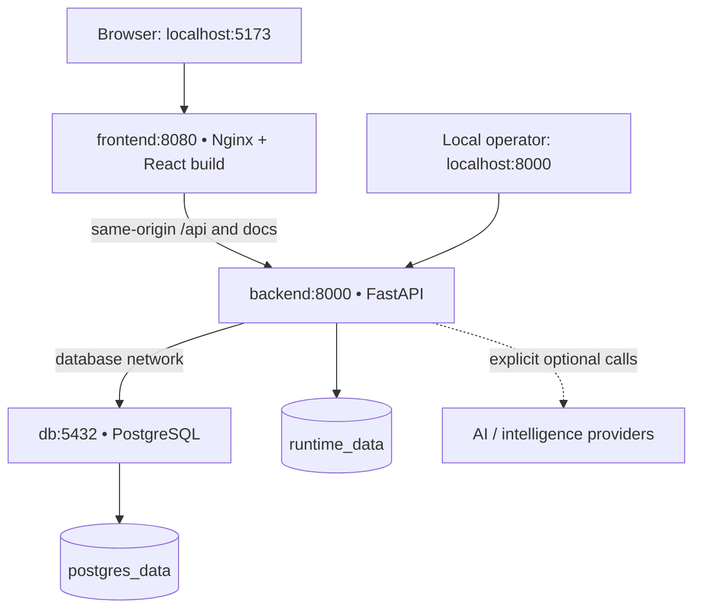

# Phase 15 — Infrastructure, Docker & Operational Hardening

This incremental update preserves Phases 1–14. It changes packaging, deployment configuration, operational HTTP behavior, and recovery tooling. Detection, scoring, incident workflows, intelligence, AI, analytics formulas and role permissions are unchanged. There are **no new migrations or dependency upgrades**. Phase 16, portfolio polish and cloud deployment have not begun.

Read [PHASE15_VALIDATION.md](PHASE15_VALIDATION.md) for what was actually executed and what still requires Docker Desktop. [PHASE15_FILES.md](PHASE15_FILES.md) lists complete new/modified files.

## Existing installation: exact PowerShell workflow

Open your existing project root in VS Code. Extract the update's `cybersentinel` contents into that same folder, merging only the listed files. Preserve `.env`, `backend/data`, existing source outside the update and PostgreSQL volumes. Do not extract into an extra nested project folder.

```powershell
Set-Location 'C:\Users\saiya\OneDrive\Documents\Projects\cybersentinel'
docker version
docker compose version
# Existing .env is preserved. New installations get locally generated random secrets.
powershell -NoProfile -ExecutionPolicy Bypass -File .\scripts\Initialize-Environment.ps1
# Keep a backup before recreating application containers; requires your existing db service running.
powershell -NoProfile -ExecutionPolicy Bypass -File .\scripts\Backup-Database.ps1
docker compose config --quiet
docker compose up --build -d --wait --wait-timeout 180
docker compose exec backend alembic upgrade head
docker compose exec backend alembic current
powershell -NoProfile -ExecutionPolicy Bypass -File .\scripts\Verify-Phase15.ps1
Start-Process 'http://localhost:5173'
Start-Process 'http://localhost:5173/docs'
```

Skip the pre-upgrade backup only for a genuinely new, empty installation. The existing eight migrations end at `0008_ai_analyses`; `upgrade head` on an up-to-date database does not rewrite records. Do not generate another initial migration. Migrations are explicit, never performed concurrently by startup workers.

Existing `.env` files work without adding the new optional settings. Keep your database username/password and JWT key. Changing initialization credentials in `.env` does not change a user already stored in PostgreSQL. The default stack no longer publishes PostgreSQL to Windows; the development override retains your existing `POSTGRES_PORT`, including `15432`.

`--wait` checks container health, not migration readiness. On a clean database the backend is alive and Swagger works before migrations; `/api/system/ready` returns 503 until `alembic upgrade head` completes. If `--wait` times out, inspect logs rather than deleting volumes.

## Architecture and containers



| Service | Image/build | Runtime and host exposure |
| --- | --- | --- |
| `db` | `postgres:17-alpine` | Official entrypoint initializes as root then PostgreSQL runs as its database user. No host port by default. |
| `backend` | `python:3.12-slim`; `production` target | Existing pinned `requirements.txt`, `/opt/venv`, user `sentinel` UID 10001, one Uvicorn worker, no reload; host `127.0.0.1:8000`. |
| `frontend` | `node:24-slim` build stage → `nginxinc/nginx-unprivileged:1.30-alpine` | `npm ci`, `npm run build`; final image has built assets and Nginx, not Node development dependencies. User 101:101; container 8080 → host `127.0.0.1:5173`. |

The existing project name `cybersentinel` and `postgres_data` key retain the `cybersentinel_postgres_data` volume. If you previously used a custom Compose `-p` name, continue using that same project name for **every** command. Do not create a different project and mistake its empty database for lost data.

There are three services and two networks: `web` joins frontend/backend and permits backend optional-provider egress; `database` is internal and joins backend/db. The browser uses relative `/api`, not a Docker hostname. Nginx forwards `/api`, `/docs`, `/redoc` and `/openapi.json` to `backend:8000`; its Docker DNS resolver refreshes upstream addresses after container replacement. Missing API routes remain JSON 404s. SPA routes fall back to `index.html`; missing hashed assets return 404. Hashed assets cache for one year; index HTML must revalidate.

Application containers use read-only root filesystems, writable size-limited `/tmp`, no Linux capabilities, `no-new-privileges`, and Docker init. Source files are not mounted in the default stack. The PostgreSQL image retains the permissions required by its official initialization flow. These controls are not a claim of complete container security.

Every service has bounded `on-failure:5` retries and Docker JSON-file log rotation (10 MiB × 3). A bad configuration eventually remains failed instead of restarting forever. This policy does **not** promise automatic startup after Docker Desktop or the host restarts: run `docker compose up -d --wait` then. Health-check failure alone does not trigger a restart.

Frontend uses SIGQUIT for graceful Nginx shutdown. Backend gets SIGTERM, up to 60 seconds for Uvicorn graceful shutdown, and 90 seconds from Compose; its lifespan disposes the SQLAlchemy pool. PostgreSQL has a 60-second stop grace period. No processing job runs automatically during startup or shutdown.

## Storage and persistence

| Location | Contents and behavior |
| --- | --- |
| `postgres_data` | Entire PostgreSQL cluster; preserved across normal `down`, rebuild and restart. |
| `runtime_data` → `/app/backend/data` | Explicit generator/importer working files in default containers; persists independently of source. |
| Host `backend/data` | Existing files are preserved. Used directly only in development mode; not automatically copied into `runtime_data`. |
| Host `backups/` | Timestamped PostgreSQL custom-format archives and SHA-256 sidecars; ignored by Git. |
| Browser downloads | Phase 14 CSV/JSON reports; not database backups and not public server files. |

To import an existing host dataset, copy it deliberately. A file copied by Docker may be root-owned, but is readable for ingestion; newly generated files inside the backend belong to `sentinel`.

```powershell
docker compose cp .\backend\data\demo_events.jsonl backend:/app/backend/data/imported_events.jsonl
docker compose exec backend python scripts/ingest_events.py --file data/imported_events.jsonl
# Bring a generated file back to Windows without mounting application source:
docker compose cp backend:/app/backend/data/demo_events.jsonl .\backend\data\demo_events.jsonl
```

`docker compose down` preserves named volumes. **`docker compose down -v` deletes them** and is not part of any normal restart, upgrade or troubleshooting instruction. Backups, exports, logs and caches are excluded from Git/build contexts; no `.env` is copied into image layers.

## Configuration: required vs optional

The existing configuration contract is retained: PostgreSQL settings are `POSTGRES_HOST`, `POSTGRES_PORT`, `POSTGRES_DB`, `POSTGRES_USER`, `POSTGRES_PASSWORD`. `DATABASE_URL` is not a newly introduced parallel setting. SQLAlchemy constructs a properly escaped Psycopg URL from these fields. Compose overrides host/port to `db:5432` regardless of Windows port mappings.

Required secrets are `POSTGRES_PASSWORD` (16+ characters, no placeholder) and `JWT_SECRET_KEY` (32+ UTF-8 bytes, no placeholder). Initialize them with the provided environment script; there are no fallback passwords. The server entrypoint reports invalid field names without printing rejected values. Optional intelligence keys and AI key/model are not required for startup, liveness or readiness. Missing/disabled providers retain the existing mock/fallback/disabled behavior. No provider key is a `VITE_*` variable.

| Category | Settings / defaults |
| --- | --- |
| HTTP runtime | `SERVER_HOST=0.0.0.0`, `SERVER_PORT=8000`, `SERVER_WORKERS=1`, `SERVER_GRACEFUL_TIMEOUT_SECONDS=60`; Compose fixes internal host/port. |
| Browser/host validation | `CORS_ORIGINS` exact JSON array; `AUTH_TRUSTED_ORIGINS` optional exact origins; `ALLOWED_HOSTS=["localhost","127.0.0.1","backend"]` with no scheme/port. |
| Proxy trust | `PROXY_HEADERS_ENABLED=false`; `FORWARDED_ALLOW_IPS=["127.0.0.1","::1"]`; enable only for verified proxy peer IPs or restricted CIDRs. Wildcard and `/0` ranges are rejected. |
| Pool | `DB_POOL_SIZE=5`, `DB_MAX_OVERFLOW=5`, `DB_POOL_TIMEOUT_SECONDS=3`, `DB_POOL_RECYCLE_SECONDS=1800`, always `pool_pre_ping=true`. |
| Connection/query bounds | `DB_CONNECT_TIMEOUT_SECONDS=3`, `DB_STATEMENT_TIMEOUT_MS=3000`. |
| Observability | `LOG_LEVEL=INFO`; `API_DOCS_ENABLED=true`. False removes `/docs`, `/redoc` and `/openapi.json`. |
| Authentication | Existing JWT lifetimes, issuer/audience, refresh sessions and process-local rate limits are unchanged. |
| Processing | Existing `INGESTION_*`, `DETECTION_*`, `RISK_*`, `INCIDENT_*` settings are unchanged. |
| Optional integrations | Existing `THREAT_INTELLIGENCE_*`, provider keys and `AI_*` settings; see `.env.example` and the Phase 9/13 guides. |

Use `APP_ENV=development` for this **local HTTP** stack even though the containers use production builds. `APP_ENV=production` already requires secure auth cookies and is intended for HTTPS termination; using it over ordinary HTTP can prevent refresh cookies from working. Production mode now also rejects DEBUG logging and obvious weak secret patterns. FastAPI debug tracebacks are disabled in every mode. No certificates or public deployment are configured here.

Keep one worker while authentication/AI rate limits are process-local. Nginx overwrites incoming forwarded/request-ID headers rather than passing arbitrary client values through. Forwarded headers are disabled in Uvicorn by default; therefore the backend sees the proxy IP and per-IP rate limits are shared by clients through that proxy. For future HTTPS/client-IP forwarding, explicitly configure the actual trusted proxy peers and origins/hosts; do not set `FORWARDED_ALLOW_IPS=*`. This requires deployment-specific validation in Phase 18.

Do not run plain `docker compose config` when sharing diagnostics: it resolves secret values. Use `config --quiet`. `.env` is local plaintext configuration and must be protected on the host. A dedicated least-privilege runtime database role and managed secret store remain deployment work; the current bootstrap role is retained for compatibility and migrations.

## Health, headers and errors

| Endpoint | Meaning |
| --- | --- |
| Frontend `/healthz` | Nginx process is responding; no database or provider checks. |
| Backend `/api/system/live` | FastAPI process is responding; Docker uses this lightweight probe. |
| Backend `/api/system/ready` | `SELECT 1` succeeds and stored Alembic revision equals all packaged heads; 200 ready, otherwise 503. |
| Existing `/api/system/health` | Preserved database-connectivity and AI-mode response; no external calls. |
| Authenticated `/api/dashboard/system/health` | Existing System Health UI contract: actual database query, pending processing, on-demand detection and separate provider/AI configuration states. |

Configured provider credentials do not prove external availability. Optional provider failures do not make the required PostgreSQL backend unready. `pool_pre_ping` discards stale connections after a database restart; active operations may return a safe 503 and must be deliberately retried by the operator. Mutating requests are not automatically replayed by Nginx.

Nginx adds `nosniff`, `no-referrer`, `DENY` and a tested SPA CSP. Inline styles are permitted for current chart rendering; script execution is same-origin only. Docs proxy locations intentionally omit the SPA CSP because Swagger uses CDN/inline assets. Backend errors have no-store headers, safe messages and request IDs; validation responses omit rejected raw inputs. A top-level React error boundary offers Retry and Return to Overview without rendering the exception text.

## Logging

Backend stdout is JSON: UTC timestamp, level, logger, message, request ID and bounded operational fields. HTTP records contain the matched route template, method, status and measured duration—not request/query contents, arbitrary URLs, headers, JWTs or body payloads. Incoming request IDs must be UUID-form or 32 hexadecimal characters; others are replaced. Nginx supplies its own request ID to the backend, and the backend returns the same value as `X-Request-ID`. It is correlation metadata, not authorization.

Known configured secrets and common bearer/key formats are redacted defensively. Exception **classes**, not SQL parameters, provider payloads, stack locals or exception messages, are logged. This deliberately reduces debugging detail. Nginx access logs contain method/status/request ID/time; its critical-level error log minimizes request URL leakage. Use the ID, status and focused local tests for diagnosis; do not add raw evidence/token dumps to logs.

```powershell
docker compose ps
docker compose logs --tail=80 backend db frontend
docker compose logs -f backend
docker compose logs -f frontend
docker compose logs -f db
```

## Clean database, admin and intentional demo processing

For a brand-new installation, initialize `.env`, start the stack, migrate and create an administrator interactively. Existing installations should keep existing accounts; the bootstrap command is idempotent.

```powershell
powershell -NoProfile -ExecutionPolicy Bypass -File .\scripts\Initialize-Environment.ps1
docker compose up --build -d --wait --wait-timeout 180
docker compose exec backend alembic upgrade head
docker compose exec backend python -m scripts.seed_detection_rules
docker compose exec backend python -m scripts.create_admin
Invoke-RestMethod 'http://localhost:5173/api/system/ready'
```

The admin password is masked, never printed and has no default. Use the username you chose. Do not pass a password as a command-line argument.

Run demo processing explicitly in local development mode; it is never part of startup. Use a new filename/run ID if a previous dataset exists. The date below is computed in UTC, keeping demo events visible in recent dashboard ranges.

```powershell
$StartDate = [DateTime]::UtcNow.AddDays(-7).ToString('yyyy-MM-dd')
$RunId = 'ops-' + [DateTime]::UtcNow.ToString('yyyyMMddHHmmss')
docker compose exec backend python scripts/generate_demo_data.py --count 10000 --seed 42 --scenario mixed --start-date $StartDate --days 7 --run-id $RunId --output "data/$RunId.jsonl"
docker compose exec backend python scripts/ingest_events.py --file "data/$RunId.jsonl"
docker compose exec backend python scripts/run_detection.py --until-empty
docker compose exec backend python scripts/run_risk_scoring.py --until-empty
docker compose exec backend python scripts/run_incident_processing.py --until-empty
docker compose exec backend python scripts/run_threat_enrichment.py --all --limit 50 --mock
```

These are the existing Phase 4–9 CLIs. Many trusted local processing CLIs deliberately require `APP_ENV=development` or `test`; Phase 15 does not bypass that restriction. Use existing authenticated APIs for authorized operations in production mode. No external API is required for this mock demo.

## Backup and restore

The scripts require only Docker Desktop and PowerShell on Windows. `pg_dump` and `pg_restore` run in the existing PostgreSQL container. Binary data is transferred with `docker compose cp`, never PowerShell `>` or `Tee-Object`, which can corrupt binary dumps in Windows PowerShell 5.1.

```powershell
powershell -NoProfile -ExecutionPolicy Bypass -File .\scripts\Backup-Database.ps1
$Backup = Get-ChildItem .\backups\*.dump | Sort-Object LastWriteTimeUtc -Descending | Select-Object -First 1
$RestoreDatabase = 'cybersentinel_restore_' + [DateTime]::UtcNow.ToString('yyyyMMdd_HHmmss')
powershell -NoProfile -ExecutionPolicy Bypass -File .\scripts\Restore-Database.ps1 -BackupFile $Backup.FullName -TargetDatabase $RestoreDatabase
# Use your actual POSTGRES_USER if different from the example.
docker compose exec db psql -U cybersentinel -d $RestoreDatabase -c 'SELECT version_num FROM alembic_version;'
docker compose exec db psql -U cybersentinel -d $RestoreDatabase -c 'SELECT count(*) FROM security_events;'
```

Output: `backups/cybersentinel_<UTC timestamp>_<random suffix>.dump` and matching `.dump.sha256`. Backup runs `pg_dump -Fc --no-owner --no-acl` and validates archive structure. Restore verifies SHA-256 and archive structure, creates a **new** database from `template0`, then uses `pg_restore --single-transaction --exit-on-error --no-owner --no-acl`. Authentication is taken from container environment and never printed as an argument.

**Restore refuses any existing target database. There is no force/overwrite option and no automated destructive restore.** Your current application database and `.env` remain unchanged. If restore fails after target creation, that new database remains for inspection; the single transaction rolls back imported changes. Retry with a new name. Restore only trusted backups you created: PostgreSQL archives can contain executable database definitions.

A deliberate cutover is a separate operator action: verify the restored database, stop backend/frontend, change only `POSTGRES_DB` to the validated target in `.env`, and recreate with `docker compose up -d --force-recreate`. Existing databases remain in the PostgreSQL volume. Do not remove the old database until you have verified the cutover and retained a backup. The script never drops it.

Archives contain all database data, including account hashes and sessions; store them privately and copy to protected off-machine storage when needed. They do not include cluster roles/grants (`--no-owner --no-acl`), `.env` or runtime JSONL files. Preserve required configuration separately. Phase 14 CSV reports are not restorable database backups.

For development-mode stacks, invoke scripts from PowerShell with the same Compose files:

```powershell
& .\scripts\Backup-Database.ps1 -ComposeFile @('docker-compose.yml', 'compose.dev.yml')
& .\scripts\Restore-Database.ps1 -BackupFile $Backup.FullName -TargetDatabase $RestoreDatabase -ComposeFile @('docker-compose.yml', 'compose.dev.yml')
```

If your PowerShell execution policy blocks direct script invocation, use the documented `powershell -ExecutionPolicy Bypass -File` form for the default stack, or set a process-scoped policy for that terminal. No machine-wide policy change is required.

## Native Docker smoke checks

```powershell
# Read-only HTTP checks plus interactive login/dashboard check:
powershell -NoProfile -ExecutionPolicy Bypass -File .\scripts\Verify-Phase15.ps1
# Deliberately interrupts services; do not run ingestion/processing concurrently:
powershell -NoProfile -ExecutionPolicy Bypass -File .\scripts\Verify-Phase15.ps1 -RestartServices
# Optional: omit login only if no admin has been created yet.
powershell -NoProfile -ExecutionPolicy Bypass -File .\scripts\Verify-Phase15.ps1 -SkipLogin
# If you intentionally configured API_DOCS_ENABLED=false, add -SkipDocs.
```

The restart variant compares counts for users, events, rules, findings, assessments, incidents, evidence, comments, incident links/processing, intelligence caches/results and AI analyses. Authentication/audit records may legitimately change during checks. It restarts all services, stops only PostgreSQL, confirms API liveness 200/readiness 503, starts PostgreSQL, waits for readiness, restarts only backend, then verifies login and the authenticated dashboard. The database is restarted in `finally` if the outage assertion fails. This checks counts, not byte-for-byte database equality; the isolated validation also compared row-content digests.

For independent clean-volume testing **without touching the existing stack**, use another project name and unused host ports for every command. The example assumes `.env` has already been initialized:

```powershell
$env:FRONTEND_PORT = '15173'
$env:BACKEND_PORT = '18000'
$env:CORS_ORIGINS = '["http://localhost:15173","http://127.0.0.1:15173"]'
docker compose -p cybersentinel-clean-smoke build --no-cache
docker compose -p cybersentinel-clean-smoke up -d --wait --wait-timeout 180
docker compose -p cybersentinel-clean-smoke exec backend alembic upgrade head
docker compose -p cybersentinel-clean-smoke exec backend python -m scripts.seed_detection_rules
Invoke-RestMethod 'http://localhost:15173/api/system/ready'
docker compose -p cybersentinel-clean-smoke exec backend python -m scripts.create_admin
docker compose -p cybersentinel-clean-smoke exec backend python -m scripts.inspect_operations
docker compose -p cybersentinel-clean-smoke down
Remove-Item Env:FRONTEND_PORT
Remove-Item Env:BACKEND_PORT
Remove-Item Env:CORS_ORIGINS
```

This creates separate `cybersentinel-clean-smoke_*` volumes and preserves them afterward. Do not use `-v` on your working project. The usual default-project verification script is not used for this alternate-project test. Visit the alternate frontend and check login manually, or set `COMPOSE_PROJECT_NAME` consistently when invoking operational scripts.

Database inspection, using the example username/database:

```powershell
docker compose exec db psql -U cybersentinel -d cybersentinel
```

```sql
\dt
SELECT version_num FROM alembic_version;
SELECT count(*) FROM security_events;
SELECT count(*) FROM detection_findings;
SELECT count(*) FROM risk_assessments;
SELECT count(*) FROM incidents;
SELECT count(*) FROM ai_analyses;
\q
```

## Development mode and normal lifecycle

Use the override only when editing source. It enables Uvicorn reload, Vite HMR, source mounts and loopback PostgreSQL port publication. All subsequent Compose commands should include both files while in this mode.

```powershell
docker compose -f docker-compose.yml -f compose.dev.yml up --build -d --wait --wait-timeout 180
docker compose -f docker-compose.yml -f compose.dev.yml exec frontend npm test -- src/tests/operations.test.jsx src/tests/api.test.js
docker compose -f docker-compose.yml -f compose.dev.yml exec backend ruff check .
# Return to built-asset/default mode:
docker compose up --build -d --wait --wait-timeout 180
```

The default backend does not install pytest/Ruff; the final frontend does not include npm. Use the development target or native environments for tests/build commands. Full security/regression verification is Phase 16. Existing test-runner scripts remain available in development mode and use separate test databases.

```powershell
docker compose stop
docker compose start
docker compose restart
docker compose down
docker compose up -d --wait --wait-timeout 180
```

`start`/`restart` do not pick up changed environment or rebuild images. After changing source, dependencies, Dockerfiles or `.env`, use `docker compose up --build -d --wait --wait-timeout 180`. Optional Docker Scout scanning may be run after local images are built; it was not performed in this environment.

## Remaining limits

The images use explicit version-family tags, not immutable digests; dependency locks are unchanged, but base-image rebuilds can change as tags receive updates. There is no public TLS, cloud deployment, queue/cluster infrastructure, managed backups, automated job scheduler, shared rate-limit store, or high-availability PostgreSQL. This phase is a production-oriented local stack, not a production-readiness certification.

Native Docker image builds, actual container UIDs/mount permissions, Docker DNS/recreation, Windows PowerShell 5.1 execution and Windows volume persistence require the provided local checks. The validation report separates those from checks executed here.

## Primary references

- [Docker Compose startup order](https://docs.docker.com/compose/how-tos/startup-order/)
- [Nginx unprivileged image](https://github.com/nginx/docker-nginx-unprivileged)
- [Nginx proxy module](https://nginx.org/en/docs/http/ngx_http_proxy_module.html)
- [Uvicorn settings](https://uvicorn.dev/settings/)
- [PostgreSQL 17 pg_dump](https://www.postgresql.org/docs/17/app-pgdump.html)
- [PostgreSQL 17 pg_restore](https://www.postgresql.org/docs/17/app-pgrestore.html)
