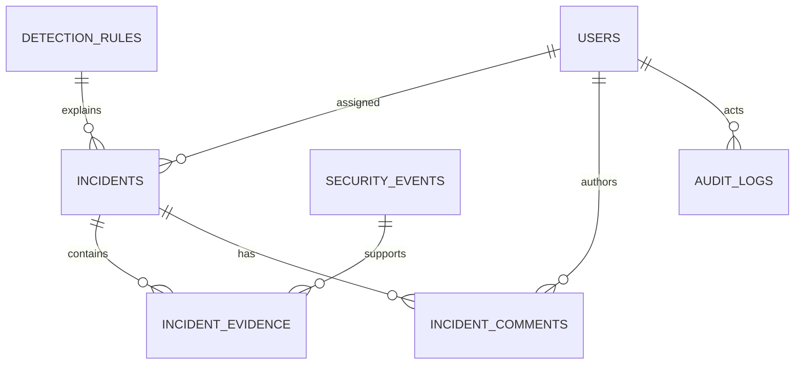

# Phase 2 — PostgreSQL database and data model

This is an update to the existing Phase 1 project. Every supplied source file is complete. See [PHASE2_FILES.md](PHASE2_FILES.md) for the exact created/modified paths. This phase implements database storage and validation only. There is no detection execution, log-ingestion API, authentication, provider integration, AI, or new frontend functionality.

## Apply the update on Windows

Keep your existing project and root `.env`. Keep `POSTGRES_PORT=15432` if that fixed the Windows port-binding error. Do not run a new-project initializer or replace working credentials. The update ZIP contains only new and modified files under `cybersentinel/`; it contains no `.env`, frontend files, Dockerfiles, or Compose file.

Download `CyberSentinel-Phase2-Update.zip` into Downloads. Open PowerShell in VS Code:

```powershell
$project = Join-Path $env:USERPROFILE 'OneDrive\Documents\Projects\cybersentinel'
$update = Join-Path $env:TEMP 'CyberSentinel-Phase2-Update'
$archive = Join-Path $env:USERPROFILE 'Downloads\CyberSentinel-Phase2-Update.zip'
Expand-Archive -LiteralPath $archive -DestinationPath $update -Force
Copy-Item -Path "$update\cybersentinel\*" -Destination $project -Recurse -Force
Set-Location $project
```

Change `$project` or `$archive` only if your folders differ. This merges the supplied files; it does not remove other files. In VS Code, the new migration must be at `backend/alembic/versions/0001_core_create_core_cybersentinel_tables.py`, not inside a second nested `cybersentinel` folder.

## Start, migrate, seed, verify

Start Docker Desktop in Linux-container mode. All commands below run from the existing project root. Run each step only after the preceding command succeeds.

### 1. Rebuild the backend dependency layer and start the stack

```powershell
docker compose config --quiet
docker compose up --build -d --wait --wait-timeout 180
docker compose ps
```

Expected: `db`, `backend`, and `frontend` are running and healthy. The only additional Python dependency is `bcrypt==5.0.0`; existing package pins are retained. `docker compose up --build` also works for foreground logs; use another terminal for subsequent commands.

The original `/api/system/health` checks connectivity, so the backend can become healthy before migrations. The new `/api/database/status` requires both connectivity and the current schema: it returns **503 until the migration is applied**.

### 2. Apply the supplied migration

```powershell
docker compose exec backend alembic upgrade head
docker compose exec backend alembic current
docker compose exec backend alembic check
```

Expected: revision `0001_core (head)` and `No new upgrade operations detected.` There are nine application tables plus Alembic's `alembic_version` table. Repeating `upgrade head` is safe. No automatic `create_all()` occurs during API startup.

**The initial migration is already included. Do not generate it again.** For a future, intentional model change, the development command is:

```powershell
docker compose exec backend alembic revision --autogenerate -m "describe the next schema change"
```

Review generated migrations before applying them, especially enum and trigger changes. The initial migration was generated from the existing models and reviewed to create shared enum types once. Its frozen definitions do not import evolving application models. Rollback is tested on isolated data; `alembic downgrade base` removes these tables and must not be used as routine setup or troubleshooting.

### 3. Seed the ten rule definitions

```powershell
docker compose exec backend python -m scripts.seed_detection_rules
docker compose exec backend python -m scripts.seed_detection_rules
```

Expected first run:

```text
Detection rules: inserted=10, already present=0
Definitions only; no detection logic is executed.
```

Expected repeat: `inserted=0, already present=10`. The seed uses PostgreSQL `ON CONFLICT DO NOTHING`; it preserves existing configuration, severity, and enabled-state changes.

### 4. Seed development users

```powershell
docker compose exec backend python -m scripts.seed_demo_users
```

With `APP_ENV=development`, enter and confirm a password at each masked prompt. Use at least 12 characters and at most 72 UTF-8 bytes. bcrypt hashes each password using a fresh salt and work factor 12. No password or hash is printed.

| Username | Email | Application role |
| --- | --- | --- |
| admin | admin@cybersentinel.local | ADMIN |
| analyst | analyst@cybersentinel.local | ANALYST |
| viewer | viewer@cybersentinel.local | VIEWER |

Expected: `Demo users: inserted=3, already present=0`. Repeating the command preserves existing hashes and roles and reports `inserted=0, already present=3`, without prompting again. A username/email collision with another account causes an error rather than overwriting it. Errors roll back the seed transaction. The script refuses both `test` and `production` environments.

For noninteractive local seeding, supply `DEMO_ADMIN_PASSWORD`, `DEMO_ANALYST_PASSWORD`, and `DEMO_VIEWER_PASSWORD` as environment variables or in the ignored root `.env`. Native Python reads the file; Compose passes it to the backend container. If you add them after starting Compose, recreate the backend with `docker compose up -d --force-recreate backend` before seeding. These variables are optional; masked prompts avoid storing them. Never commit their values. No JWT or login endpoint exists yet.

### 5. Verify HTTP, documentation, and proxy connectivity

```powershell
powershell -NoProfile -ExecutionPolicy Bypass -File .\scripts\Verify-Phase2.ps1
Invoke-RestMethod 'http://localhost:8000/api/database/status' | ConvertTo-Json
$rules = Invoke-RestMethod 'http://localhost:8000/api/detection-rules'
$rules.Count
$rules | Select-Object rule_id, name, severity, enabled | Format-Table
Start-Process 'http://localhost:8000/docs'
Start-Process 'http://localhost:5173'
```

The script reads your configured frontend/backend ports. The individual URLs above assume the unchanged Phase 1 ports, `8000` and `5173`.

Expected database status, HTTP 200:

```json
{
  "status": "healthy",
  "database": "postgresql",
  "connected": true,
  "schema_ready": true,
  "migration_revision": "0001_core",
  "expected_revision": "0001_core",
  "missing_tables": []
}
```

Expected rule count: `10`, sorted from `CS-001` through `CS-010`. The endpoint supports `?limit=2&offset=2`, validates bounds (`limit` 1–100, `offset` >= 0), and returns 503 with a redacted message when the table/database is unavailable. Both development routes are absent when `APP_ENV=production`; they are intentionally unauthenticated local inspection routes until Phase 3.

The React application remains the original foundation UI and may still show Phase 1 explanatory labels. Its actual connectivity cards and API proxy continue to work. No chart or incident UI is implemented in this phase.

### 6. Inspect PostgreSQL directly

This command uses the container's configured username and database, including custom values:

```powershell
docker compose exec db sh -c 'psql -U "$POSTGRES_USER" -d "$POSTGRES_DB"'
```

For the original default username and database, the simpler equivalent is:

```powershell
docker compose exec db psql -U cybersentinel -d cybersentinel
```

At the `psql` prompt:

```sql
\dt
\d incidents
\d security_events
\dT+
SELECT version_num FROM alembic_version;
SELECT rule_id, name, severity, enabled FROM detection_rules ORDER BY rule_id;
SELECT username, email, role, is_active FROM users ORDER BY username;
SELECT count(*) AS seeded_rules FROM detection_rules;
\q
```

Expected: ten tables including `alembic_version`, four enum types, ten rules, and three demo users. Users are application accounts, not PostgreSQL server roles.

### 7. Run all tests against a separate database

```powershell
docker compose exec backend python -m scripts.run_database_tests
docker compose exec backend ruff check .
```

The test runner creates `cybersentinel_test_<random UUID>` using the existing database credentials, passes its URL only through the child process environment, runs pytest, and drops only that database afterward. The configured development database is never migrated, truncated, or dropped by this runner. The development PostgreSQL bootstrap role needs `CREATEDB`, which the standard image's bootstrap role has. Production mode is refused.

Tests add another isolation layer: migration operations occur in a newly generated `cs_test_<UUID>` schema; transactions are rolled back after each test; only that new schema is removed. This also makes an explicitly supplied `TEST_DATABASE_URL` safe from deletion of existing tables. Use a designated test database when supplying it manually. There is no SQLite substitute.

Expected: the complete suite passes, then the temporary database is removed. See [PHASE2_VALIDATION.md](PHASE2_VALIDATION.md) for the delivered test count and exactly what was executed in the build workspace. If the process is forcibly terminated, an unused temporary test database may remain; its generated name is printed for inspection.

Running plain `docker compose exec backend python -m pytest -q` executes unit tests and **skips** database tests unless `TEST_DATABASE_URL` is set. Skipped tests are not evidence of PostgreSQL correctness.

## Native Python commands in VS Code / PowerShell

Keep PostgreSQL in Docker. Stop the backend/frontend containers first only if you are replacing them with native processes. From the project root:

```powershell
docker compose up -d --wait db
Set-Location .\backend
# If the Phase 1 virtual environment does not exist:
# py -3.12 -m venv .venv
.\.venv\Scripts\python.exe -m pip install -r requirements-dev.txt
.\.venv\Scripts\python.exe -m alembic upgrade head
.\.venv\Scripts\python.exe -m alembic current
.\.venv\Scripts\python.exe -m alembic check
.\.venv\Scripts\python.exe -m scripts.seed_detection_rules
.\.venv\Scripts\python.exe -m scripts.seed_demo_users
.\.venv\Scripts\python.exe -m scripts.run_database_tests
.\.venv\Scripts\python.exe -m uvicorn app.main:app --reload --host 127.0.0.1 --port 8000
```

For a later model change: `.\.venv\Scripts\python.exe -m alembic revision --autogenerate -m "describe change"`. Native Python reads the root `POSTGRES_HOST` and `POSTGRES_PORT`, so your `127.0.0.1:15432` mapping works. The container backend keeps the unchanged Compose overrides `POSTGRES_HOST=db` and `POSTGRES_PORT=5432`.

## Data model

All primary keys are UUIDs, generated in Python or by PostgreSQL's built-in `gen_random_uuid()`. Time fields use `TIMESTAMPTZ`; inputs require an offset. PostgreSQL preserves the instant and renders it in the connection's timezone. No external UUID extension is needed on PostgreSQL 17.

| Table | Purpose and important choices |
| --- | --- |
| users | Unique normalized username/email; bcrypt hash; native role; active flag; created/updated/last-login times |
| security_events | Unique producer `event_id`; timestamp, INET addresses, account, service, ports, context, status, JSONB raw payload, processed flag |
| detection_rules | Unique `rule_id`; description, native severity, enabled flag, JSONB configuration |
| incidents | Unique external `incident_id`; rule/analyst references, source/user, bounded score/confidence, native severity/status, timestamps, optional JSONB AI analysis and action list |
| incident_evidence | Incident/event links, evidence type/description, JSONB evidence; one row per incident/event/type combination |
| threat_intelligence | Unique normalized `(indicator_type, indicator)` cache identity, scores, reports, provider list, JSONB raw response, observation/expiry times |
| incident_comments | Incident/author references, nonblank note, created/updated timestamps |
| audit_logs | Optional actor, action, entity identifier, JSONB old/new values, timestamp and INET address; no FK to a deleted target entity |
| system_metrics | Metric name, fixed-precision numeric value, unit/time, JSONB `metadata` |

`SystemMetric.metric_metadata` is the Python attribute for PostgreSQL's `metadata` column, because SQLAlchemy reserves `Base.metadata`. Schemas serialize it as `metadata`; `SystemMetricCreate.to_model_values()` maps it for ORM creation.



Analyst/author/actor links are nullable. Threat cache and metrics tables are independent of this incident relationship graph. Event usernames describe monitored accounts and are not foreign keys to CyberSentinel analyst users.

### Constraints and deletion rules

- Risk score, confidence, abuse score and reputation confidence: 0–100. Ports: 0–65535 when supplied. Reports: nonnegative. Metric values: finite fixed-precision decimals.
- JSON objects/arrays are checked in PostgreSQL. Cache expiry must follow the last check; first observation must not follow it. Incident resolution cannot predate detection.
- Event, incident, rule, username, and email identifiers are unique. Normalization makes case variants of account identifiers collide rather than creating duplicates.
- Deleting an incident cascades to its evidence links and comments, **never its source security events**. An event still referenced by evidence cannot be deleted. A rule in use cannot be deleted.
- Deleting a user sets analyst/comment/audit actor references to null; the incident, comment, and audit rows survive. Audit entity IDs have no polymorphic FK and survive deletion of the described object.
- Four database triggers maintain `updated_at` for users, rules, incidents, and comments for both ORM and direct SQL updates.
- This phase provides audit storage and role fields. Automatic incident audit writing, role-based authorization, and assignment policy are later service/authentication work.

Required event and incident query indexes are included, plus cache expiry, foreign-key lookup, metric name/time, and audit entity/time indexes. Unique constraints already create their own indexes; separate duplicate indexes are avoided.

### Request and response schemas

Pydantic v2 schemas cover all nine models, reject extra fields, validate timezone-aware timestamps, IPs, enum values, scores, and port ranges. `UserCreate` accepts a masked `SecretStr` password excluded from dumps; it does not accept a client-selected role. `UserResponse` has no password/hash field. These schemas establish future contracts without adding write endpoints.

JSONB fields use ordinary dict/list values. When changing nested JSON with the ORM, assign a replacement object (for example `rule.configuration = {**rule.configuration, "threshold": 10}`) so SQLAlchemy tracks the update; arbitrary in-place nested mutation is not tracked automatically.

### Cache storage, not provider integration

`app/repositories/threat_cache.py` provides transactional `store_cached_indicator()` and expiry-aware `get_cached_indicator()`. It normalizes domains and IPv4/IPv6 addresses, uses an atomic PostgreSQL upsert, preserves the UUID and first-seen time, and prevents an older response from replacing a newer one. The caller owns commit/rollback. No external lookup is performed.

### Session and migration ownership

The original `Settings.database_url` safely builds `postgresql+psycopg` URLs from root `.env` `POSTGRES_*` fields. A second, conflicting mandatory `DATABASE_URL` was not introduced. Password punctuation remains supported. `get_db()` yields and closes one SQLAlchemy session per request; read-only requests do not commit. Seeds explicitly wrap writes in `session.begin()`, committing once or rolling back on failure.

The API never creates tables on startup. Alembic imports all model modules and owns schema changes. The migration also owns native enum creation/deletion and update triggers, which require manual migration review beyond autogenerated table differences.

## Troubleshooting and compatibility fixes

| Symptom / issue | Resolution |
| --- | --- |
| Windows refuses host port 5432 | Keep root `.env` `POSTGRES_PORT=15432`; leave Compose's internal `db:5432` unchanged |
| Backend fails to import bcrypt | Rebuild backend with the updated locked requirements, or install `requirements-dev.txt` in the native environment |
| `/api/system/health` works but `/api/database/status` is 503 | Inspect `missing_tables`/revision and apply `alembic upgrade head` |
| `/api/detection-rules` returns an empty list | Run the rule seed after the migration |
| New routes return 404 | Ensure updated backend files are in the existing project and `APP_ENV=development`; production intentionally hides these routes |
| Shared severity enum would be created twice | Initial migration explicitly creates four enums once and references them with `create_type=False` |
| `metadata` conflicts with SQLAlchemy's reserved attribute | PostgreSQL column stays `metadata`; Python attribute is `metric_metadata` with schema mapping |
| `.local` demo emails fail public-domain validators | Shared local syntax validation supports the requested demo domain without network/DNS checks |
| A seed is repeated | Rule IDs and user identities are checked atomically; existing rows/settings/passwords are preserved |
| Test database creation is denied | Use a development test role with CREATEDB, or a designated `TEST_DATABASE_URL`; never grant extra production privileges for tests |

Docker Desktop and PowerShell validation must run on your Windows machine. The documented test runner and verification script provide that acceptance path. Do not remove the data volume or regenerate working database credentials to resolve migration/startup issues.

## References

- [SQLAlchemy PostgreSQL types and upserts](https://docs.sqlalchemy.org/en/20/dialects/postgresql.html)
- [SQLAlchemy relationship cascades](https://docs.sqlalchemy.org/en/20/orm/cascades.html)
- [Alembic autogeneration and review requirements](https://alembic.sqlalchemy.org/en/latest/autogenerate.html)
- [Pydantic ORM integration](https://docs.pydantic.dev/latest/examples/orms/)
- [bcrypt](https://github.com/pyca/bcrypt)

Phase 2 ends here. Proceed to authentication only after explicitly starting Phase 3.
