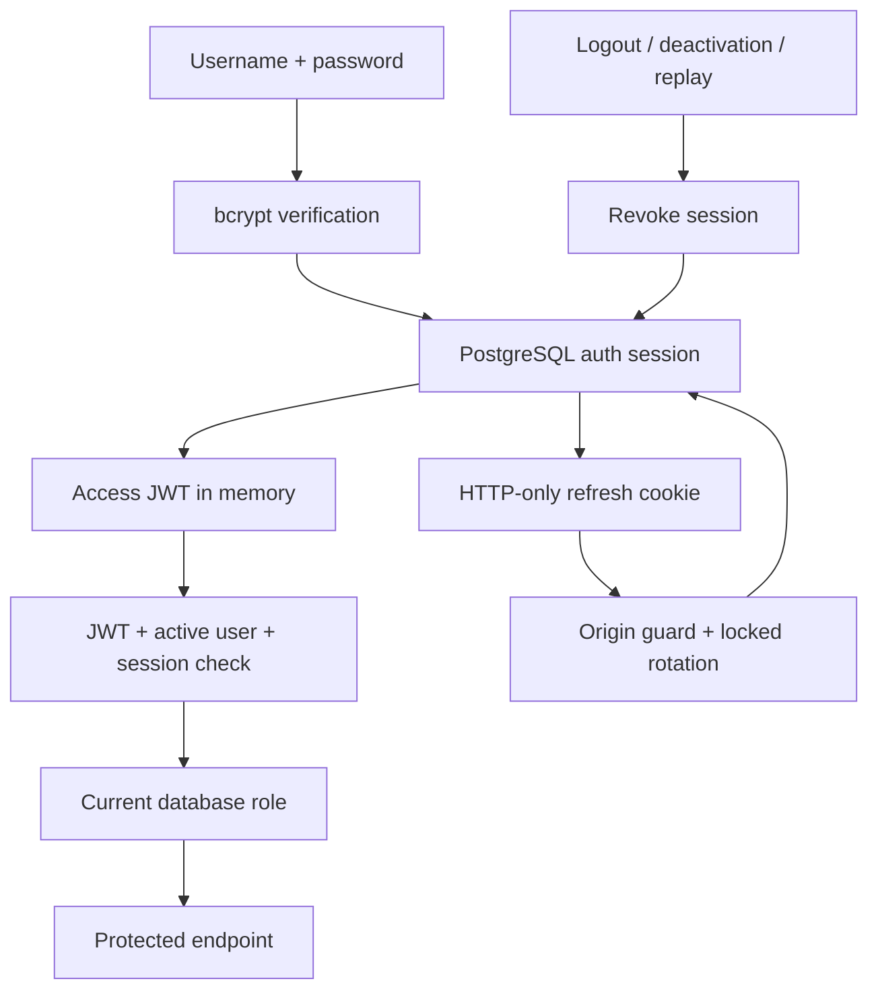

# Phase 3 — Authentication and role permissions

This update adds authentication to the existing Phase 2 project. It preserves the established User model, UUID keys, enums, database connection, bcrypt hashes, Docker services, source mounts, and root environment-variable names. It contains complete files for the paths listed in [PHASE3_FILES.md](PHASE3_FILES.md). No detection, event generator, ingestion, AI, or threat-provider functionality is added.

## Apply the update on Windows

Download `CyberSentinel-Phase3-Update.zip` to Downloads. The ZIP paths are relative to the existing project root; there is no extra `cybersentinel` wrapper directory. If you have additional local edits, compare the file list before merging these complete updated files.

In VS Code PowerShell:

```powershell
$project = 'C:\Users\saiya\OneDrive\Documents\Projects\cybersentinel'
$archive = Join-Path $env:USERPROFILE 'Downloads\CyberSentinel-Phase3-Update.zip'
Expand-Archive -LiteralPath $archive -DestinationPath $project -Force
Set-Location $project
```

Your actual `.env` is not in the archive. Keep your working `POSTGRES_PORT=15432`, database credentials, and existing JWT secret. The `.env.example` changes are reference defaults, not a replacement for `.env`. The backend container continues to use `db:5432` internally. No volumes need to be deleted and neither Dockerfile nor Compose needs replacement.

## Configuration and dependencies

The only new Python dependency is **PyJWT 2.15.0**, recorded in both lock files. bcrypt 5.0.0, FastAPI, Pydantic 2, SQLAlchemy 2 and Psycopg 3 remain the existing versions. No frontend dependency is added. Docker rebuild installs the new backend dependency.

The Phase 1 initializer already generates `JWT_SECRET_KEY`. Reuse it. If your key is missing, shorter than 32 bytes, or still a placeholder, generate a new value locally and set only `JWT_SECRET_KEY` in `.env`:

```powershell
python -c "import secrets; print(secrets.token_urlsafe(64))"
```

If Python is not installed on Windows, the rebuilt backend image can generate it without importing application settings:

```powershell
docker compose run --rm --no-deps backend python -c "import secrets; print(secrets.token_urlsafe(64))"
```

Do not share the generated value. Changing the signing key ends existing token validity. Placeholder/short keys fail startup validation. Restart/recreate the backend after an environment change.

| Variable | Default | Behavior |
| --- | --- | --- |
| `JWT_SECRET_KEY` | Required existing secret | Random signing key, at least 32 UTF-8 bytes |
| `JWT_ACCESS_TOKEN_EXPIRE_MINUTES` | `30` | Existing Phase 1 name retained; range 1–120 |
| `JWT_ALGORITHM` | `HS256` | Fixed allowlist; no client-selected algorithm |
| `JWT_REFRESH_TOKEN_EXPIRE_DAYS` | `7` | Absolute session lifetime, range 1–30 |
| `AUTH_TRUSTED_ORIGINS` | `[]` | JSON list of additional exact origins, usually deployed Swagger |
| `AUTH_RATE_LIMIT_ENABLED` | `true` | In-memory authentication limiter |
| `AUTH_LOGIN_LIMIT` | `10` | Login attempts per minute per peer address |
| `AUTH_REGISTER_LIMIT` | `5` | Registration attempts per minute per peer address |
| `AUTH_REFRESH_LIMIT` | `30` | Refresh attempts per minute per peer address |
| `CORS_ORIGINS` | Existing localhost origins | Explicit frontend origins; credentialed CORS, never wildcard |
| `APP_ENV` | Existing `development` | `production` sets Secure cookies and omits temporary DB/test routes |

All new optional settings have defaults, so existing `.env` files with a valid JWT secret work without adding every variable. Optional code settings `JWT_ISSUER=cybersentinel` and `JWT_AUDIENCE=cybersentinel-api` are validated on every token. Use one consistent hostname in browser URLs: `localhost` and `127.0.0.1` have separate cookie jars. If you change frontend ports, update `CORS_ORIGINS`. Native API origins use the existing `BACKEND_PORT` value in development.

## Start, migrate, and create an administrator

Run from the project root:

```powershell
docker compose up --build -d --wait --wait-timeout 180
if ($LASTEXITCODE -ne 0) { throw 'Stack startup failed; inspect Docker logs.' }
docker compose exec backend alembic upgrade head
if ($LASTEXITCODE -ne 0) { throw 'Migration failed.' }
docker compose exec backend alembic current
docker compose exec backend alembic check
docker compose exec backend python -m scripts.seed_detection_rules
docker compose exec backend python -m scripts.create_admin --username admin --email admin@cybersentinel.local --full-name 'Security Administrator'
```

Expected: three healthy containers; revision `0002_auth_sessions (head)`; `No new upgrade operations detected.`; ten rules remain, without duplicate insertion.

`create_admin` prompts twice for a masked password if the administrator is new. Use at least 12 characters, at most 72 UTF-8 bytes, and no NUL character. It accepts passphrases without mandatory symbol/case combinations. Passwords are never CLI arguments. The module form `python -m scripts.create_admin` ensures imports work from the backend working directory.

If `admin` was seeded in Phase 2, the script reports that it already exists and preserves its password and role. Use the password originally supplied. It does not silently reset a password, promote a conflicting Viewer, or reactivate an inactive account. If you need a new operator account, choose a different username and email; bootstrap access requires access to the backend runtime.

For local demo ANALYST/VIEWER accounts, the existing development-only seed remains available:

```powershell
docker compose exec backend python -m scripts.seed_demo_users
```

It prompts only for missing users and does not reset existing accounts. Alternatively, register users through the UI and promote them through an administrator account.

## Migration design

`0002_auth_sessions` follows the unchanged `0001_core`. It adds one table:

| Column | Purpose |
| --- | --- |
| `id` | Session UUID, also referenced by the token `sid` claim |
| `user_id` | Indexed FK to the existing user; account deletion removes its sessions |
| `refresh_token_hash` | SHA-256 digest of the current refresh JWT; no raw token stored |
| `created_at`, `last_used_at` | UTC timestamps |
| `expires_at` | Indexed absolute expiry, later than creation |
| `revoked_at` | Null until logout, deactivation or replay invalidates the session |

Passwords remain bcrypt hashes in `users`. No new User model or parallel database connection is introduced. Existing domain tables and user data are preserved. Do not run `alembic revision --autogenerate` for this delivery: the migration is supplied. `Base.metadata.create_all()` is not used.

For future model changes, the normal development commands remain:

```powershell
docker compose exec backend alembic revision --autogenerate -m 'describe your schema change'
# Review the generated migration before applying it.
docker compose exec backend alembic upgrade head
```

Downgrading this revision removes sessions and ends their validity while retaining domain tables; it also requires rolling back to compatible Phase 2 application code. It is not part of installation.

## Use the browser

```powershell
Start-Process 'http://localhost:5173/login'
Start-Process 'http://localhost:8000/docs'
```

1. Sign in with **username and password**, not email. Phase 2 demo usernames are `admin`, `analyst`, and `viewer`.
2. Confirm the protected overview and the username/role in the header. The overview remains a readiness page; no fabricated security metrics appear.
3. Reload the page. The HTTP-only refresh cookie restores the session; access tokens are not stored in Local Storage or Session Storage.
4. As ADMIN, open **User Access** (`/admin`) to list users, change roles, and activate/deactivate accounts. Changes are audited. The only active admin cannot downgrade or deactivate themselves.
5. As VIEWER or ANALYST, visit `/admin` directly. A 403 screen appears; the server independently rejects the admin endpoints.
6. Sign out. A confirmed server logout returns you to login and revokes that session. A network failure shows an error rather than claiming successful revocation.
7. **Create an account** registers a VIEWER. Public role selection is rejected. Registration does not sign the user in automatically.

Authentication state is checked on tab focus and every minute; every API request checks current database permissions immediately. Frontend guards improve navigation but are not the authorization boundary.

## Swagger authentication

Open `http://localhost:8000/docs` (or `/docs` on the frontend proxy).

1. Expand `POST /api/auth/login` and click **Try it out**.
2. Set the `X-CSRF-Guard` header parameter to `1`.
3. Enter your username and password as JSON, then **Execute**.
4. Copy only the returned `access_token`. Click **Authorize**, paste the token into **BearerAuth**, and authorize. Do not prefix it with `Bearer`; Swagger adds that prefix.
5. Execute `GET /api/auth/me`. Expect HTTP 200 with your profile and no password hash.
6. Test `GET /api/test/authenticated`, `/api/test/analyst`, `/api/test/admin`, and `/api/users` against the matrix below.
7. To refresh, call `POST /api/auth/refresh` with `X-CSRF-Guard: 1` and `{}`. Swagger's browser sends the refresh cookie. Replace the access JWT in **Authorize** with the new response token.
8. Call `POST /api/auth/logout` with `X-CSRF-Guard: 1`. Reusing either previous access token now returns 401. Swagger's own **Logout** button only clears Swagger's local authorization; use the API endpoint to revoke the server session.

JWTs and passwords should not be included in shared screenshots. Refresh tokens intentionally do not appear in JSON. An access JWT is never accepted as a refresh JWT. `/docs` HTML and OpenAPI are local; Swagger's default JS/CSS assets require internet access.

| Request | Anonymous | VIEWER | ANALYST | ADMIN |
| --- | --- | --- | --- | --- |
| `GET /api/auth/me` | 401 | 200 | 200 | 200 |
| `GET /api/test/authenticated` | 401 | 200 | 200 | 200 |
| `GET /api/test/analyst` | 401 | 403 | 200 | 200 |
| `GET /api/test/admin` | 401 | 403 | 403 | 200 |
| `GET /api/detection-rules` | 401 | 200 | 200 | 200 |
| `GET /api/users`, `GET /api/users/{id}` | 401 | 403 | 403 | 200 |
| `PATCH /api/users/{id}/role` or `/status` | 401 | 403 | 403 | 200, or 409 for last-admin removal |

The temporary `/api/test/*`, `/api/database/status`, and `/api/detection-rules` routes exist only in development/test, preserving Phase 2's diagnostic routing. Health/liveness stay public for Docker. User management/authentication remain available in production mode. Incident/analyst mutation APIs are future work; the analyst test route proves the reusable role dependency now.

Admin request bodies:

```json
{"role": "ANALYST"}
```

```json
{"is_active": false}
```

Use the UUID from `GET /api/users` in the URL. Invalid enum values and non-boolean statuses return 422. The listing supports `limit` 1–100, nonnegative `offset`, and optional `q` for escaped username/email substring search.

## PowerShell verification

From the root, run with each account whose password you know:

```powershell
powershell -NoProfile -ExecutionPolicy Bypass -File .\scripts\Verify-Phase3.ps1 -Username admin
powershell -NoProfile -ExecutionPolicy Bypass -File .\scripts\Verify-Phase3.ps1 -Username analyst
powershell -NoProfile -ExecutionPolicy Bypass -File .\scripts\Verify-Phase3.ps1 -Username viewer
```

The script reads the configured host ports, prompts for a masked password, holds credentials only in process memory, and does not print tokens. It checks connectivity/docs, migration head, anonymous 401, login/profile, ten authenticated rules through the frontend proxy, expected role permissions, refresh, and revocation of old/new access tokens after logout. It does not change account roles or statuses.

Expected final line: `Phase 3 HTTP checks passed.` Run the browser sequence above for screen verification. If you use different usernames, substitute them. The existing `Verify-Phase2.ps1` accepts `-AccessToken` for protected rule listing; without a token it explicitly skips that check and verifies the database/proxy only. `Verify-Phase1.ps1` is unchanged.

## Inspect PostgreSQL

For your existing configured database:

```powershell
docker compose ps
docker compose exec db psql -U cybersentinel -d cybersentinel
```

In psql:

```sql
\dt
SELECT version_num FROM alembic_version;
SELECT username, email, role, is_active, last_login FROM users ORDER BY username;
SELECT username, left(hashed_password, 4) AS bcrypt_prefix,
       length(hashed_password) AS hash_length FROM users;
SELECT action, entity_type, entity_id, timestamp FROM audit_logs ORDER BY timestamp DESC LIMIT 20;
SELECT user_id, created_at, expires_at, revoked_at FROM auth_sessions ORDER BY created_at DESC LIMIT 10;
\q
```

Expect **11 tables** including Alembic's version table, revision `0002_auth_sessions`, bcrypt prefix `$2b$` and length `60`, and login/admin audit rows after using the application. Use your `.env` username/database if different. The query shows hash format, not full password hashes or tokens.

## Tests and builds

```powershell
docker compose exec backend python -m scripts.run_database_tests
docker compose exec backend ruff check app scripts tests
docker compose exec frontend npm run build
```

The existing test runner creates a separate `cybersentinel_test_<uuid>` database, migrates isolated schemas, runs all tests, and removes only the test database it created. It never drops your development tables. The configured development database role needs `CREATEDB`; the local Docker bootstrap role has it. Alternatively, provide `TEST_DATABASE_URL` for a dedicated test database and run `python -m pytest -q`. Without this variable, direct pytest runs unit tests and explicitly skips database tests.

Test coverage includes registration/duplicates/invalid input, bcrypt verification, JWT required claims/signature/algorithm/type/expiry, inactive/missing users, all roles, DB-authoritative role changes, admin safety, refresh rotation/replay, logout, deactivation/reactivation, CSRF/CORS, cookie settings, bounded rate limits, audit secret exclusion, recoverable real audit insert failure, bootstrap idempotency, and migration preservation. Existing Phase 2 tests remain included.

## Authentication architecture and limits



- Access JWTs contain UUID subject/session/token IDs, role, token type, issued/expiry times, issuer and audience. Validation checks all required claims and a fixed algorithm. The role claim is descriptive; the current DB role controls access.
- Refresh JWTs use an HTTP-only, host-only `cs_refresh` cookie scoped to `/api/auth`, `SameSite=Strict`, and `Secure` in production. Access JWTs remain in memory. Cookie endpoints require `X-CSRF-Guard: 1` and reject untrusted browser origins. Non-browser clients may omit Origin but must send the header. This works with the existing same-origin Vite proxy.
- Refresh rotates the stored digest under a row lock. Reuse of a validly signed older token revokes that entire session. Sessions expire absolutely after seven days by default; refresh does not extend them. A lost refresh response can require signing in again because the old token cannot safely be reused.
- Logout revokes the session referenced by the cookie and/or bearer credential. Because access requests also check the session row, the associated access tokens stop working immediately. Other independently signed-in devices remain signed in. Deactivation revokes every session for that account; reactivation requires a fresh login.
- Web Locks serialize cookie operations across tabs in supporting browsers; BroadcastChannel synchronizes sign-in/sign-out notices without sharing token values. Older browsers without Web Locks can encounter concurrent-refresh replay rejection and must sign in again. Use current Edge/Chrome/Firefox for the local demo.
- Administrator membership changes use a transaction-scoped PostgreSQL advisory lock and reread the actor's permissions. This prevents concurrent admin changes from each removing a different final administrator. Login locks the user row so account deactivation cannot miss a concurrently created session.
- Public registrations are VIEWER only. Username/email use the existing lowercase normalization and email syntax validator, which intentionally accepts the Phase 2 `.local` demo addresses. No email ownership verification, password reset, or MFA is provided in this phase.
- Registration/admin audits commit with the account change. Login/logout/replay audits use a savepoint: a recoverable audit insert failure is logged by error class only and does not undo a valid authentication operation. Database disconnection may still prevent login. Responses and validation errors omit rejected credential inputs; no tokens, passwords, hashes, or database credentials are put in audit snapshots.
- The limiter is bounded and process-local. Restarts reset it and multiple workers have independent quotas. The Vite proxy can aggregate requests under one peer address. A real deployment needs a shared edge/application limiter and an explicit trusted-proxy policy; do not blindly trust client-provided forwarding headers.
- Production requires HTTPS and preferably one public origin for the UI/API. `APP_ENV=production` changes cookie/diagnostic behavior; it does not configure TLS, ingress, backups, least-privilege database roles, or cloud deployment. HTTP-only cookies reduce token exposure to JavaScript but do not make the application immune to XSS. Expired/revoked session retention cleanup is future operational work.

## Validation and issues resolved

See [PHASE3_VALIDATION.md](PHASE3_VALIDATION.md) for recorded results and limits. This update was checked with an embedded PostgreSQL 17.5 engine, live FastAPI/Vite processes, and Chromium browser automation. Docker Desktop, Windows PowerShell, and your Windows services are outside this execution environment; run the supplied commands there to confirm the target deployment.

Compatibility fixes include retaining the existing JWT expiry variable name, preserving bcrypt seed credentials, adding exactly one session migration, requiring authentication on the Phase 2 rule endpoint, updating its old verification script, and sanitizing Pydantic validation responses. No real `.env`, host port, database volume, Dockerfile, or Compose change was needed.

Troubleshooting:

- **401:** missing/expired/revoked bearer token, inactive/deleted user, or invalid refresh session. Sign in again; no fake refresh response is returned.
- **403 on login/refresh/logout:** set `X-CSRF-Guard: 1`; check that your exact browser origin is allowed and hostname is consistent.
- **409 on admin change:** retain at least one active ADMIN. A duplicate registration also returns 409 with a generic identity-conflict message.
- **422:** inspect the validation message; public role fields are forbidden and password/username lengths are enforced.
- **429:** wait for the `Retry-After` interval. Do not disable rate limits to hide a request loop.
- **503 or missing `auth_sessions`:** run `alembic upgrade head` and inspect `docker compose logs --tail=80 backend`.
- **PowerShell red build text but image reports Built:** inspect `$LASTEXITCODE`; native stderr formatting alone is not evidence of a failed build. Your earlier host-port conflict remains addressed by `POSTGRES_PORT=15432`.

## References

- [PyJWT usage](https://pyjwt.readthedocs.io/en/latest/usage.html)
- [FastAPI security dependencies](https://fastapi.tiangolo.com/tutorial/security/)
- [OWASP session management](https://cheatsheetseries.owasp.org/cheatsheets/Session_Management_Cheat_Sheet.html)
- [OWASP CSRF prevention](https://cheatsheetseries.owasp.org/cheatsheets/Cross-Site_Request_Forgery_Prevention_Cheat_Sheet.html)

Phase 3 ends here. Phase 4 has not started.
