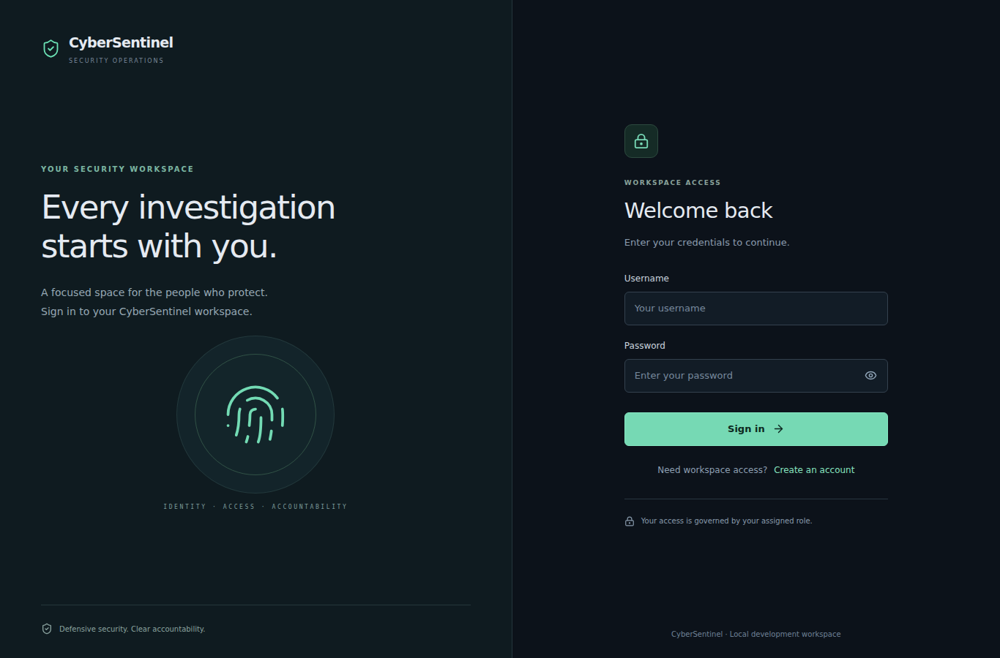
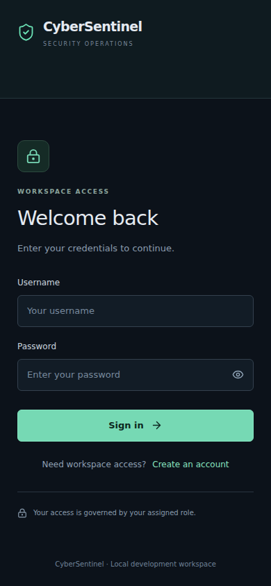
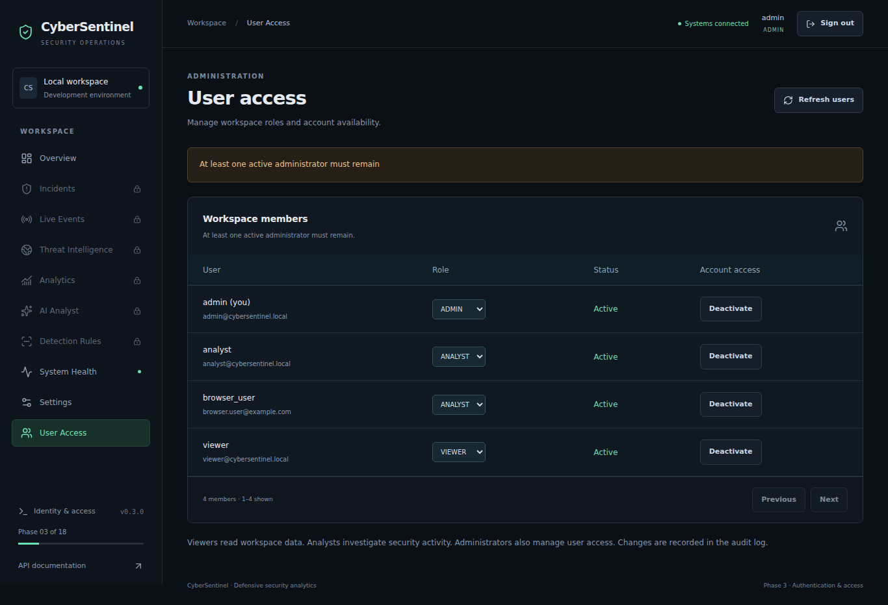

# Phase 3 validation record

Final automated backend/build checks: **26 September 2026 (UTC)**. Live browser checks: **25 September 2026 (UTC)**.

## Results

| Check | Recorded result |
| --- | --- |
| Full pytest suite against migrated PostgreSQL schemas | **128 passed**, no skips, 14.07 seconds in the final run |
| Python lint, `ruff check app scripts tests` | Passed |
| React production build, `npm run build` | Passed; 1,955 modules transformed |
| Existing Phase 2 to Phase 3 upgrade | Passed; existing user ID, password hash and role preserved |
| Migration downgrade/upgrade round trip | Passed in disposable test schemas |
| Alembic model/migration comparison | Passed; no new upgrade operations detected |
| Native PostgreSQL enums, JSONB, INET, constraints and relationships | Existing integration tests passed |
| Detection-rule seed repeated | Ten inserted on first run, zero on second |
| Existing demo-user seed repeated | Three inserted on first run, zero on second; passwords preserved |
| Real FastAPI health, schema status, `/docs`, OpenAPI | HTTP 200 |
| Vite frontend and same-origin API proxy | HTTP 200 and live database connectivity |
| Chromium desktop/mobile browser flow | Passed; no JavaScript page errors |

The test count includes all existing tests plus Phase 3 tests. A test-only migration fixture initially used a string shorter than the existing password-hash constraint allowed. It was corrected to use a real bcrypt hash; the final migration preservation test passes.

One warning remains from the existing FastAPI/Starlette TestClient: its `httpx` integration is deprecated in favor of `httpx2`. The test suite passes with the established locked `httpx` version. No extra HTTP dependency was introduced solely to suppress this warning.

## Browser verification

The browser used the actual React application, Vite proxy, FastAPI authentication endpoints, and migrated database, rather than mocked API responses. Automated assertions covered:

1. Anonymous `/admin` redirects to login.
2. Invalid credentials show the generic failure message.
3. VIEWER login returns to `/admin` and shows the forbidden screen, without an admin navigation item.
4. The protected overview loads; reloading rotates the refresh cookie and recovers the session.
5. The refresh cookie is HTTP-only, Strict SameSite, and scoped to `/api/auth`; JavaScript cannot read it. Local Storage and Session Storage contain no credentials.
6. A second tab restores the same account. Signing out in one tab signs out the other and clears the cookie.
7. Registration creates a real user and returns to login.
8. ADMIN lists accounts, promotes the new user, deactivates/reactivates it, and sees the last-active-admin safeguard when trying to deactivate themselves.
9. The 390 × 844 login page has no horizontal overflow. The desktop page was checked at 1366 × 900.

The browser runtime initially failed because its bundled font configuration pointed to unavailable paths. Pointing the validation browser to the runtime's installed font configuration resolved this without changing application code or disabling browser web security.

Desktop login:



Mobile login:



Administrator screen with the last-admin safeguard:



These screenshots use disposable test accounts, not production identities or security incidents.

## Database and security checks

Tests cover default-VIEWER registration, duplicate normalized identities, bcrypt storage/verification, rejected weak passwords, generic login failures, active-user checks, access/refresh token separation, expiration, malformed/tampered signatures, required claims, issuer/audience/algorithm validation, all role combinations, current DB roles overriding stale token claims, admin changes, and last-active-admin protection.

Refresh rotation, reuse revocation, current-session logout, all-session revocation on deactivation, and non-revival after reactivation are exercised. Tests also cover CSRF/origin checks, credentialed CORS, Secure cookies in production mode, rate limits, no credential leakage in responses/audit snapshots, recoverable audit failures (including a real failed PostgreSQL insert), and bootstrap idempotency.

## Validation environment and limits

- Python 3.12.14 with the project's locked requirements; PyJWT 2.15.0 is the new dependency.
- PostgreSQL 17.5 provided by PGlite 0.3.15 and its socket adapter, reached through Psycopg/SQLAlchemy. This is an embedded PostgreSQL engine, not SQLite. Disposable schemas isolated the integration tests.
- The external validation harness disabled Psycopg's automatic prepared-statement threshold to accommodate the embedded adapter's shared connection behavior. This adjustment is **not** in the application, dependency locks, Docker setup or delivered test fixtures.
- Node 24.19.0 and the existing Vite dependencies; a Chromium 153 browser controlled by Playwright for live UI checks. Browser/embedded-database tooling is validation-only and is not added to application dependencies.
- Docker Desktop, native PostgreSQL server processes and Windows PowerShell are unavailable in this execution environment. The Windows Compose stack and PowerShell scripts were not executed here. Your previous screenshot established the Phase 2 Windows services as healthy; Phase 3 must still be verified there with the supplied commands.
- Separate-database creation/deletion by the existing runner remains covered by its safety unit tests; the embedded validation used isolated schemas. Run `python -m scripts.run_database_tests` inside your backend container for native PostgreSQL verification.
- Parallel database-session stress testing and production security assessment were not performed. The locking implementation is deliberate, but this report does not claim production load or attack-resistance measurements.

## Confirm on Windows

Follow [PHASE3.md](PHASE3.md) to apply the update, rebuild, migrate and create the first administrator. Then run:

```powershell
docker compose ps
docker compose exec backend alembic current
docker compose exec backend alembic check
docker compose exec backend python -m scripts.run_database_tests
docker compose exec backend ruff check app scripts tests
docker compose exec frontend npm run build
powershell -NoProfile -ExecutionPolicy Bypass -File .\scripts\Verify-Phase3.ps1 -Username admin
```

Expected: three healthy services, migration `0002_auth_sessions`, no model drift, **128 tests passing**, a successful frontend build, and successful authenticated HTTP checks. Repeat the verification script with ANALYST and VIEWER usernames. Check `/login`, `/admin`, reload and sign-out manually in your browser.
