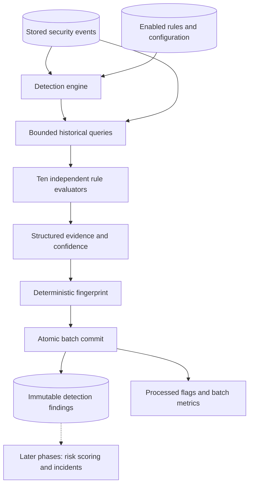

# Phase 6 — Cybersecurity detection engine

Merge `CyberSentinel-Phase6-Update.zip` into the existing Phase 5 project root. The ZIP contains complete new/updated files at their existing relative paths, without an enclosing folder. Preserve your actual `.env`, users, event data and `POSTGRES_PORT=15432`. No dependency or frontend change is needed. **Apply the new Alembic migration before running detection.**

Phase 6 produces immutable **detection findings**. A finding says that observed behavior matched a rule; it is not a confirmed attack or an incident. No risk scores, incident/evidence rows, response recommendations, external intelligence calls or AI analysis are created.

## Architecture



| Component | Location | Responsibility |
| --- | --- | --- |
| Findings model | `backend/app/models/detection_finding.py` | Findings, evidence, severity snapshot, unique fingerprint |
| Migration | `backend/alembic/versions/0003_detection_findings.py` | Findings table, constraints and query indexes |
| Rule contract | `backend/app/detection/base.py` | Shared pure evaluator and structured `DetectionMatch` |
| Configuration | `backend/app/detection/configuration.py` | Strict per-rule settings and backwards-compatible defaults |
| Rule modules | `backend/app/detection/rules/` | One implementation per CS-001 through CS-010 |
| Helpers | `backend/app/detection/utils/` | Rolling windows, historical baselines, Haversine distance and fingerprints |
| Reputation interface | `backend/app/detection/reputation.py` | Independent synthetic indicator provider, no network |
| Orchestrator | `backend/app/detection/engine.py` | Rule snapshot, evaluation, atomic persistence, counters and rollback |
| Repository | `backend/app/repositories/detection_repository.py` | Bounded queries, locking, deduplication and finding/statistics queries |
| API | `backend/app/routes/detection.py` | Existing JWT/RBAC, run/read/configuration routes |
| CLI | `backend/scripts/run_detection.py` | Trusted local runner and dry-run preview |
| Evaluation | `backend/scripts/evaluate_detections.py` | Optional ground-truth comparison, outside runtime detection code |

Existing event/rule models, sessions, enum types, authentication dependencies, ingestion and the Phase 4 generator are reused. `get_events_in_window` centralizes context queries. Rule implementations perform no database writes and never import the simulator or evaluation script.

## Rules and defaults

Existing database settings take precedence. Phase 2 seeded some values differently from the illustrative Phase 6 prompt; these values are preserved rather than silently retuned.

| Rule | Default trigger and grouping | Evidence |
| --- | --- | --- |
| CS-001 Brute force | At least **5** `LOGIN_FAILED` events in **120 s**, same source IP and username | Attempts, account/source, threshold, times and IDs |
| CS-002 Password spraying | At least **8** qualifying usernames in **300 s**, same source IP; each qualifying account has at most **3** failures in the window | Total/qualifying accounts, attempts, bounded username list |
| CS-003 Impossible travel | Adjacent successful logins for one user, at least **500 km** apart, within **7200 s**, requiring **more than 900 km/h** | Coordinates, supplied city/country, distance, elapsed hours, required speed |
| CS-004 Unusual login | Successful login outside **08:00–20:00 Asia/Kolkata**, unless adequate historical activity supplies a baseline | Local time, explicit timezone, expected hours, baseline source/count, device |
| CS-005 Privilege escalation | Successful `PRIVILEGE_CHANGE` from outside configured privileged roles into **ADMIN**, without a nonempty approval reference by default | Previous/new role, target, actor, approval reference |
| CS-006 Port activity | At least **20** unique destination ports in **60 s**, same source and destination IP | Port count/list, destination, log count and times |
| CS-007 Sensitive access | At least **500** record accesses in **1200 s**, same username; optional historical baseline can raise the threshold | Record-access total, log-row total, resource types and baseline calculation |
| CS-008 Suspicious IP | Independent local provider score at least **75**; three synthetic indicators have score **92** | Indicator, score, explicit synthetic provider attribution |
| CS-009 Access denied | At least **10** `ACCESS_DENIED` events in **300 s**, same username and source IP | Denial count, resource paths, times and IDs |
| CS-010 API activity | At least **200** `API_REQUEST` events in **60 s**, same source IP by default; optional grouping by username | Request count, endpoint list, response-code distribution and baseline calculation |

CS-001/002/006/007/009/010 use inclusive trailing windows and emit when the condition crosses from below to at/above its threshold. A sustained above-threshold burst does not generate another finding for every request. It can produce another finding after the observed condition falls below threshold or after a gap exceeding the window. Findings capture the **threshold-crossing evidence**, not the eventual peak of a continuing burst. Incident grouping and later evidence accumulation belong to subsequent phases.

CS-002 counts accounts with few attempts separately from brute force. CS-006 is passive analysis of supplied logs. CS-005 treats `administrator` and `ADMIN` as the same privileged role; approval references are taken from supplied logs, not independently verified. Its wording requests review, not a compromise verdict.

CS-007 supports `SENSITIVE_RECORD_ACCESS` and sensitive `FILE_ACCESS` records for compatibility with the earlier seed. A valid integer `raw_data.record_count` is used first, then the length of a valid `record_ids` list, otherwise one access per log. Counts represent access operations, not guaranteed distinct records. No record payloads are copied into findings.

CS-003 uses `raw_data.geo.latitude/longitude`. Missing/invalid coordinates skip the pair safely. Equal-time distant logins report `simultaneous_logins=true` and a null numeric speed, avoiding Infinity in JSON. Only adjacent successful logins are compared; an intervening login without usable coordinates breaks the pair. VPNs, shared accounts and inaccurate geolocation remain possible explanations.

CS-008's independent local set is `192.0.2.44`, `198.51.100.73`, `203.0.113.18`. It does not inspect labels or query the threat-intelligence table. These static development entries do not expire. The provider interface supports optional expiry, which is checked against processing time when configured. The legacy `require_unexpired_cache` setting controls this check; it does not enable an external cache/API.

### Historical baselines

- **Login hours:** with at least 20 prior successful login events on earlier local calendar days within 30 days, use the central 80% of observed login hours plus one hour of padding. Otherwise use organization hours. Current-day events are excluded. Organization hours support overnight shifts; historical inference is a simple contiguous interval and is not a sophisticated shift model.
- **Sensitive access:** after at least 7 active completed UTC days within 14 days, calculate the median daily record-access count. The effective threshold is `max(record_threshold, ceil(median * baseline_multiplier))`.
- **API requests:** after the same history requirement, calculate each completed UTC day's peak request count in UTC-aligned buckets of `window_seconds`, then take their median. The effective threshold is `max(request_threshold, ceil(median_peak * baseline_multiplier))`. Current detection still uses rolling windows; historical bucket boundaries are a documented approximation.
- Volume defaults: `baseline_enabled=true`, `baseline_days=14`, `minimum_baseline_days=7`, `baseline_multiplier=5`. Disable the baseline explicitly for fixed-threshold tuning. Insufficient history uses the configured threshold, and the evidence says which method was used.

Baselines use supplied behavior, not approved-benign labels. Historical attacks can contaminate them. These explainable development heuristics are not a calibrated anomaly model. Default seven-day generated data generally has fewer than seven prior completed days, so volume rules use their configured thresholds.

### Configuration validation

`PATCH /api/detection-rules/{rule_id}` merges supplied configuration keys into the existing object, validates the complete result, then persists defaults and an audit record. Unknown keys, wrong types, invalid timezones, negative thresholds, unsupported event types and inverted baseline limits are rejected with 422. Configuration values are not interpreted as SQL or Python.

Window limits are generally 1–86400 seconds (travel allows up to 604800). Count thresholds must be positive and within documented schema bounds. Login hours are 0–23 / 0–24; baseline windows are bounded. The code in `configuration.py` gives every exact bound. The old CS-001 `multiple_users_escalation_threshold` key is accepted for compatibility but reserved: CS-001 groups per account, CS-002 handles multiple accounts, and Phase 6 does not escalate rule severity.

Changing rules does not clear processed flags or rewrite old findings. Use `--replay` to apply current settings to stored history. Disabling a rule means it does not participate in subsequent passes; re-enabling it requires replay to examine events processed while it was disabled.

## Findings, confidence and deduplication

The new table uses the existing UUID primary-key convention and `severity_level` PostgreSQL enum. It contains:

| Field group | Columns |
| --- | --- |
| Identity | `id`, unique `finding_id`, `detection_rule_id` foreign key |
| Meaning | `title`, `description`, severity snapshot, integer `confidence` 0–100 |
| Entity | `source_ip` (INET), `username`, `entity_key` |
| Evidence | `primary_event_id` foreign key, JSONB `evidence_event_ids`, JSONB `evidence_data`, positive `event_count` |
| Time | timezone-aware `first_seen`, `last_seen`, database `created_at` |
| Idempotency | unique, 64-character hexadecimal `fingerprint` |

Findings are immutable through the application: there is no finding update/delete endpoint, status workflow or mutable `updated_at` field. A readable ID is `FIND-<event-date>-<full UUID hex>`; uniqueness is enforced in PostgreSQL. Referenced rules and primary events use `ON DELETE RESTRICT`.

A canonical JSON sequence containing the detector version, rule ID, entity tuple and **threshold/primary anchor's producer event ID** is SHA-256 hashed. The anchor is evidence of the logical detection. PostgreSQL `ON CONFLICT (fingerprint) DO NOTHING` supplies atomic duplicate protection. Configurations and severities are not part of that key; replay never rewrites an existing finding, even if settings change. The evidence stores the effective configuration used at creation; the nested `rule` API object shows the current rule definition.

Evidence retains at most 100 event IDs by default, including the anchor, plus bounded attributes, aggregate counts, time bounds and the effective configuration. `event_count`, `evidence_total` and `evidence_truncated` distinguish total contributing log rows from retained references. The repository verifies retained IDs exist before insertion; the primary reference is also enforced by a database foreign key. JSONB reference arrays are not foreign keys. There is no event-deletion feature; direct SQL deletion outside the application can invalidate non-primary references.

For volume/count rules, confidence is `min(95, round(75 + 20 * log2(observed / threshold) / 3))` after the threshold is reached: 1× is 75, 2× about 82, and 8× or more is 95. Other explicit heuristics are 90 for impossible travel, 85 for unapproved privilege change, 95 for an exact synthetic-indicator match, and 70/80 for configured/historical unusual hours. Confidence describes rule-match strength, **not probability of compromise and not risk**. Severity is copied from the database rule without asset weighting or escalation.

## Processing and transaction semantics

1. Take a PostgreSQL transaction-level advisory lock and load the enabled rule/configuration snapshot for the run.
2. Claim at most `DETECTION_BATCH_SIZE` events in `timestamp ASC, id ASC` order using `FOR UPDATE SKIP LOCKED`.
3. Query bounded context by event type, entity and time. Both processed and unprocessed historical events can be evidence.
4. Evaluate every enabled rule, validate references, insert findings, mark the claimed events processed and write three batch-level metrics in one transaction.
5. Commit; repeat if requested. A rule/query/evidence/audit failure rolls back the current batch. Prior committed batches remain.

The advisory lock serializes batches across competing engine workers and rule edits; a competing request receives 409 and can retry. This favors chronology over parallel throughput. Lock release is automatic on commit/rollback/disconnect. There is no distributed queue or background daemon.

`processed=true` means the event has been evaluated against the enabled rules for that pass. It does not remove the event from historical lookbacks. Missing metadata can lead a rule to evaluate and safely skip an event. Detection changes no other event field and never deletes events.

For late-arriving logs, relevant already-processed anchors after the incoming event are reevaluated within each rule's bounded lookahead. New evidence may establish an earlier threshold crossing with a different anchor; that can create another legitimate immutable finding. Phase 6 does not merge overlapping findings. A full replay scans each anchor once, avoiding redundant future-anchor checks.

A run uses a `created_at` upper bound captured at start and a chronological keyset cursor. `--until-empty` finishes this eligible pass, subject to `DETECTION_MAX_BATCHES`; it does not chase concurrent arrivals forever. Concurrent commits or older timestamps arriving after the cursor can remain for the next invocation. Inspect both `complete` and `unprocessed_events`.

A normal repeat after success evaluates zero queued events and creates zero findings. `--replay` also evaluates processed events and reports matching fingerprints as duplicates. It does not reset flags. A selected `--rule` pass can persist findings but **never marks events processed**, because the other enabled rules have not all run. Dry runs persist no findings, flags, metrics or audits. Use `--replay --dry-run` to preview already-processed history.

If a connection fails around commit acknowledgement, the batch's outcome may be uncertain rather than guaranteed rolled back. Retry and inspect stored results; fingerprint uniqueness makes retries safe.

### Limits, metrics and indexes

| Optional environment variable | Default | Bounds / purpose |
| --- | ---: | --- |
| `DETECTION_BATCH_SIZE` | 500 | 1–1000; default claimed batch size |
| `DETECTION_MAX_BATCHES` | 100 | 1–1000; bounds one run even with `until_empty` |
| `DETECTION_MAX_CONTEXT_EVENTS` | 50000 | 1000–200000 per rule/batch; exceeding it fails the batch visibly |
| `DETECTION_EVIDENCE_LIMIT` | 100 | 2–200 retained event references per finding |

These defaults work with the existing `.env`. If context exceeds its cap, reduce the batch size or review the lookback/context setting; nothing is silently truncated for rule evaluation. The bounded evidence list is separate from the complete evaluated context. Very active entities may need configuration changes or later database-side aggregation. No claim of unlimited SIEM scale is made.

`system_metrics` receives three rows per committed batch: `detection_events_processed`, `detection_findings_created`, `detection_duration_ms`, with run ID and batch number in metadata. Metric duration covers batch work before the final commit; the run response measures total elapsed execution including commits. Dry runs write none. API-triggered non-dry runs record one `DETECTION_RUN_TRIGGERED` audit at the first committed batch, or for an empty run. Its payload records invocation options; complete outcome totals are returned by the runner and can be reconstructed from batch metrics. Rule changes record old/new settings once per update.

The migration adds event indexes on `(processed,timestamp,id)`, `(event_type,timestamp)`, `(source_ip,timestamp)` and `(username,timestamp)`. Existing single-column indexes are retained. Finding indexes cover rule/time, last seen, severity, source and username, plus unique identifiers/fingerprint. There is no new enum and no `create_all()` migration path. Only CS-008's untouched legacy description is corrected to describe the synthetic provider; existing configuration edits are preserved.

## API contracts

| Method | Endpoint | Access |
| --- | --- | --- |
| POST | `/api/detection/run` | ADMIN, ANALYST |
| GET | `/api/detections` | ADMIN, ANALYST, VIEWER |
| GET | `/api/detections/{finding_id}` | ADMIN, ANALYST, VIEWER |
| GET | `/api/detection/stats` | ADMIN, ANALYST, VIEWER |
| GET | `/api/detection-rules` | ADMIN, ANALYST, VIEWER |
| PATCH | `/api/detection-rules/{rule_id}` | ADMIN only |

The existing rule-list response and limit/offset contract are retained; the route is now available in every environment rather than being a development-only database check. Database inspection itself remains development/test only. All detection routes use existing JWT/session authentication and `Cache-Control: no-store`.

Run body fields: optional `batch_size` (1–1000), `until_empty`, `rule`, `dry_run`, `replay`; booleans default false. An empty body uses defaults. The response reports actual elapsed milliseconds, evaluated/newly processed events, matched/created/duplicate findings, enabled rule count, per-rule match counts, batches, remaining events, complete/error state and at most 20 previews. 401/403 enforce authentication/roles; 409 means lock contention; 422 means invalid input/configuration or context limits; failures return a sanitized response with confirmed prior-batch progress.

List filters: `limit` default 50/max 500, `offset` default 0/max 1,000,000, `rule_id`, `severity`, `source_ip`, `username`, timezone-aware `start_time`/`end_time`. Time filters apply inclusively to `last_seen`. Sort is newest `last_seen` first with UUID tie-breaking. Counts/items are separate read-committed queries and may change during concurrent writes. Stats return finding totals grouped by rule/severity and the current unprocessed event count. No incident objects are exposed.

## Windows PowerShell and Docker

From your existing project root, after merging the update:

```powershell
Set-Location 'C:\Users\saiya\OneDrive\Documents\Projects\cybersentinel'
docker compose up --build -d --wait --wait-timeout 180
docker compose exec backend alembic upgrade head
docker compose exec backend alembic current
docker compose exec backend python -m scripts.seed_detection_rules
docker compose ps
```

Expected head: `0003_detection_findings`. Seeding inserts only missing rules; it preserves existing thresholds and enable/disable edits. All three containers should be healthy. Health checks verify API/database connectivity; `/api/database/status` additionally verifies schema/head readiness. Do not generate another migration: this update already includes it. No new dependency installation is needed; the existing Windows dependency lock already includes `tzdata`.

Run the exact requested 10,000-event workflow:

```powershell
docker compose exec backend python scripts/generate_demo_data.py `
  --count 10000 --seed 42 --scenario mixed --output data/detection_test.jsonl

docker compose exec backend python scripts/ingest_events.py `
  --file data/detection_test.jsonl --batch-size 500

docker compose exec backend python scripts/run_detection.py --until-empty

docker compose exec backend python scripts/run_detection.py --until-empty

docker compose exec backend python scripts/run_detection.py --replay --until-empty

docker compose exec backend python scripts/evaluate_detections.py
```

Reuse an existing generated file if it already exists; add `--overwrite` only when intentionally replacing that file. Input filenames do not change producer IDs. Existing matching event IDs are correctly skipped by ingestion. Existing unrelated data is preserved, so your counts can differ from isolated benchmark counts. Do not clear development tables to force a benchmark result.

The default 95%-normal 10,000-event sample cannot fit the generator's minimum 500-event API-burst episode after reserving other scenarios. To include all ten detectable behaviors, use a separate **92%-normal** dataset:

```powershell
docker compose exec backend python scripts/generate_demo_data.py `
  --count 10000 --seed 42 --scenario mixed --normal-ratio 0.92 `
  --output data/detection_all_rules.jsonl

docker compose exec backend python scripts/ingest_events.py --file data/detection_all_rules.jsonl

docker compose exec backend python scripts/run_detection.py --until-empty
```

This dataset has different IDs and adds rows to your development database. Its benchmark in an isolated schema produced findings for every rule; exact counts are in the validation report.

### Preview, individual rules and local Python

```powershell
docker compose exec backend python scripts/run_detection.py --dry-run --replay --until-empty

docker compose exec backend python scripts/run_detection.py `
  --rule CS-001 --replay --until-empty --batch-size 250

# The module entry point is also supported:
docker compose exec backend python -m scripts.run_detection --until-empty
```

The local CLI is restricted to `APP_ENV=development` or `test` with trusted database credentials. HTTP endpoints enforce role permissions independently. Exit codes: 0 means the eligible pass completed; 2 means more work remains beyond the requested batch/run bound; 1 means a failure (earlier commits may remain) or forbidden environment. Invalid arguments use argparse exit 2. Inspect `$LASTEXITCODE` immediately when scripting.

Without the backend container, reuse the existing backend virtual environment and published PostgreSQL port:

```powershell
Set-Location 'C:\Users\saiya\OneDrive\Documents\Projects\cybersentinel'
docker compose up -d db
Set-Location .\backend
.\.venv\Scripts\python.exe -m alembic upgrade head
.\.venv\Scripts\python.exe -m scripts.seed_detection_rules
.\.venv\Scripts\python.exe scripts/run_detection.py --until-empty
.\.venv\Scripts\python.exe scripts/evaluate_detections.py
```

Keep local `POSTGRES_HOST=127.0.0.1`, `POSTGRES_PORT=15432`. Compose still supplies `db:5432` internally. If your virtual environment is missing, create it with `py -3.12 -m venv .venv` and install the existing `requirements-dev.txt`.

## SQL verification

From the project root:

```powershell
docker compose exec db psql -U cybersentinel -d cybersentinel
```

Use your existing database/user names if customized. Inside psql:

```sql
\dt
SELECT version_num FROM alembic_version;

SELECT processed, COUNT(*) FROM security_events GROUP BY processed;

SELECT f.finding_id, r.rule_id, r.name, f.severity, f.confidence,
       f.source_ip, f.username, f.first_seen, f.last_seen, f.event_count
FROM detection_findings f
JOIN detection_rules r ON f.detection_rule_id = r.id
ORDER BY f.created_at DESC;

SELECT r.rule_id, r.name, COUNT(*) AS findings
FROM detection_findings f
JOIN detection_rules r ON f.detection_rule_id = r.id
GROUP BY r.rule_id, r.name ORDER BY findings DESC;

SELECT COUNT(*) AS findings, COUNT(DISTINCT fingerprint) AS unique_fingerprints
FROM detection_findings;

SELECT COUNT(*) AS missing_evidence_references
FROM detection_findings f
CROSS JOIN LATERAL jsonb_array_elements_text(f.evidence_event_ids) AS refs(event_id)
LEFT JOIN security_events e ON e.event_id = refs.event_id
WHERE e.id IS NULL;

SELECT finding_id, jsonb_pretty(evidence_data)
FROM detection_findings ORDER BY created_at DESC LIMIT 1;

SELECT metric_name, SUM(metric_value) AS total
FROM system_metrics WHERE metric_name LIKE 'detection_%'
GROUP BY metric_name;

SELECT COUNT(*) FROM incidents;
SELECT COUNT(*) FROM incident_evidence;
\q
```

Expected: no remaining queued events after a complete full pass, equal finding/fingerprint counts, zero missing evidence references, and unchanged incident tables. On an initially empty installation the incident counts are zero. Replays can add metrics/audits while leaving finding counts unchanged.

## API and Swagger verification

Authenticate using an existing ADMIN or ANALYST username; passwords are entered through a masked prompt:

```powershell
$credential = Get-Credential -Message 'Existing CyberSentinel username and password'
$body = @{ username = $credential.UserName; password = $credential.GetNetworkCredential().Password } | ConvertTo-Json
$login = Invoke-RestMethod -Method Post -Uri 'http://localhost:8000/api/auth/login' `
  -Headers @{ 'X-CSRF-Guard' = '1' } -ContentType 'application/json' -Body $body
$headers = @{ Authorization = "Bearer $($login.access_token)" }
Remove-Variable body, credential

Invoke-RestMethod 'http://localhost:8000/api/detection/stats' -Headers $headers
$page = Invoke-RestMethod 'http://localhost:8000/api/detections?limit=5&rule_id=CS-001' -Headers $headers
$page | ConvertTo-Json -Depth 12
if ($page.items.Count -gt 0) {
  Invoke-RestMethod "http://localhost:8000/api/detections/$($page.items[0].finding_id)" -Headers $headers
}

Invoke-RestMethod -Method Post 'http://localhost:8000/api/detection/run' `
  -Headers $headers -ContentType 'application/json' `
  -Body '{"batch_size":500,"until_empty":true}'

# ADMIN only; deliberately changes this rule's threshold:
Invoke-RestMethod -Method Patch 'http://localhost:8000/api/detection-rules/CS-001' `
  -Headers $headers -ContentType 'application/json' `
  -Body '{"configuration":{"failed_attempt_threshold":7,"window_seconds":180}}'
```

Open `http://localhost:8000/docs`. Execute `/api/auth/login` with `X-CSRF-Guard: 1`, copy only the access token into **Authorize → BearerAuth**, and inspect the six detection/rule endpoints. Try a dry run and inspect the typed response, then list a finding and its evidence. VIEWER should read findings/rules but receive 403 for runs/updates; ANALYST may run detection but receives 403 for rule changes. Missing authentication returns 401. Swagger's interactive assets need the same CDN access as earlier phases.

## Tests and evaluation

```powershell
docker compose exec backend python -m scripts.run_database_tests
docker compose exec backend ruff check .
docker compose exec backend alembic check
Invoke-RestMethod http://localhost:8000/api/system/health
Invoke-RestMethod http://localhost:8000/api/database/status
```

The existing test runner creates its own temporary PostgreSQL database and isolates schema migrations; it does not delete development data. Plain pytest skips database tests unless a separate `TEST_DATABASE_URL` is supplied. See [PHASE6_VALIDATION.md](PHASE6_VALIDATION.md) for actual counts, runtimes and environment limits.

`evaluate_detections.py` is a read-only development utility and the sole new code allowed to inspect `raw_data.simulation`. It is never imported by runtime detection code. It compares distinct `(expected rule, scenario_id)` pairs with findings whose retained evidence overlaps that scenario. It reports expected/detected/missed scenarios and findings with no matching scenario label. Scenario recall is detected/expected; finding-label agreement is agreeing findings/evaluated findings. Label agreement is not asserted to be real-world precision. Overlapping behavior and capped evidence complicate interpretation. Normal activity and malware-alert scenarios are excluded from expected scenario pairs because they have no dedicated Phase 6 rule. The script evaluates all labeled data in the database; use isolated datasets for controlled comparisons.

A labeled scenario can legitimately be missed when its event count is below the configured threshold. The measured default datasets each contained one eight-denial scenario below the retained CS-009 threshold of ten. Those misses are reported rather than tuning settings after observing the labels.

[PHASE6_FILES.md](PHASE6_FILES.md) lists every complete created/modified file. Phase 7 has not been started.
