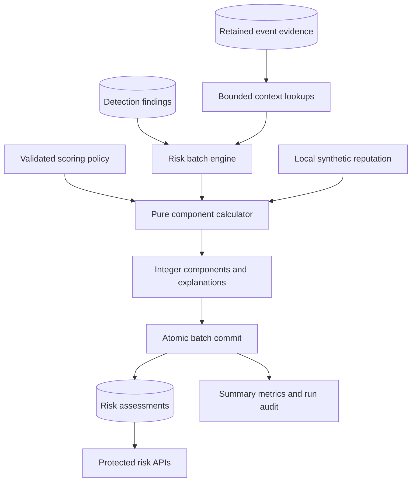

# Phase 7 — Explainable risk scoring

This update scores existing detection findings. It adds six deterministic components, PostgreSQL assessments, a migration, authenticated APIs, a development CLI and tests. Existing events, detection evidence, severity, confidence and fingerprints remain unchanged. There is no incident creation, response recommendation, external reputation call, AI or frontend dashboard change.

Merge the incremental archive into your existing project root. Keep your actual `.env`, database volume and all other Phase 1–6 files. No new dependency is required. The exact file list is [PHASE7_FILES.md](PHASE7_FILES.md); measured tests and integration results are in [PHASE7_VALIDATION.md](PHASE7_VALIDATION.md).

## Architecture



| Responsibility | File |
| --- | --- |
| Policy, fixed v1 recipe and configurable sensitivity | `backend/app/risk/config.py` |
| Six pure scoring components and category conversion | `backend/app/risk/components.py` |
| Evidence validation, explicit facts, input hashing and total | `backend/app/risk/calculator.py` |
| Batch transactions, dry runs, rescoring, statistics and audits | `backend/app/risk/engine.py` |
| Bounded finding/event queries, persistence and read queries | `backend/app/repositories/risk_repository.py` |
| ORM model and migration | `backend/app/models/risk_assessment.py`, `backend/alembic/versions/0004_risk_assessments.py` |
| Typed requests/responses and existing JWT/RBAC reuse | `backend/app/schemas/risk.py`, `backend/app/routes/risk.py` |
| Trusted development CLI | `backend/scripts/run_risk_scoring.py` |

The scorer does not import the generator or inspect simulation labels. It retrieves findings irrespective of whether their original detection rule is currently enabled. Disabling a detector does not erase previously observed evidence.

## Formula and category boundaries

Each component is rounded independently to an integer using half-up rounding (`floor(value + 0.5)`). The final score is their sum. Values outside a component's range cause an error instead of being silently concealed. The total is guarded and capped at 0–100. Configuration validates that maximums sum to 100. The fixed maximums are part of algorithm **v1**; changing the recipe requires a deliberate version/code/migration change.

| Component | Maximum | v1 calculation |
| --- | ---: | --- |
| Detection severity | 25 | LOW=5, MEDIUM=12, HIGH=20, CRITICAL=25, using the finding's stored severity |
| Detection confidence | 15 | `confidence × 15 / 100` |
| Behavioral intensity | 20 | Rule-specific anomaly/exceedance calculation; authentication follow-up bonus stays within this cap |
| Event frequency/breadth | 15 | Time compression or distinct protected-resource breadth; no second use of the threshold count |
| Asset/action sensitivity | 15 | Highest applicable configured service, action, role, endpoint, account or destination mapping |
| Reputation context | 10 | Local score <25=0, 25–74=4, 75–89=7, 90–100=10 |

| Score | Risk level |
| --- | --- |
| 0–24 | LOW |
| 25–49 | MEDIUM |
| 50–74 | HIGH |
| 75–100 | CRITICAL |

The existing `SeverityLevel` enum supplies the four labels without introducing a duplicate PostgreSQL type. `DetectionFinding.severity`, `DetectionFinding.confidence` and `RiskAssessment.risk_score/risk_level` remain distinct attributes. Confidence is match strength; risk is this policy's contextual prioritization. Neither is a calibrated probability of compromise.

## Rule-specific behavior

For count/speed rules, let `r = observed / threshold`. Intensity is `20 × min(1, max(0, log(r) / log(full_ratio)))`, with `full_ratio=10` by default. At threshold it contributes zero; ten times threshold reaches 20. The threshold comes from **the finding's evidence snapshot**, including Phase 6's effective historical threshold when available. Editing the live detection rule does not reinterpret an old finding.

| Rule | Intensity measure | Independent frequency/breadth | Additional context |
| --- | --- | --- | --- |
| CS-001 Brute force | Failed attempts / threshold | Time compression | Matching successful authentication within the follow-up interval adds up to 4 behavioral points; account/service sensitivity and local reputation |
| CS-002 Password spray | Qualifying account count / threshold | Time compression | Success against a retained or explicitly listed target adds up to 4 points; targeted-account mappings contribute sensitivity |
| CS-003 Impossible travel | Required speed / speed threshold | Zero: elapsed time already contributes to velocity | Distant simultaneous logins receive 20 intensity points without storing infinity; distance/elapsed time are retained |
| CS-004 Unusual login | Circular hours from expected interval, scaled to 20 at 6 hours | Zero for the single login | Uses the stored timezone-aware local login and expected interval, including overnight intervals |
| CS-005 Privilege change | Admin gain=15, other logged role gain=5; missing approval reference adds 5 | Zero for the single change | New role sensitivity: ADMIN/ADMINISTRATOR=15, MANAGER=9; structured roles, not finding titles |
| CS-006 Port activity | Unique port count / threshold | Time compression | Retained ports 22/3389/5432/3306 have default sensitivity 12; destination mappings can raise it |
| CS-007 Sensitive access | Record-access count / effective threshold | Time compression | Effective baseline threshold and record count are distinct from log-event count; sensitive actions default to 12 |
| CS-008 Local indicator | Zero: reputation is scored in its own component | Zero for the indicator-only match | Independent Phase 6 local provider; no reuse of the label or old evidence reputation as a live lookup |
| CS-009 Access denied | Denial count / threshold | `15 × min(1, (distinct_paths − 1) / 9)`, minimum zero | Retained resource paths, including configured administrative prefixes |
| CS-010 API burst | Request count / effective threshold | Up to 10 for time compression plus 5 for the fraction of known HTTP responses that are 4xx/5xx | Endpoint sensitivity, authenticated account, response distribution and diagnostic requests/minute |

Time compression is `1 − min(1, observed_span / configured_window)`, with a floor of zero. Count is not reused in this formula. When there is fewer than two events or zero timestamp span, compression contributes zero because rate cannot be established reliably. API composition ignores `unknown` status entries; absent known responses contribute zero composition points. Error composition can reflect benign failures and is an explicit development heuristic.

Successful-login lookups require `LOGIN_SUCCESS`, a successful status, the same source IP and a known target account, from the finding's `last_seen` through `last_seen + 300 seconds` inclusive. These later events are separate risk context: they do not get appended to the original finding. The breakdown retains their count and up to 20 IDs. Successful authentication does **not** prove account compromise. Missing future logs mean no observed follow-up, not proof that none occurred. Use intentional rescoring after relevant new logs arrive.

Phase 6 emits threshold-crossing findings and freezes their evidence. Phase 7 does not silently replace the finding's original five failures with a later burst's peak of fifty. Its intensity uses the snapshot it actually received. It also does not claim capped retained evidence represents every targeted account, port or path.

## Configurable sensitivity and processing bounds

Default service values include employee-portal=4, files-service=7, records-api=12, identity-service=13, admin-console=15, database=15 and authentication=10. Action defaults include API_REQUEST=4, FILE_ACCESS=7, SENSITIVE_RECORD_ACCESS=12, ADMIN_LOGIN=12 and PRIVILEGE_CHANGE=7, with new-role mappings considered separately. The highest applicable value wins; service/action/role values are not added together.

Administrative and records endpoint prefixes include `/admin`, `/api/admin`, `/records` and `/api/records`. Matching respects path segment boundaries: `/administrator` does not match `/admin`. Query parameters are removed for prefix matching. Account and destination mappings are empty by default: the scorer never guesses that an account is privileged based on its name. These are CyberSentinel development defaults, not universal enterprise ratings.

| Environment variable | Default | Bounds/purpose |
| --- | ---: | --- |
| `RISK_BATCH_SIZE` | 250 | 1–500 findings |
| `RISK_MAX_BATCHES` | 100 | 1–1000 batches per invocation |
| `RISK_MAX_CONTEXT_EVENTS` | 10000 | 100–50000 successful-authentication context rows per batch |
| `RISK_SCORING` | Built-in policy | JSON object parsed and validated as `RiskScoringConfig` |

Existing `.env` files need no changes. To override a policy, a root `.env` line can contain:

```dotenv
RISK_SCORING={"account_points":{"employee014":15},"success_lookahead_seconds":300}
```

Individual mapping fields replace their default mapping when supplied. For example, overriding `service_points` means specifying the complete desired service map; omitted **fields** retain their defaults. Values must be integers 0–15. Changes take effect when the backend/CLI reloads its settings; with Compose, recreate the backend after editing environment settings. Existing v1 scores require `--rescore` to apply a changed policy. Every assessment stores the full policy snapshot and its SHA-256 hash.

Other policy fields include `intensity_full_ratio`, `success_bonus`, `unusual_full_hours`, `denied_resource_full_count`, `administrative_ports`, `administrative_port_sensitivity`, `sensitive_record_points`, `default_service_points`, `service_points`, `action_points`, `role_points`, `endpoint_points`, `account_points` and `destination_points`. See the typed configuration file for bounds. HTTP callers cannot replace scoring policy through a run request.

## Assessment schema, explanations and versioning

| Fields | Meaning |
| --- | --- |
| `id`, `assessment_id` | UUID primary key and unique readable `RISK-YYYYMMDD-<UUID hex>` identifier |
| `detection_finding_id` | Foreign key to the existing finding, with RESTRICT deletion |
| `risk_score`, `risk_level` | Integer 0–100 and exact category |
| `score_version` | Algorithm version, currently `v1` |
| `severity_score`, `confidence_score`, `behavioural_score`, `frequency_score`, `asset_sensitivity_score`, `reputation_score` | Persisted integer components |
| `breakdown` | JSONB containing six `{points,max,reason}` objects plus explicit context, original confidence/severity and configuration snapshot |
| `input_hash`, `config_hash` | Canonical SHA-256 hashes of scoring inputs/policy for reproducibility and change detection |
| `calculated_at`, `created_at` | Timezone-aware calculation/run snapshot time and original insertion time |

PostgreSQL enforces total/component bounds, exact component sum, category mapping, finding/version uniqueness, hash formats and explanation integrity. Each explanation must contain a nonempty reason, the matching numeric component value and correct maximum. Indexes support version/score/time sorting, level filters and calculation time. The unique `(detection_finding_id, score_version)` index also covers finding lookups without a redundant standalone index.

There is **one assessment per finding per algorithm version**. A normal run processes only findings lacking the active version. Repeating it creates zero new rows and reports `already_scored`. Rescoring recalculates using current stored context and policy. If `input_hash` is unchanged, it retains the existing row and timestamp. If input changes, it deliberately updates that version's row while preserving `id`, `assessment_id` and `created_at`; `calculated_at`, hashes, score and breakdown change.

This design **does not retain earlier scores within the same version**. A later algorithm version can create a separate assessment and preserve v1. List/statistics APIs default to v1 to avoid counting several versions of one finding together; `score_version` can select another version. Normal runs do not automatically detect policy changes or newly arrived context for already-scored findings: use `--rescore` deliberately.

## Batch safety, metrics and audits

The engine selects a bounded batch in `(created_at,id)` order, uses a run-start cutoff and a keyset cursor, and retrieves retained events in groups of at most 5,000 IDs. It performs bounded successful-login context queries by source/account pairs. There is no query per evidence event. SQL projects only scoring fields and four bounded metadata values; unrelated raw payloads are not loaded into the scorer. Context over the configured limit fails the batch visibly; reduce batch size or raise the bounded limit rather than silently dropping evidence.

Each risk batch takes its own PostgreSQL transaction-level advisory lock. Simultaneous risk batches receive a retryable 409; the unique finding/version constraint is a second guard. Detection uses a different lock and may continue to create immutable findings; new findings beyond the scorer's cutoff wait for a later run. Native multi-process stress testing is not claimed by the embedded validation.

Assessments, batch metrics and audit progress commit together. A database/provider/logic failure rolls back the current batch; prior batches remain committed and the failure response reports confirmed progress. If commit acknowledgement is lost, inspect/retry because the outcome may be uncertain. Version uniqueness and input hashing make retries bounded and idempotent.

Malformed or missing evidence skips the affected finding with a safe reason and lets valid neighbors proceed. Skipped findings remain unscored. The run reports at most 20 skip details, the total invalid count and `complete=false`; the CLI exits 2. No source evidence is repaired or deleted automatically. Dry runs roll back all work and create no assessments, metrics or audits. Preview lists are limited to 20 findings while run totals cover all evaluated findings.

Three summary metric rows are written per non-dry batch: `risk_findings_scored`, `risk_average_score`, `risk_scoring_duration_ms`, tagged with run ID/batch/version. The metric duration measures batch work before commit; API/CLI duration measures the whole engine invocation. Metric averages are per batch, so aggregate them with the corresponding scored counts rather than averaging averages blindly.

Each non-dry API invocation creates one `RISK_SCORING_RUN_TRIGGERED` audit row. Later batches update its confirmed progress with evaluated, created, updated, unchanged and invalid counts plus rescore/version/configuration metadata. An empty invocation is also audited. CLI calls use trusted local database access and do not impersonate an analyst.

## APIs and permissions

| Method | Path | Permission |
| --- | --- | --- |
| POST | `/api/risk/run` | ADMIN, ANALYST |
| GET | `/api/risk` | ADMIN, ANALYST, VIEWER |
| GET | `/api/risk/stats` | ADMIN, ANALYST, VIEWER |
| GET | `/api/risk/{assessment_id}` | ADMIN, ANALYST, VIEWER |

Run fields: optional `finding`, `rule`, `batch_size`, `until_empty`, `rescore`, `dry_run`. All booleans default false. A normal run processes one batch unless `until_empty=true`; the maximum-batch guard still applies. Response includes actual duration, confirmed create/update counts, already-scored count, invalid/unchanged counts, remaining unscored findings, previews and distribution/average of **valid findings evaluated in this invocation**. An empty repeat's run distribution is zero; use `/api/risk/stats` for persisted totals.

List filters: `limit` (50 default, maximum 500), `offset`, `risk_level`, `minimum_score`, `maximum_score`, `rule_id`, `finding_id`, `source_ip`, `username`, timezone-aware `start_time`/`end_time`, `score_version`. Time filters apply inclusively to `calculated_at`. Sorting is highest risk, then newest calculation, then stable UUID. Counts and page rows are separate read-committed queries and can change during concurrent writes.

Single results include the finding/rule, source/account, detection confidence/severity, all risk components, breakdown, evidence summary, calculation time and version/hashes. Stats contain persisted count, average, maximum and all four risk-level counts. The existing Phase 6 finding response remains compatible; retrieve its risk with `/api/risk?finding_id=FIND-...`.

Missing authentication returns 401, VIEWER run attempts 403, missing requested findings/rules 404, busy batches 409, invalid input/context limits 422 and database/logic failures 503. Existing BearerAuth JWT/session authorization is reused. Risk responses have `Cache-Control: no-store`.

## Exact Windows PowerShell / Docker workflow

After extracting the update into your existing project:

```powershell
Set-Location 'C:\Users\saiya\OneDrive\Documents\Projects\cybersentinel'
docker compose up --build -d --wait --wait-timeout 180
docker compose exec backend alembic upgrade head
docker compose exec backend alembic current
docker compose exec backend python -m scripts.seed_detection_rules
docker compose ps
Invoke-RestMethod http://localhost:8000/api/database/status
```

Expected migration head: `0004_risk_assessments`. Database status should be healthy with `schema_ready=true` and matching migration/expected revisions. Apply the supplied migration, not another autogenerated initial migration. Existing credentials and host port **15432**, if configured previously, stay unchanged; containers still use `db:5432`. Health endpoints retain their earlier meanings; system health's `SELECT 1` alone does not assert migration readiness.

If Phase 6 findings already exist, score them directly:

```powershell
docker compose exec backend python scripts/run_risk_scoring.py --until-empty
docker compose exec backend python scripts/run_risk_scoring.py --until-empty
docker compose exec backend python scripts/run_risk_scoring.py --rescore --until-empty
```

To execute the requested full 10,000-event workflow:

```powershell
docker compose exec backend python scripts/generate_demo_data.py `
  --count 10000 --seed 42 --scenario mixed --output data/risk_test.jsonl

docker compose exec backend python scripts/ingest_events.py --file data/risk_test.jsonl
docker compose exec backend python scripts/run_detection.py --until-empty
docker compose exec backend python scripts/run_risk_scoring.py --until-empty
docker compose exec backend python scripts/run_risk_scoring.py --until-empty
docker compose exec backend python scripts/run_risk_scoring.py --rescore --until-empty
```

Reuse an existing file when present; `--overwrite` only replaces a generated file when you intentionally choose it. The same generator settings/seed/run ID produce the same event IDs, regardless of filename. Previously imported events are therefore skipped correctly. Do not delete your development tables to reproduce isolated validation totals. Counts depend on your existing data and configured rules.

The default 95% normal mix does not fit an API-burst episode within its attack budget. Optional all-rule coverage uses `--normal-ratio 0.92 --output data/risk_all_rules.jsonl`, then the same ingest/detect/score sequence. That dataset adds different event IDs; validation measured it in an isolated schema.

### CLI modes

```powershell
docker compose exec backend python scripts/run_risk_scoring.py --dry-run --rescore --until-empty
docker compose exec backend python scripts/run_risk_scoring.py --rule CS-001 --rescore --until-empty
docker compose exec backend python scripts/run_risk_scoring.py --finding 'FIND-REPLACE-WITH-ACTUAL-ID' --rescore
docker compose exec backend python -m scripts.run_risk_scoring --batch-size 100 --until-empty
```

The six options are `--finding`, `--rule`, `--batch-size`, `--until-empty`, `--rescore`, `--dry-run`. Combining finding and rule applies both filters. Exit 0 means the selected pass completed; 2 means invalid findings or more work remains, or argument parsing failed; 1 means a run/configuration/environment failure. Check `$LASTEXITCODE` immediately when scripting. The trusted CLI requires `APP_ENV=development` or `test`; authenticated HTTP operations use existing role checks in every environment.

For native Python with the existing Windows backend virtual environment:

```powershell
Set-Location 'C:\Users\saiya\OneDrive\Documents\Projects\cybersentinel'
docker compose up -d db
Set-Location .\backend
.\.venv\Scripts\python.exe -m alembic upgrade head
.\.venv\Scripts\python.exe -m scripts.run_risk_scoring --until-empty
.\.venv\Scripts\python.exe -m scripts.run_risk_scoring --dry-run --rescore --until-empty
```

Reuse the existing local PostgreSQL host/port settings. If the virtual environment is absent, create it with `py -3.12 -m venv .venv` and install `requirements-dev.txt` from `backend`. Do not change Docker's internal database host to `localhost`.

## PostgreSQL verification

```powershell
docker compose exec db psql -U cybersentinel -d cybersentinel
```

Use your actual configured user/database if customized. Inside psql:

```sql
\dt
SELECT version_num FROM alembic_version;

SELECT ra.assessment_id, f.finding_id, r.rule_id, f.severity AS detection_severity,
       f.confidence, ra.risk_score, ra.risk_level, ra.score_version, ra.calculated_at
FROM risk_assessments ra
JOIN detection_findings f ON ra.detection_finding_id = f.id
JOIN detection_rules r ON f.detection_rule_id = r.id
WHERE ra.score_version = 'v1'
ORDER BY ra.risk_score DESC, ra.calculated_at DESC;

SELECT risk_level, COUNT(*) AS total, ROUND(AVG(risk_score), 2) AS average_score
FROM risk_assessments WHERE score_version = 'v1'
GROUP BY risk_level ORDER BY average_score DESC;

SELECT COUNT(*) AS unscored
FROM detection_findings f
WHERE NOT EXISTS (SELECT 1 FROM risk_assessments ra
                  WHERE ra.detection_finding_id = f.id AND ra.score_version = 'v1');

SELECT detection_finding_id, score_version, COUNT(*)
FROM risk_assessments GROUP BY detection_finding_id, score_version HAVING COUNT(*) > 1;

SELECT assessment_id, jsonb_pretty(breakdown)
FROM risk_assessments ORDER BY risk_score DESC LIMIT 1;

SELECT metric_name, metric_value, unit, timestamp
FROM system_metrics WHERE metric_name LIKE 'risk_%' ORDER BY timestamp DESC LIMIT 9;

SELECT action, new_value, timestamp FROM audit_logs
WHERE action = 'RISK_SCORING_RUN_TRIGGERED' ORDER BY timestamp DESC LIMIT 3;

SELECT COUNT(*) FROM incidents;
SELECT COUNT(*) FROM incident_evidence;
SELECT COUNT(*) FROM incident_comments;
\q
```

Expected: assessments for every valid eligible finding, zero duplicate finding/version groups, explained scores within bounds and unchanged incident tables. On a new isolated database incident counts are zero. Invalid evidence is reported and remains unscored until corrected through the appropriate upstream process.

## Authenticated API and Swagger verification

```powershell
$api = 'http://localhost:8000'
$credential = Get-Credential -Message 'CyberSentinel username (not email) and password'
$body = @{ username = $credential.UserName; password = $credential.GetNetworkCredential().Password } | ConvertTo-Json
$login = Invoke-RestMethod -Method Post -Uri "$api/api/auth/login" `
  -Headers @{ 'X-CSRF-Guard' = '1' } -ContentType 'application/json' -Body $body
$body = $null
$credential = $null
$headers = @{ Authorization = "Bearer $($login.access_token)" }

Invoke-RestMethod -Method Post -Uri "$api/api/risk/run" -Headers $headers `
  -ContentType 'application/json' -Body '{"until_empty":true}'
Invoke-RestMethod "$api/api/risk/stats" -Headers $headers | ConvertTo-Json -Depth 5
$page = Invoke-RestMethod "$api/api/risk?limit=5&minimum_score=25" -Headers $headers
$page | ConvertTo-Json -Depth 8
if ($page.items.Count -gt 0) {
  $assessmentId = $page.items[0].assessment_id
  Invoke-RestMethod "$api/api/risk/$assessmentId" -Headers $headers | ConvertTo-Json -Depth 10
}
Invoke-RestMethod -Method Post -Uri "$api/api/auth/logout" `
  -Headers @{ Authorization = "Bearer $($login.access_token)"; 'X-CSRF-Guard' = '1' }
$login = $null
$headers = $null
```

Open `http://localhost:8000/docs`, log in through `/api/auth/login` with `X-CSRF-Guard: 1`, and paste the access token into **Authorize → BearerAuth**. Confirm the four risk operations appear. Use an ADMIN or ANALYST for a run; VIEWER should receive 403 when triggering scoring but can read results. Do not paste tokens into screenshots or documentation. Swagger's CDN asset requirement is unchanged from earlier phases.

## Tests

```powershell
docker compose exec backend python -m scripts.run_database_tests
docker compose exec backend ruff check .
docker compose exec backend alembic check
```

The existing test runner creates a separate temporary database and isolates migrations. It does not clear development data. Plain pytest skips PostgreSQL tests if a separate `TEST_DATABASE_URL` is not supplied. See the validation report for what was actually executed in this environment and the native Docker/Windows verification limits.

Phase 7 ends with scored, explainable findings. Incident grouping and response workflow remain Phase 8.
