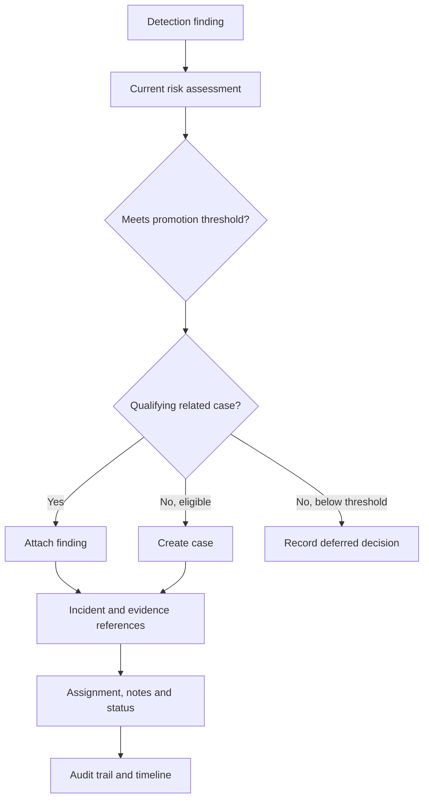

# Phase 8 — Incident management and investigation

This update implements the case-management layer on top of the existing Phase 7 project. Apply its complete changed files to the existing project root. The file list is in [PHASE8_FILES.md](PHASE8_FILES.md); actual test and pipeline results are in [PHASE8_VALIDATION.md](PHASE8_VALIDATION.md).

## Architecture and responsibilities



- `app/incidents/correlation.py` contains the pure policy, identity contexts and deterministic matching.
- `app/incidents/engine.py` orchestrates bounded batches, evidence validation, promotion, attachment, risk aggregation, state, audits and metrics.
- `app/incidents/workflow.py` centralizes status transitions, assignment validation and analyst notes.
- `app/repositories/incident_repository.py` owns parameterized PostgreSQL queries, reference persistence, filtering and paginated investigation projections.
- `app/routes/incidents.py` contains thin authenticated HTTP handlers. The CLI uses the same service.

The four stored layers remain distinct: raw security events, immutable detection findings, versioned risk assessments and analyst-managed incidents. Incident processing never updates the first three layers or their `processed` flags. It does not use simulation labels, AI or external reputation services.

## Database changes

Migration **`0005_incident_workflow`**, following `0004_risk_assessments`, extends the existing tables:

| Table | Change |
| --- | --- |
| `incidents` | Adds `first_seen`, `last_seen`, `resolution_summary`, `risk_score_version`, `risk_updated_at`; indexes `username` and `created_at`; enforces ordered event times |
| `incident_findings` | New reference table with UUID `id`, incident/finding foreign keys, `added_at`, a human-readable `relationship_reason` and JSONB `correlation_data` |
| `incident_processing` | New state keyed by finding UUID, with `risk_input_hash`, `policy_hash`, `outcome`, `evaluated_at`, `context_updated_at` |
| `incident_evidence` | Adds nullable `detection_finding_id` to the existing incident/event references |

Existing incidents are backfilled with `first_seen=last_seen=detected_at`. Their status, risk, assignment, notes and existing evidence are retained. Existing ORM constructors still default the new event times from `detected_at`. Legacy cases without finding links are readable but cannot provide a correlation anchor. Their `risk_score_version` remains null until managed from linked findings.

The original `detection_rule_id` remains the initiating rule; the join table is authoritative for all associated rules. `source_ip` is the primary initiating source. `username` is the first known account; it cannot be used to bridge different known accounts. List filters also search linked findings, so later related IPs and rules remain discoverable.

A finding belongs to **one incident** in this version. Both `(incident_id, detection_finding_id)` and `detection_finding_id` are unique. Case/finding links use `RESTRICT` foreign keys, preventing direct deletion of a linked case or finding. No delete endpoint exists. The previous behavior for unlinked legacy incidents remains compatible.

Incident evidence stores event foreign keys, one originating finding reference and a small `reference_only` marker. The existing incident/event/type uniqueness prevents duplicate event entries when findings share an event. All contributing findings remain in `incident_findings`; a shared event's evidence row identifies its first attachment. Full log payloads are not copied.

## Eligibility and correlation

Only findings with the active Phase 7 algorithm's assessment (`v1`) are considered. The default promotion threshold is **50**. Risk 49 remains a finding unless it correlates with an existing case; risk 50 and 90 are eligible. Unscored findings wait for risk scoring. Targeting an unscored finding explicitly returns 422.

Eligible findings are evaluated before lower-risk findings, then by `first_seen ASC, id ASC` within each group. This lets lower-risk evidence join a case created in the same pass. It does not alter Phase 6's chronological event processing.

The matching score is a **correlation score**, never a new risk score:

| Shared context | Points |
| --- | ---: |
| Same nonempty username | 3 |
| Same source IP | 3 |
| Same known primary-event device | 2 |
| Related rule | 2 |
| Combined case/event span within the window | 2 |

The minimum score defaults to **8**, and **at least two identity attributes** from username/IP/device must match. Time or severity alone can never create a link. Contradictory known account names reject the case, including when an earlier event had no username. Unknown/empty device markers do not count.

Authentication/access rules CS-001/002/003/004/005/009 are related. A rule is related to itself. CS-008 is supporting reputation context for any rule. Other rule pairs gain no family points. Matching username plus IP can meet the threshold even across rule families; a shared IP alone cannot.

The full combined span from the earliest first-seen to the latest last-seen must fit **60 minutes** by default. This prevents successive small overlaps from creating a case that expands indefinitely. A single finding with a longer evidence span may create its own case, but cannot bypass the correlation-window check to absorb more findings.

When several cases qualify, choose the highest correlation score, then nearest event-time gap, then earliest case creation time and UUID. Matching reasons, contributing factors, matched finding ID, threshold and window are persisted on the link. Candidate queries filter by identity, status and timestamps; exceeding the configured bound fails the current batch explicitly.

## Risk, confidence, titles and descriptions

`incident.risk_score = MAX(current linked v1 risk scores)`. There is **no correlation bonus**. Severity uses the existing Phase 7 categories: LOW 0–24, MEDIUM 25–49, HIGH 50–74, CRITICAL 75–100. Confidence is the maximum linked detection confidence and remains a separate field.

Titles use the initiating finding's deterministic title and account/IP, bounded to 255 characters. Descriptions state the linked finding count, observed time interval and aggregation policy. They do not assert compromise or prescribe a response.

When Phase 7 deliberately rescores a finding, its changed input hash makes it pending for incident processing. Running the processor refreshes its existing case from all current linked assessments, including score decreases. Existing links and analyst status are preserved. Run incident processing after rescoring; persisted incident aggregates reflect the last successful incident-processing transaction, shown by `risk_updated_at`. Finding-list responses show the current assessment, which may be newer until that processing runs.

## Idempotency, deferred state and transactions

`incident_processing` stores the evaluated risk input and policy hashes. Normal repeats skip unchanged linked findings. A changed risk input, active score version or incident policy makes the finding eligible for reevaluation without adding a second link.

Below-threshold findings get `DEFERRED` state. They are reconsidered when their risk/policy changes or incident context changes. The state records the maximum incident `updated_at` observed after its batch; a later case change invalidates that context watermark. This conservative strategy may revisit deferred findings after an unrelated case or assignment update, but does not create duplicate incidents. An until-empty pass can revisit an earlier deferred finding after later attachments provide new context.

Batches default to 100 findings, with at most 100 batches per invocation. `until_empty` honors that guard. Runs use a start-time cutoff for findings/assessments, so newly arriving or rescored work can wait for the next invocation. PostgreSQL advisory locks are acquired in a fixed order: risk-scoring lock, then incident lock. Investigation writes take the incident lock. Busy operations return 409 rather than running competing case decisions.

Each successful batch commits incidents, links, evidence, processing state, audit entries and summary metrics together. A failure rolls back the current batch; previous committed batches remain. Reported create/attachment counts reflect confirmed commits. A lost commit acknowledgement can leave the outcome uncertain; inspect/retry safely using the unique links and processing state.

Invalid retained evidence is skipped with a bounded explanation, never repaired or marked evaluated. The response reports `invalid_findings`, `complete=false`, and at most 20 skip details. The CLI exits 2. Unexpected database/logic errors return a sanitized 503 summary; provider/DB exception text is not exposed.

`--dry-run` performs read-only SQL and builds slim virtual case contexts in memory. It reports projected creations and links while actual write counters remain zero. It produces no incident, link, state, audit or metric writes. Its context cache is bounded by `INCIDENT_MAX_CANDIDATES`. Planning IDs are temporary previews; the real run generates new IDs. A dry plan is not a reservation against later changes.

Metrics are summary-level, per committed batch: `incidents_created`, `incidents_updated`, `incident_processing_duration_ms`. Metrics count operations in each batch; API/CLI `incidents_updated` counts distinct existing cases changed during the invocation, excluding newly created cases. Severity distribution covers distinct cases touched by the run, not all persisted cases. An empty repeat therefore reports zeros; use `/stats` for stored totals.

## Investigation workflow

| Current state | Allowed next state |
| --- | --- |
| OPEN | INVESTIGATING, FALSE_POSITIVE |
| INVESTIGATING | RESOLVED, FALSE_POSITIVE |
| RESOLVED | INVESTIGATING |
| FALSE_POSITIVE | INVESTIGATING |

Invalid and repeated same-state transitions return 409. Resolving requires nonblank `resolution_summary`; false positive requires nonblank `reason`, each at most 4,000 characters. Both terminal states set `resolved_at` and store the closure explanation. Reopening clears those active closure fields; their old values remain in the audit trail. Evidence and findings are retained.

By default new findings never automatically reopen a closed case. They may join another qualifying active case or create a new case if eligible. `INCIDENT_REOPEN_WINDOW_MINUTES=0` disables automatic reopening. A positive value permits reopening a RESOLVED case only when a newly created finding arrives after its resolution, processing occurs within that real-time reopen interval, and all correlation checks pass. It reopens to INVESTIGATING and records the automatic reason. FALSE_POSITIVE cases never reopen automatically.

ADMIN and ANALYST may investigate any incident and assign/unassign any active ADMIN or ANALYST. Ownership restrictions are intentionally not enabled for this demo. Assignment validates UUID, existence, current role and active status while locking the target user. `analyst_id: null` unassigns. Assigning the same user is an idempotent no-op. Later account deactivation does not rewrite historical case ownership; returned analyst references expose the current active state so an operator can reassign.

All roles can read. VIEWER cannot process, assign, change status or comment. Every route uses the existing JWT/session checks. Notes are append-only through this API, trimmed and limited to 4,000 characters. Authors expose only UUID, username, full name, role and active status.

Audits include `INCIDENT_CREATED`, `FINDING_ATTACHED_TO_INCIDENT`, `INCIDENT_CONTEXT_UPDATED`, `INCIDENT_ASSIGNED`, `INCIDENT_STATUS_CHANGED`, `INCIDENT_RESOLVED`, `INCIDENT_REOPENED`, `INCIDENT_MARKED_FALSE_POSITIVE`, and `INCIDENT_COMMENT_ADDED`. API processing records `INCIDENT_PROCESSING_BATCH` summaries. CLI-created audit entries use a null actor, accurately identifying trusted operator execution. Explicit business snapshots are recorded; no password hashes, JWTs, request headers or raw event bodies are copied into audits. Note audits record the note ID/length rather than duplicate its text.

## API contract

| Method | Endpoint | Roles |
| --- | --- | --- |
| GET | `/api/incidents` | All authenticated roles |
| GET | `/api/incidents/stats` | All authenticated roles |
| POST | `/api/incidents/process` | ADMIN, ANALYST |
| GET | `/api/incidents/{incident_id}` | All authenticated roles |
| PATCH | `/api/incidents/{incident_id}/assign` | ADMIN, ANALYST |
| PATCH | `/api/incidents/{incident_id}/status` | ADMIN, ANALYST |
| POST | `/api/incidents/{incident_id}/comments` | ADMIN, ANALYST |
| GET | `/api/incidents/{incident_id}/comments` | All authenticated roles |
| GET | `/api/incidents/{incident_id}/findings` | All authenticated roles |
| GET | `/api/incidents/{incident_id}/events` | All authenticated roles |
| GET | `/api/incidents/{incident_id}/timeline` | All authenticated roles |

List filters: `status`, `severity`, `minimum_risk`, `maximum_risk`, `assigned_analyst` (UUID), `username`, `source_ip`, `rule_id`, `start_time`, `end_time`, `limit`, `offset`. Time filters select cases overlapping the supplied timezone-aware event-time interval. Default sorting: severity CRITICAL/HIGH/MEDIUM/LOW, descending risk, newest creation, UUID. List/page limits default to 50, maximum 200; offset is bounded to 1,000,000. Invalid ranges/IPs/UUIDs return 422.

Detail responses include metadata, assigned analyst, the first 20 findings/comments/timeline entries with page totals, and up to 50 evidence references with `evidence_total`. Dedicated findings/events/comments/timeline endpoints paginate the rest. New incident event projections include timestamps, event IDs, type, IPs, account, service, device and status; fetch `/api/events/{event_id}` for a full original event.

Timeline entries use `{timestamp, type, title, reference_id, actor_id}` and are sorted oldest first with stable type/reference tie-breakers. A PostgreSQL UNION combines linked event times, finding creation times, current risk calculation times, notes and incident audits before pagination. Comment audits are omitted from the timeline because the note itself supplies that entry. General and specific terminal status audits remain distinct. Current risk entries reflect Phase 7's current assessment; this does not invent historical assessment versions that Phase 7 did not retain.

Statistics return total/open/investigating/resolved/false-positive counts, all four severity counts, average risk and unassigned count. No fabricated MTTR is reported. List totals and page queries use ordinary read-committed queries and may change during concurrent writes.

Processing accepts `until_empty`, `minimum_risk`, `finding`, `dry_run`, `batch_size`; all are optional. Counters distinguish all attachments (including the first finding in each new case), `correlated_findings` (attachments to an already-existing/planned case), deferred skips and invalid evidence. There are at most 20 decision previews. Durations use an actual monotonic clock.

## Configuration

Existing `.env` files continue working through defaults. Optional settings in `.env.example`:

| Variable | Default | Allowed range |
| --- | ---: | --- |
| `INCIDENT_MIN_RISK_SCORE` | 50 | 0–100 |
| `INCIDENT_CORRELATION_WINDOW_MINUTES` | 60 | 1–1440 |
| `INCIDENT_CORRELATION_MIN_SCORE` | 8 | 8–12 |
| `INCIDENT_REOPEN_WINDOW_MINUTES` | 0 | 0–1440; 0 disables |
| `INCIDENT_BATCH_SIZE` | 100 | 1–500 |
| `INCIDENT_MAX_BATCHES` | 100 | 1–1000 |
| `INCIDENT_MAX_CANDIDATES` | 1000 | 1–10000 |

After changing environment policy, recreate the backend with `docker compose up -d --force-recreate backend`. An invocation's `--minimum-risk` override is included in its policy hash; changing back to the default deliberately reevaluates decisions. Policy changes never detach existing evidence or merge previously separate cases.

## Exact PowerShell and Docker upgrade

Merge the supplied files into the existing project. Keep the actual `.env` and database volume.

```powershell
Set-Location 'C:\Users\saiya\OneDrive\Documents\Projects\cybersentinel'
docker compose up --build -d --wait --wait-timeout 180
docker compose exec backend alembic upgrade head
docker compose exec backend alembic current
docker compose exec backend python -m scripts.seed_detection_rules
docker compose ps
Invoke-RestMethod http://localhost:8000/api/database/status
Invoke-RestMethod http://localhost:8000/api/system/health
Start-Process http://localhost:8000/docs
```

Expected head: `0005_incident_workflow`. Database status: HTTP 200, `schema_ready=true`, matching current/expected revision. System health: HTTP 200 after a real PostgreSQL query. Existing port mapping remains host `15432` if previously configured; containers still connect to `db:5432`. No dependency install is needed for this update.

If existing findings are ready:

```powershell
docker compose exec backend python scripts/run_risk_scoring.py --until-empty
docker compose exec backend python scripts/run_incident_processing.py --dry-run --until-empty
docker compose exec backend python scripts/run_incident_processing.py --until-empty
docker compose exec backend python scripts/run_incident_processing.py --until-empty
```

A normal unchanged repeat should create zero cases and zero links. Deferred findings may be reevaluated after intervening case changes, as described above.

Full requested 10,000-event workflow:

```powershell
docker compose exec backend python scripts/generate_demo_data.py `
  --count 10000 --seed 42 --scenario mixed --output data/incident_test.jsonl

docker compose exec backend python scripts/ingest_events.py --file data/incident_test.jsonl
docker compose exec backend python scripts/run_detection.py --until-empty
docker compose exec backend python scripts/run_risk_scoring.py --until-empty
docker compose exec backend python scripts/run_incident_processing.py --until-empty
docker compose exec backend python scripts/run_incident_processing.py --until-empty
```

Reuse an existing generated file when present. `--overwrite` deliberately replaces only that generated file. Identical generator settings produce stable event IDs, so previously imported data is skipped correctly. Local totals depend on existing data, policies, rule settings and analyst status. Do not delete development data to reproduce the isolated measurements. Optional all-rule coverage uses `--normal-ratio 0.92` and a different output filename.

All five CLI options:

```powershell
docker compose exec backend python scripts/run_incident_processing.py --until-empty --minimum-risk 50
docker compose exec backend python scripts/run_incident_processing.py --dry-run --until-empty --batch-size 50
docker compose exec backend python scripts/run_incident_processing.py --finding 'FIND-REPLACE-WITH-ACTUAL-ID'
```

Exit codes: 0 completed, 2 incomplete/invalid evidence or invalid arguments, 1 environment/processing failure. Check `$LASTEXITCODE` immediately. CLI execution requires `APP_ENV=development` or `test`; the API uses RBAC in every environment.

Native Python using the existing Windows backend virtual environment:

```powershell
Set-Location 'C:\Users\saiya\OneDrive\Documents\Projects\cybersentinel'
docker compose up -d db
Set-Location .\backend
.\.venv\Scripts\python.exe -m alembic upgrade head
.\.venv\Scripts\python.exe -m scripts.run_incident_processing --until-empty
```

If that virtual environment is absent, create it using `py -3.12 -m venv .venv` and install the existing `requirements-dev.txt`. Reuse the root `.env` host connection settings.

## Authenticated verification and investigation

In PowerShell from the project root, sign in using an existing ADMIN or ANALYST. Password input is prompted, not embedded in the script:

```powershell
$baseUrl = 'http://localhost:8000'
$credential = Get-Credential -Message 'Existing CyberSentinel username and password'
$loginBody = @{
  username = $credential.UserName
  password = $credential.GetNetworkCredential().Password
} | ConvertTo-Json
$login = Invoke-RestMethod -Method Post -Uri "$baseUrl/api/auth/login" `
  -ContentType 'application/json' -Headers @{'X-CSRF-Guard'='1'} `
  -Body $loginBody -SessionVariable browserSession
$headers = @{Authorization = "Bearer $($login.access_token)"}
Remove-Variable loginBody, credential

Invoke-RestMethod -Method Post -Uri "$baseUrl/api/incidents/process" `
  -Headers $headers -ContentType 'application/json' -Body '{"until_empty":true}'
$cases = Invoke-RestMethod -Uri "$baseUrl/api/incidents?limit=20" -Headers $headers
$cases.items | Select-Object incident_id, title, risk_score, severity, status
Invoke-RestMethod -Uri "$baseUrl/api/incidents/stats" -Headers $headers

$caseId = $cases.items[0].incident_id
$detail = Invoke-RestMethod -Uri "$baseUrl/api/incidents/$caseId" -Headers $headers
Invoke-RestMethod -Uri "$baseUrl/api/incidents/$caseId/findings" -Headers $headers
Invoke-RestMethod -Uri "$baseUrl/api/incidents/$caseId/events" -Headers $headers
Invoke-RestMethod -Uri "$baseUrl/api/incidents/$caseId/timeline" -Headers $headers
Invoke-RestMethod -Uri "$baseUrl/api/incidents/$caseId/comments" -Headers $headers
```

Choose an OPEN case before the following sequence; state transitions are validated. If no cases exist, inspect the processing summary and risk threshold first.

```powershell
$me = Invoke-RestMethod -Uri "$baseUrl/api/auth/me" -Headers $headers
$assignment = @{analyst_id=$me.id} | ConvertTo-Json
Invoke-RestMethod -Method Patch -Uri "$baseUrl/api/incidents/$caseId/assign" `
  -Headers $headers -ContentType 'application/json' -Body $assignment
Invoke-RestMethod -Method Patch -Uri "$baseUrl/api/incidents/$caseId/status" `
  -Headers $headers -ContentType 'application/json' -Body '{"status":"INVESTIGATING"}'
Invoke-RestMethod -Method Post -Uri "$baseUrl/api/incidents/$caseId/comments" `
  -Headers $headers -ContentType 'application/json' -Body '{"comment":"Reviewed the linked synthetic evidence."}'
Invoke-RestMethod -Method Patch -Uri "$baseUrl/api/incidents/$caseId/status" `
  -Headers $headers -ContentType 'application/json' `
  -Body '{"status":"RESOLVED","resolution_summary":"Validated the synthetic exercise."}'
Invoke-RestMethod -Method Patch -Uri "$baseUrl/api/incidents/$caseId/status" `
  -Headers $headers -ContentType 'application/json' -Body '{"status":"INVESTIGATING","reason":"Further review required."}'

Invoke-RestMethod -Method Post -Uri "$baseUrl/api/auth/logout" `
  -WebSession $browserSession -Headers @{'X-CSRF-Guard'='1'}
Remove-Variable headers, login, browserSession
```

Successful reads/mutations return 200; comment creation returns 201. Repeat with a VIEWER token: reads succeed, all four write operations return 403. Without a token, protected routes return 401.

Swagger: open `/docs`, log in through `/api/auth/login` with `X-CSRF-Guard: 1`, copy its access token into **Authorize → BearerAuth**, and inspect the **Incident management** group. All eleven operations use explicit response schemas; static `/stats` and `/process` precede the incident-ID route. Swagger assets require internet access; `/openapi.json` is served locally.

## Database verification

```powershell
docker compose exec db psql -U cybersentinel -d cybersentinel
```

Use the actual configured user/database if customized. Inside psql:

```sql
\dt
SELECT version_num FROM alembic_version;
SELECT incident_id, title, severity, risk_score, status, username, source_ip,
       first_seen, last_seen, created_at
FROM incidents ORDER BY risk_score DESC, created_at DESC;

SELECT i.incident_id, COUNT(l.detection_finding_id) AS findings
FROM incidents i JOIN incident_findings l ON i.id=l.incident_id
GROUP BY i.incident_id ORDER BY findings DESC;

SELECT status, COUNT(*) FROM incidents GROUP BY status;
SELECT outcome, COUNT(*) FROM incident_processing GROUP BY outcome;
SELECT processed, COUNT(*) FROM security_events GROUP BY processed;

SELECT i.incident_id, f.finding_id, r.risk_score, l.relationship_reason,
       jsonb_pretty(l.correlation_data)
FROM incident_findings l
JOIN incidents i ON i.id=l.incident_id
JOIN detection_findings f ON f.id=l.detection_finding_id
JOIN risk_assessments r ON r.detection_finding_id=f.id AND r.score_version='v1'
ORDER BY i.incident_id, l.added_at;

-- Expected zero rows after incident processing has refreshed current scores:
SELECT i.incident_id, i.risk_score, MAX(r.risk_score) AS linked_maximum
FROM incidents i JOIN incident_findings l ON l.incident_id=i.id
JOIN risk_assessments r ON r.detection_finding_id=l.detection_finding_id
WHERE r.score_version='v1'
GROUP BY i.id HAVING i.risk_score <> MAX(r.risk_score);

-- Expected zero duplicate links:
SELECT detection_finding_id, COUNT(*) FROM incident_findings
GROUP BY detection_finding_id HAVING COUNT(*) > 1;

SELECT action, user_id, old_value, new_value, timestamp FROM audit_logs
WHERE entity_type='incident' ORDER BY timestamp DESC LIMIT 20;
SELECT metric_name, metric_value, unit, timestamp FROM system_metrics
WHERE metric_name LIKE 'incident%' ORDER BY timestamp DESC LIMIT 12;
\q
```

## Tests

The existing runner creates a disposable test database and random schemas, runs pytest, and removes only that generated database:

```powershell
docker compose exec backend python -m scripts.run_database_tests
```

Focused incident checks:

```powershell
docker compose exec backend python -m scripts.run_database_tests `
  tests/test_incident_correlation.py tests/test_incident_engine.py tests/test_incident_api.py
```

Tests cover promotion boundaries, correlation and account separation, full-case time bounds, later low-risk attachment, repeat safety, changed scores/policy, read-only planning, shared evidence, failure rollback, limits, all roles, assignment validation, status/closure/reopening, notes, chronological pagination, filtering, statistics, schema constraints, migrations and API documentation. Native PostgreSQL concurrency and Docker/Windows behavior must be checked locally; see the validation report for exactly what was executed here.

Phase 8 ends at backend incident management. External intelligence, dashboard APIs, the full SOC frontend and AI analysis remain later phases.
