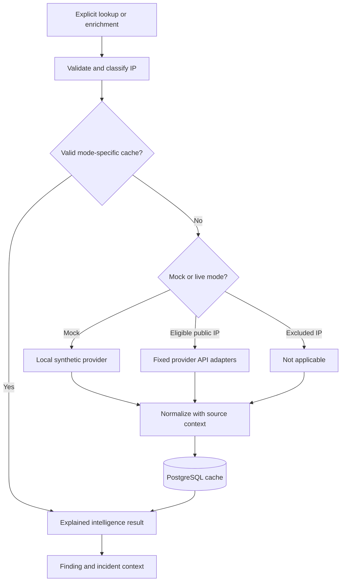

# Phase 9 — Threat intelligence and enrichment

Apply this update to the existing Phase 8 project. Complete new/modified files are included; no project recreation is needed. See [PHASE9_FILES.md](PHASE9_FILES.md) for the file manifest and [PHASE9_VALIDATION.md](PHASE9_VALIDATION.md) for measured results and validation limits.

## Architecture



`app/threat_intelligence/service.py` coordinates explicit requests, the PostgreSQL cache, provider cooldowns, audits and metrics. The three adapters and local mock implement `ThreatIntelligenceProvider`. `aggregator.py` combines normalized results, while `cache.py` owns mode-specific storage. `services/incident_enrichment.py` resolves existing incident/finding/event references. `routes/threats.py` and `scripts/run_threat_enrichment.py` call these same services.

Synchronous HTTP adapters match the existing synchronous SQLAlchemy sessions and FastAPI threadpool handlers. There is no new worker queue, Redis dependency or background polling. Raw event data and simulation scenario labels do not determine provider results.

## Provider contracts and normalization

Only canonical IPv4/IPv6 strings are accepted. CIDRs, hostnames, URLs and scoped IPv6 are rejected. Public indicators are sent to the provider, never contacted directly. Private, loopback, link-local, multicast, unspecified, reserved, documentation and selected IPv6 translation/tunnel ranges are excluded. Each adapter independently enforces the gate. The development provider can evaluate documentation ranges offline.

| Provider | Fixed HTTPS lookup | Authentication | Preserved context |
| --- | --- | --- | --- |
| AbuseIPDB | `api.abuseipdb.com/api/v2/check`, `ipAddress` and `maxAgeInDays=90` | `Key` header | Abuse confidence, total reports, country, ISP, usage type, last report and sanitized response |
| VirusTotal v3 | `www.virustotal.com/api/v3/ip_addresses/{ip}` | `x-apikey` header | Malicious/suspicious/harmless/undetected counts, community reputation, AS owner, country, last analysis and sanitized response |
| AlienVault OTX | `otx.alienvault.com/api/v1/indicators/IPv4/{ip}/general` or `IPv6` | `X-OTX-API-KEY` header | Pulse count and metadata, tags, ASN/country, reported time when present and sanitized response |
| CyberSentinel Mock | No network | None | Phase 6 synthetic indicator set, synthetic score and reports |

No provider SDK is required. Existing `httpx==0.28.1` moves from development-only to runtime dependencies; its locked `httpcore==1.0.9` and `certifi==2026.7.22` are added to the runtime lock. Existing AnyIO, h11 and idna satisfy its other dependencies. No dependency versions used by earlier phases are upgraded.

The `ti-v1` mapping is an explicit application policy, not a provider-endorsed probability:

| Source | Normalized signal and label |
| --- | --- |
| AbuseIPDB | Retain the 0–100 abuse confidence. 75+ → MALICIOUS, 1–74 → SUSPICIOUS, 0 → NO_ADVERSE_SIGNALS |
| VirusTotal | At least 3 malicious engines: `min(100, 75 + 5 × (malicious - 3))`, MALICIOUS. Fewer adverse engines: `min(74, 40 + 10 × malicious + 5 × suspicious)`, SUSPICIOUS. Explicit zero adverse counts with at least one harmless/undetected result: 0, NO_ADVERSE_SIGNALS. Missing/empty counts: UNKNOWN |
| OTX | Positive pulse count: `min(74, 25 + 5 × pulses)`, SUSPICIOUS. Explicit zero: 0, NO_ADVERSE_SIGNALS. Missing count: UNKNOWN. Pulse association alone never sets MALICIOUS |
| Mock | `192.0.2.44`, `198.51.100.73`, `203.0.113.18`: Phase 6 score **92**, MALICIOUS, 143 simulated reports. Other documentation IPs: 0, NO_ADVERSE_SIGNALS. Public IPs: UNKNOWN. Internal IPs: not applicable |

VirusTotal's signed community `reputation` is retained as `provider_score`; it is not treated as an abuse percentage. Engine counts remain in `raw_response.data.attributes.last_analysis_stats`. OTX pulse count remains in `raw_response.pulse_info.count`; its `provider_score` is null. Missing countries, dates, ISPs and counts remain null.

Aggregation takes the maximum available normalized signal, never an average of incompatible raw values. Any MALICIOUS signal wins; otherwise any SUSPICIOUS signal wins. Disagreement remains visible per provider. When there are no adverse signals but a provider failed, returned an unavailable report or lacks interpretable evidence, the aggregate is UNKNOWN with null score/malicious. A disabled or unconfigured provider does not erase another provider's successful result, but `partial=true` exposes incomplete coverage. NO_ADVERSE_SIGNALS means only that the checked sources supplied no adverse signal; it does not establish safety.

Every response exposes `mode`, `simulation`, `data_label`, lookup status, explanation, provider-specific timestamps and source results. Mock mode never becomes live because keys are present. Live failures never silently become simulated successes.

## Persistence and cache behavior

Migration **`0006_threat_intelligence`** follows `0005_incident_workflow`:

| Table | Change |
| --- | --- |
| `threat_intelligence` | Reuses the existing unique `(indicator_type, indicator)` identity, UUID, first-seen and cache upsert. Makes `malicious`, `abuse_score`, `confidence_score`, `reports` nullable so unknown is distinct from zero/false. Existing values remain intact |
| `threat_intelligence_results` | Adds one current JSONB provider bundle per `(indicator_id, mode)`, plus normalized level/score, policy hash, checked/expiry timestamps and expiry index |
| `threat_provider_state` | Adds shared per-provider cooldown, last status and credential-version hash; stores no API key |

The existing identity table's compatibility fields summarize the most recently written mode. APIs use `threat_intelligence_results` as the authoritative mode-specific result. Mock and live records cannot replace each other. The compatibility `confidence_score` is null for new intelligence; no probability is fabricated. Existing legacy cache rows remain stored but are not accepted as Phase 9 provider bundles without an explicit lookup.

Successful provider TTL defaults to 24 hours. Live failures/unknown statuses use a 300-second short TTL, extended by `Retry-After` when needed. Offline mock results use the configured successful TTL. The aggregate expires when its earliest provider expires. On refresh, still-valid individual provider results are reused, unless force refresh was explicitly requested. Changing relevant settings, normalization policy or credentials invalidates policy compatibility; keys themselves are never stored in payloads or hashes returned by the API.

Repeated lookups upsert rather than append duplicate cache identities. GETs return cached results only, including `stale` and `configuration_changed`; they neither refresh nor write metrics. Cache storage is a current snapshot, not an unlimited provider response history. Existing score snapshots retain the exact source values and explanations used for that calculation.

## Failure handling, limits and concurrency

- TLS verification is enabled, API hosts are fixed, redirects and environment proxies are disabled. Only the public IP and provider-required lookup parameters leave the application; incident notes and event payloads are not sent.
- Default HTTP timeout is 10 seconds. A monotonic deadline also bounds response streaming; a currently blocking HTTP operation is governed by HTTPX's timeout. Each response is limited to 512 KiB by default. Invalid JSON, nonfinite numbers, malformed fields and indicator mismatches produce an unknown/error result.
- Successful raw JSON is bounded and sanitized: credential-named fields and known configured key values are removed. Error bodies and headers are not stored or exposed. Logs report mode/status/counters rather than credentials or raw exceptions.
- 401/403 become `auth_error`; cooldown is at least 24 hours unless the credential changes. 429 becomes `rate_limited` and honors seconds/date `Retry-After`. Timeouts, 5xx and malformed reports remain unknown.
- At most one retry is allowed for a timeout or 500/502/503/504, only without `Retry-After` and when provider spacing fits the configured short retry delay. Default VT spacing is 15 seconds, so VT failures are deferred instead of immediately retried. Authentication failures, 429s, redirects and 404s are not retried immediately.
- Default provider spacing is AbuseIPDB 1 second, VirusTotal 15 seconds, OTX 1 second, shared in PostgreSQL across IPs and API/CLI processes. Cooldown responses include `retry_at`; force refresh cannot bypass them. These conservative pacing controls do not promise compliance with every account's daily quota; provider responses remain authoritative.
- A nonblocking PostgreSQL transaction advisory lock allows one enrichment lookup writer at a time across workers. Contention returns 409. A single indicator's cache, cooldown, metrics and audit writes commit together; failure rolls back that indicator. External quota usage cannot be rolled back.
- Bulk work resolves at most the configured incident/unique-IP limits before provider requests. It commits each unique indicator separately and records one batch summary. A default 60-second budget is checked between IPs; the in-progress lookup can extend the elapsed time. Incomplete work reports `complete=false`, an explanation and the same offset for safe resumption.

The embedded validation environment cannot prove multi-process PostgreSQL advisory-lock behavior or account-specific live quotas; verify these on native PostgreSQL before deployment.

## Finding and incident enrichment

Finding IPs are derived from `source_ip` and retained evidence event source/destination IPs. Incident IPs are the union of the primary source, all linked finding sources, and incident evidence source/destination IPs. SQL removes duplicates; private destinations produce local not-applicable results and no external traffic. All referenced IPs, rather than just the initiating source, can therefore be reviewed.

Associations reuse existing event/finding/incident references and canonical IP identity. No duplicate event or incident model, copied event payload or association to a simulation scenario is introduced. Related-result GETs return a paginated `indicators` list plus `missing_indicators`, `total_indicators`, `limit` and `offset`. Association is to the current cache; this phase does not implement a historical intelligence snapshot per incident.

Bulk `--all` selects one bounded page, newest incidents first. Shared IPs are looked up once per page; later pages reuse the cache. `incidents_evaluated` counts selected cases; `incidents_enriched` counts cases with at least one successful source result, not proof that every related IP is known. `unique_indicators` is the planned union; `indicators_evaluated` reports completed lookups. `external_lookups` counts IPs requiring HTTP, while `provider_requests` counts actual requests including retries. `next_offset=null` means no further selected pages.

Enrichment does not change raw security events, detection evidence or severity, processed flags, risk scores, incident risk/status/assignment/notes, or existing audit entries. Cache hits may add a new manual-lookup audit/summary metrics; idempotency refers to data identity and lack of duplicate enrichment records, not suppression of operator audit history.

Audits: `THREAT_LOOKUP_PERFORMED`, `THREAT_INTELLIGENCE_REFRESHED`, `INCIDENT_ENRICHMENT_TRIGGERED`. API actor IDs use existing authentication; trusted CLI audits have no invented user. Metrics are summary-level: `threat_lookup_count`, `threat_cache_hits`, `threat_provider_errors`, `threat_enrichment_duration_ms`, `incidents_enriched`. Error metrics count failed statuses observed in lookup results, including cached failures; `provider_requests` is the actual HTTP-attempt counter. Duration uses measured service time before the final summary commit; CLI/API wall times may be slightly greater.

## Explicit Phase 7 / Phase 8 workflow

Default scoring continues to use the original local synthetic reputation provider. An opt-in `CachedReputationProvider` implements that same interface without HTTP. It accepts only fresh, compatible, usable results from the configured mock/live mode that existed when the scoring run started. Missing/expired/unknown context contributes zero with an explicit explanation, not a claim of safety.

Use `reputation_source="cached"` in `/api/risk/run`, or `--reputation-source cached` in the existing CLI. Existing assessments still require **`rescore=true` / `--rescore`**. The existing reputation bands (25→4, 75→7, 90→10 points) and total-risk formula are unchanged. Provider mode, scores, policy explanations and timestamps enter the existing risk input snapshot/hash. No HTTP request is made by scoring.

After a deliberate rescore, run the existing Phase 8 processor to refresh linked case risk. Its maximum-linked-score rule and investigation workflow remain authoritative. Enrichment does not write `incident.risk_score` directly. Phase 7 retains different score versions but deliberately updates an existing assessment of the same version on explicit rescore; this phase does not add a separate historical revision archive. Export an old assessment first if its complete pre-rescore contents must be retained beyond the existing audit coverage.

## Environment variables

Your existing `.env` remains valid and defaults to offline mock mode. Merge optional values from `.env.example` rather than replacing your credentials or port configuration.

| Variable | Default | Purpose |
| --- | --- | --- |
| `THREAT_INTELLIGENCE_ENABLED` | `true` | Master provider switch |
| `THREAT_INTELLIGENCE_MOCK_MODE` | `true` | Offline simulation; false explicitly selects live mode |
| `ABUSEIPDB_API_KEY`, `VIRUSTOTAL_API_KEY`, `OTX_API_KEY` | Empty | Backend-only optional secrets |
| `ABUSEIPDB_ENABLED`, `VIRUSTOTAL_ENABLED`, `OTX_ENABLED` | `true` | Independent adapter switches |
| `THREAT_INTELLIGENCE_CACHE_TTL_HOURS` | `24` | Successful cache TTL, 1–168 hours |
| `THREAT_INTELLIGENCE_ERROR_TTL_SECONDS` | `300` | Unsuccessful live lookup TTL, 1–3600 seconds |
| `THREAT_INTELLIGENCE_TIMEOUT_SECONDS` | `10` | HTTP timeout, 0.1–30 seconds |
| `THREAT_INTELLIGENCE_MAX_RESPONSE_BYTES` | `524288` | Maximum provider payload, 1024–2097152 bytes |
| `THREAT_INTELLIGENCE_MAX_INCIDENTS` | `50` | Maximum incidents per bulk invocation, 1–100 |
| `THREAT_INTELLIGENCE_MAX_INDICATORS` | `100` | Maximum unique IPs per bulk invocation, 1–500 |
| `THREAT_INTELLIGENCE_ABUSEIPDB_INTERVAL_SECONDS` | `1` | Minimum shared spacing, 1–3600 seconds |
| `THREAT_INTELLIGENCE_VIRUSTOTAL_INTERVAL_SECONDS` | `15` | Minimum shared spacing, 1–3600 seconds |
| `THREAT_INTELLIGENCE_OTX_INTERVAL_SECONDS` | `1` | Minimum shared spacing, 1–3600 seconds |
| `THREAT_INTELLIGENCE_MAX_RETRIES` | `1` | Maximum immediate transient retries, 0–1 |
| `THREAT_INTELLIGENCE_MAX_RETRY_DELAY_SECONDS` | `2` | Longest immediate retry wait, 0–15 seconds |
| `THREAT_INTELLIGENCE_RUN_TIMEOUT_SECONDS` | `60` | Bulk budget checked between IPs, 1–300 seconds |

Put actual API keys only in your local `.env`; never use a `VITE_` prefix. To enable live mode, set `THREAT_INTELLIGENCE_MOCK_MODE=false`, configure the desired key(s), then recreate the backend with `docker compose up -d --force-recreate backend`. `docker compose restart` does not reload changed container environment values. Missing keys are reported per provider and do not disable other configured adapters. Tests and the offline demonstration need no live credentials.

## API contract

All endpoints use existing Phase 3 JWT/session validation and explicit Pydantic response models.

| Method and path | Roles | Behavior |
| --- | --- | --- |
| `POST /api/threats/lookup` | ADMIN, ANALYST | Body `{"ip":"198.51.100.73","force_refresh":false}`. Canonical validation, cache or configured provider request, detailed aggregate |
| `GET /api/threats` | ADMIN, ANALYST, VIEWER | Cached page. Filters: `indicator`, `provider`, `reputation_level`, `malicious`, `last_checked` (aware timestamp lower bound), `mode`; `limit` 1–100, `offset` 0–1000000 |
| `GET /api/threats/ip/{ip}` | All three | Full cached provider payload; optional `mode=mock` or `live`; 404 if no bundle |
| `GET /api/threats/providers/status` | All three | Configuration, active mode and persisted cooldowns; makes no provider request and is not a live provider health test |
| `POST /api/threats/enrich/incidents` | ADMIN, ANALYST | Body `{"limit":50,"offset":0,"force_refresh":false}`; optional `incident_id`. Returns measured summary and page continuation |
| `GET /api/incidents/{incident_id}/threat-intelligence` | All three | Cached current context for all associated IPs, paginated by `limit`/`offset`, optional mode |
| `GET /api/detections/{finding_id}/threat-intelligence` | All three | Cached current context for retained finding evidence IPs, same pagination/mode |

List and related-result endpoints omit large `raw_response` bodies; the IP detail/explicit lookup returns them. Unauthenticated requests return 401, viewer write attempts 403, invalid input 422, missing entities/cache 404, writer contention 409 and unexpected persistence failures sanitized 503. Provider failures normally return 200 with explicit unknown/error statuses because the lookup outcome is represented successfully. Inspect provider statuses, not just the HTTP status.

## Windows PowerShell: upgrade and start

From your existing project directory, merge the archive's files. Preserve your actual `.env`; the update contains only `.env.example`. Docker Compose, both Dockerfiles, frontend and existing host port mapping are unchanged.

```powershell
Set-Location 'C:\Users\saiya\OneDrive\Documents\Projects\cybersentinel'
# If the update ZIP is in Downloads:
Expand-Archive -Path "$env:USERPROFILE\Downloads\CyberSentinel-Phase9-Update.zip" `
  -DestinationPath . -Force

docker compose up -d --build --wait --wait-timeout 180
if ($LASTEXITCODE -ne 0) { throw 'Container startup failed; inspect docker compose logs' }
docker compose exec backend alembic upgrade head
if ($LASTEXITCODE -ne 0) { throw 'Migration failed' }
docker compose exec backend alembic current
docker compose exec backend alembic check
docker compose ps
Invoke-RestMethod -Uri 'http://localhost:8000/api/system/health'
Invoke-RestMethod -Uri 'http://localhost:8000/api/database/status'
Start-Process 'http://localhost:8000/docs'
```

Expected migration head: **`0006_threat_intelligence`**; `alembic check` reports no new upgrade operations. Compose should show all three services healthy. Health reports `phase: 9`, `version: 0.9.0`; database status reports a connected, migrated schema. These URLs use your observed backend port 8000; substitute your existing `BACKEND_PORT` if customized. Keep `POSTGRES_PORT=15432` if you previously changed it for the Windows 5432 bind conflict; Docker-internal PostgreSQL still uses `db:5432`.

No new detection-rule seed is required for the upgrade. The existing seed remains safe to repeat:

```powershell
docker compose exec backend python -m scripts.seed_detection_rules
```

Do not generate another initial migration or delete the PostgreSQL volume.

## Offline CLI demonstration

```powershell
docker compose exec backend python scripts/run_threat_enrichment.py --ip 198.51.100.73 --mock
docker compose exec backend python scripts/run_threat_enrichment.py --ip 198.51.100.73 --mock
docker compose exec backend python scripts/run_threat_enrichment.py --ip 198.51.100.73 --mock --force-refresh

docker compose exec backend python scripts/run_threat_enrichment.py --all --limit 50 --mock
docker compose exec backend python scripts/run_threat_enrichment.py --all --limit 50 --mock
```

The first IP lookup reports simulated score 92 and zero external requests. The second has `cache_hit=true` and zero provider evaluations. Forced mock refresh preserves indicator identity and writes a newer timestamp. An unchanged bulk repeat has cache hits for every unique IP and zero provider requests; new/expired data or changed configuration can require reevaluation.

| CLI argument | Meaning |
| --- | --- |
| `--ip ADDRESS` | One validated IP |
| `--incident ID` | One existing case |
| `--finding ID` | One existing detection finding |
| `--all` | One bounded page of existing cases |
| `--limit N` | Page size, default 50, request maximum 100 and configured cap applies |
| `--offset N` | Page offset; follow returned `next_offset` |
| `--force-refresh` | Bypass valid cache but not shared cooldowns |
| `--mock` | Force offline mock mode for this invocation |

Choose exactly one target. CLI execution requires `APP_ENV=development` or `test` and trusted database access; deployed users use authenticated APIs. Exit 0 means completed, 2 means incomplete/invalid arguments, 1 means environment or service failure. `--mock` overrides an otherwise live environment for that invocation. Without it, the CLI uses configured mode.

Use actual existing IDs for targeted enrichment or deliberate rescoring:

```powershell
$caseId = Read-Host 'Existing incident_id'
$findingId = Read-Host 'Existing finding_id'
docker compose exec backend python scripts/run_threat_enrichment.py --incident $caseId --mock
docker compose exec backend python scripts/run_threat_enrichment.py --finding $findingId --mock
# Optional: select the configured mode's fresh cache for a deliberate Phase 7 rescore.
docker compose exec backend python scripts/run_risk_scoring.py `
  --finding $findingId --rescore --reputation-source cached
# Apply that score through the existing Phase 8 logic.
docker compose exec backend python scripts/run_incident_processing.py --until-empty
```

The scorer uses the backend's configured mock/live mode. A CLI-only `--mock` enrichment does not switch a live-configured scorer to mock data.

## Full 10,000-event workflow

```powershell
docker compose exec backend python scripts/generate_demo_data.py `
  --count 10000 --seed 42 --scenario mixed --output data/threat_test.jsonl
docker compose exec backend python scripts/ingest_events.py --file data/threat_test.jsonl
docker compose exec backend python scripts/run_detection.py --until-empty
docker compose exec backend python scripts/run_risk_scoring.py --until-empty
docker compose exec backend python scripts/run_incident_processing.py --until-empty
docker compose exec backend python scripts/run_threat_enrichment.py --all --limit 50 --mock
docker compose exec backend python scripts/run_threat_enrichment.py --all --limit 50 --mock
```

If the generated file already exists, reuse it; `--overwrite` intentionally replaces that generated file only. Stable event IDs mean identical earlier imports are skipped instead of duplicated. Existing database contents and configured thresholds affect totals, so do not delete development records to reproduce isolated benchmark counts. If there are more than 50 cases, process subsequent `next_offset` pages. For live bulk lookups, cooldowns can yield partial/unknown context; resume after the indicated retry time instead of forcing repeated requests.

## Authenticated API and Swagger verification

Use an existing ADMIN or ANALYST username and privately prompted password:

```powershell
$baseUrl = 'http://localhost:8000'
$credential = Get-Credential -Message 'Existing CyberSentinel username and password'
$loginBody = @{
  username = $credential.UserName
  password = $credential.GetNetworkCredential().Password
} | ConvertTo-Json
$login = Invoke-RestMethod -Method Post -Uri "$baseUrl/api/auth/login" `
  -ContentType 'application/json' -Headers @{'X-CSRF-Guard'='1'} `
  -Body $loginBody -SessionVariable browserSession
$headers = @{Authorization="Bearer $($login.access_token)"}
Remove-Variable loginBody, credential

Invoke-RestMethod -Uri "$baseUrl/api/threats/providers/status" -Headers $headers
$lookupBody = @{ip='198.51.100.73'; force_refresh=$false} | ConvertTo-Json
$first = Invoke-RestMethod -Method Post -Uri "$baseUrl/api/threats/lookup" `
  -Headers $headers -ContentType 'application/json' -Body $lookupBody
$second = Invoke-RestMethod -Method Post -Uri "$baseUrl/api/threats/lookup" `
  -Headers $headers -ContentType 'application/json' -Body $lookupBody
$first | Select-Object mode, simulation, reputation_level, normalized_score, cache_hit, external_requests
$second | Select-Object mode, simulation, reputation_level, normalized_score, cache_hit, external_requests

Invoke-RestMethod -Uri "$baseUrl/api/threats?limit=10&mode=mock" -Headers $headers
Invoke-RestMethod -Uri "$baseUrl/api/threats/ip/198.51.100.73?mode=mock" -Headers $headers
$summary = Invoke-RestMethod -Method Post -Uri "$baseUrl/api/threats/enrich/incidents" `
  -Headers $headers -ContentType 'application/json' -Body '{"limit":50}'
$summary
$cases = Invoke-RestMethod -Uri "$baseUrl/api/incidents?limit=1" -Headers $headers
if ($cases.items.Count -gt 0) {
  $caseId = $cases.items[0].incident_id
  Invoke-RestMethod -Uri "$baseUrl/api/incidents/$caseId/threat-intelligence" -Headers $headers
}
$findings = Invoke-RestMethod -Uri "$baseUrl/api/detections?limit=1" -Headers $headers
if ($findings.items.Count -gt 0) {
  $findingId = $findings.items[0].finding_id
  Invoke-RestMethod -Uri "$baseUrl/api/detections/$findingId/threat-intelligence" -Headers $headers
}
Invoke-RestMethod -Method Post -Uri "$baseUrl/api/auth/logout" `
  -Headers @{'X-CSRF-Guard'='1'} -WebSession $browserSession
Remove-Variable headers, login, browserSession
```

A missing cache returns 404; an internal/documentation IP in **live** mode returns not applicable without network access. The examples expect the default mock configuration.

Swagger: open `/docs`, use `/api/auth/login` with `X-CSRF-Guard: 1`, then paste the returned access token into **Authorize → BearerAuth**. All seven operations appear under **Threat intelligence** with response models. Try a mock lookup, repeat it, inspect the cached IP, enrich a case page and inspect related finding/case context. With VIEWER, all read operations are allowed, both POST operations return 403. Swagger's UI assets require internet; `/openapi.json` is served locally.

## PostgreSQL inspection

Your existing database/user in the supplied setup are both `cybersentinel`:

```powershell
docker compose exec db psql -U cybersentinel -d cybersentinel
```

For customized database/user values, use those existing values instead. Inside psql:

```sql
\dt
SELECT version_num FROM alembic_version;

SELECT t.indicator, r.mode, r.reputation_level, r.normalized_score,
       r.malicious, r.checked_at, r.expires_at
FROM threat_intelligence t
JOIN threat_intelligence_results r ON r.indicator_id=t.id
ORDER BY r.checked_at DESC;

SELECT t.indicator, r.mode, p->>'provider' AS provider,
       p->>'lookup_status' AS status, p->>'provider_score' AS provider_score,
       p->>'normalized_score' AS normalized_score,
       p->>'explanation' AS explanation
FROM threat_intelligence t
JOIN threat_intelligence_results r ON r.indicator_id=t.id
CROSS JOIN LATERAL jsonb_array_elements(r.payload->'providers') p
ORDER BY t.indicator, r.mode, provider;

SELECT indicator_type, indicator, COUNT(*)
FROM threat_intelligence
GROUP BY indicator_type, indicator HAVING COUNT(*) > 1;
SELECT indicator_id, mode, COUNT(*)
FROM threat_intelligence_results
GROUP BY indicator_id, mode HAVING COUNT(*) > 1;

SELECT provider, next_allowed_at, last_status FROM threat_provider_state;
SELECT processed, COUNT(*) FROM security_events GROUP BY processed;
SELECT metric_name, metric_value, unit, timestamp
FROM system_metrics WHERE metric_name LIKE 'threat_%' OR metric_name='incidents_enriched'
ORDER BY timestamp DESC LIMIT 20;
SELECT action, entity_type, entity_id, timestamp
FROM audit_logs
WHERE action IN ('THREAT_LOOKUP_PERFORMED','THREAT_INTELLIGENCE_REFRESHED','INCIDENT_ENRICHMENT_TRIGGERED')
ORDER BY timestamp DESC LIMIT 20;
\q
```

Both duplicate queries should return zero rows. Mock-only execution needs no provider cooldown rows because it makes no HTTP requests. Table count is 16 application tables plus `alembic_version` for a clean database.

## Tests and native Python alternative

Docker's existing development backend installs `requirements-dev.txt`. Use the existing isolated-database test runner so tests do not modify your development records:

```powershell
docker compose exec backend python -m scripts.run_database_tests
docker compose exec backend ruff check .
```

The runner creates a uniquely named test database and tests within a random schema, then removes only that temporary database. The development PostgreSQL role needs `CREATEDB`. Plain `pytest` without `TEST_DATABASE_URL` skips database tests; it is not a full substitute.

To use the existing native Windows backend environment instead:

```powershell
Set-Location 'C:\Users\saiya\OneDrive\Documents\Projects\cybersentinel'
docker compose up -d db
Set-Location .\backend
# If missing, create once: py -3.12 -m venv .venv
.\.venv\Scripts\python.exe -m pip install -r requirements-dev.txt
.\.venv\Scripts\python.exe -m alembic upgrade head
.\.venv\Scripts\python.exe -m alembic check
.\.venv\Scripts\python.exe -m scripts.run_threat_enrichment --ip 198.51.100.73 --mock
.\.venv\Scripts\python.exe -m scripts.run_threat_enrichment --all --limit 50 --mock
.\.venv\Scripts\python.exe -m scripts.run_database_tests
```

For a native API process, stop only the container backend (`docker compose stop backend` from the root) before running `.\.venv\Scripts\python.exe -m uvicorn app.main:app --host 127.0.0.1 --port 8000` from `backend`. Reuse your root `.env` host/port values. No frontend work is part of Phase 9.

## Provider references and limits

Adapters were checked against official interfaces:

- [AbuseIPDB v2 documentation](https://docs.abuseipdb.com/)
- [VirusTotal IP lookup](https://docs.virustotal.com/reference/ip-info)
- [VirusTotal IP object](https://docs.virustotal.com/reference/ip-object)
- [Official OTX Python SDK request implementation](https://github.com/AlienVault-OTX/OTX-Python-SDK/blob/master/OTXv2.py)
- [Official OTX indicator types](https://github.com/AlienVault-OTX/OTX-Python-SDK/blob/master/IndicatorTypes.py)

Live provider requests disclose the queried public IP to that provider. Use approved indicators and your provider account's permitted usage; this application does not submit scans, files, URLs, incident notes or raw events. No live-provider success is claimed in this delivery. Fixture-driven adapter tests verify request/normalization/error behavior; actual credentials, quotas and network service availability remain deployment checks.

Phase 9 ends here. Dashboard APIs, SOC frontend work and AI remain subsequent phases.
