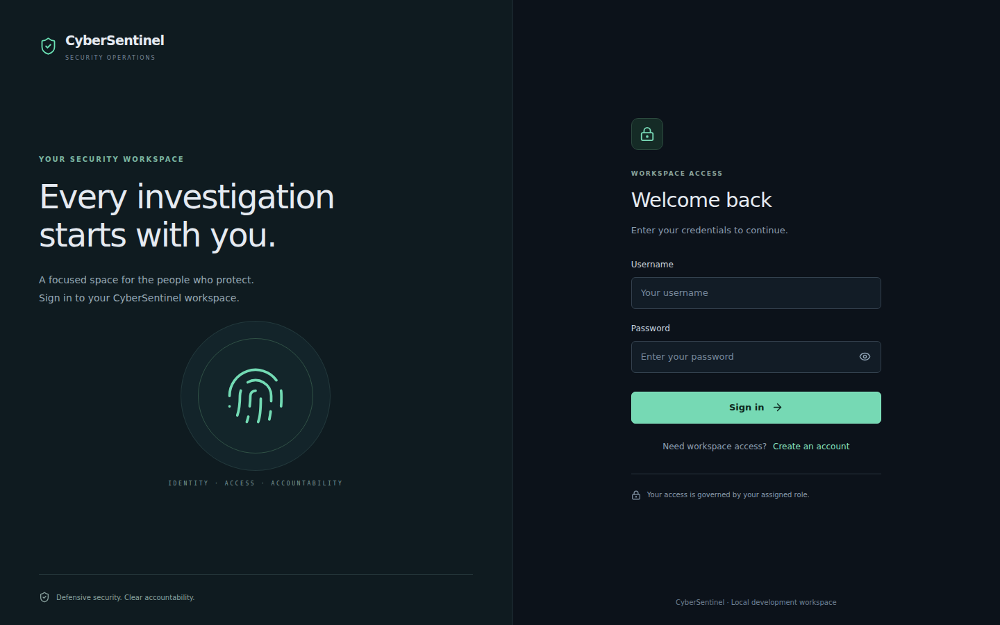
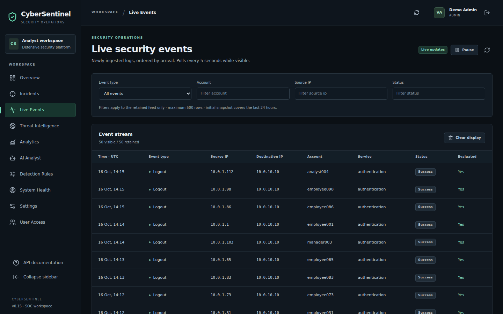
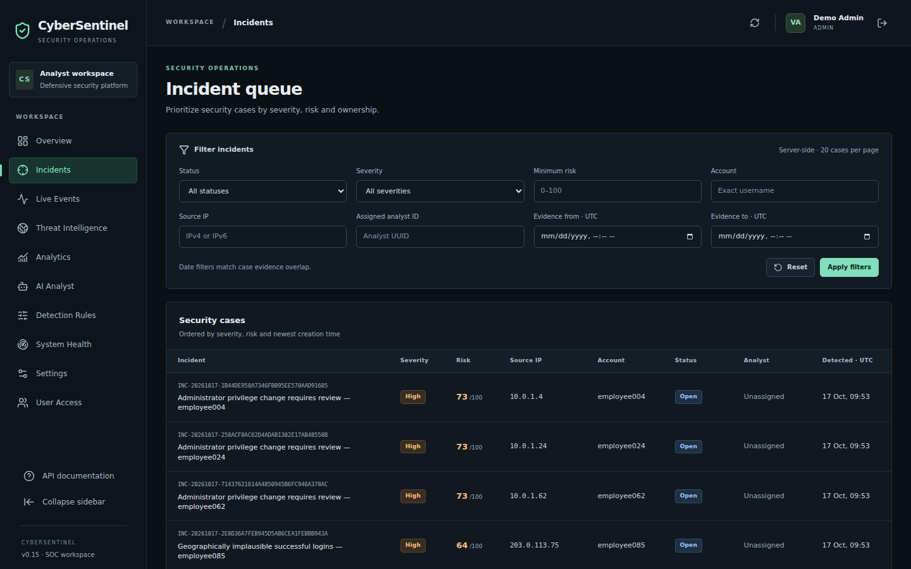
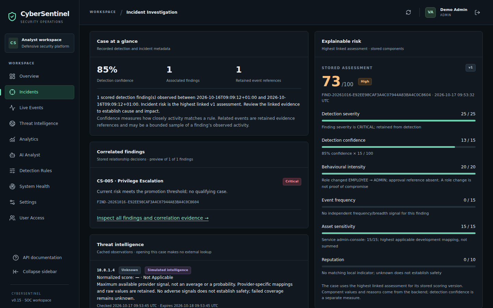
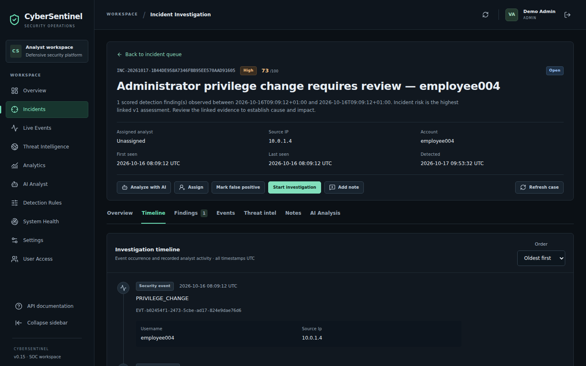
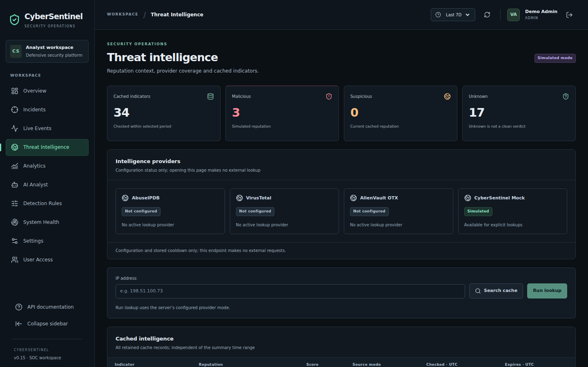
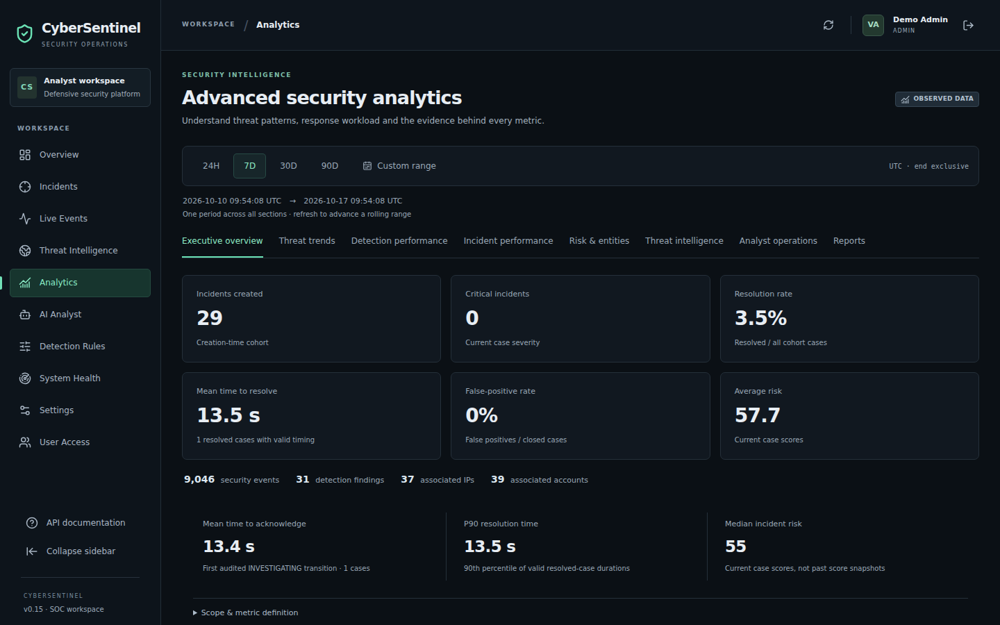
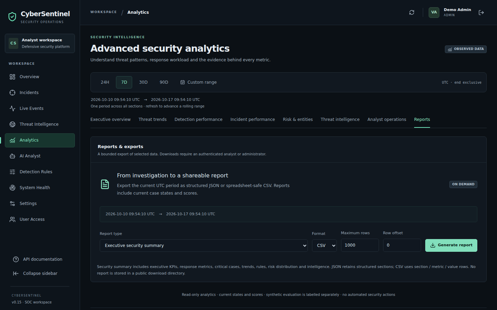
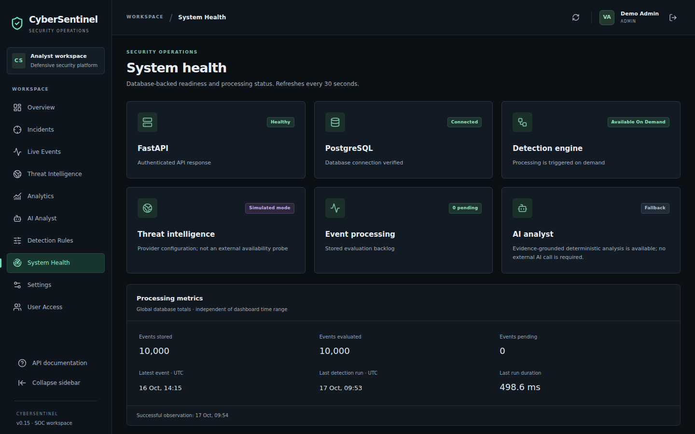
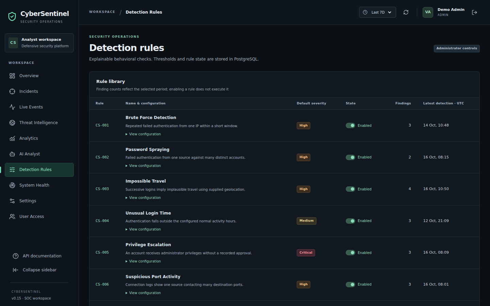

# Application screenshots

[Project overview](../README.md) · [Demo guide](DEMO.md) · [Verification](PHASE17_VALIDATION.md)

Captured from the actual React production build against FastAPI and an isolated PGlite database on 2026-10-17, using Chromium 153 at **1440 × 900**, UTC, 100% device scale. The capture used Vite preview as a local reverse proxy, not Docker/Nginx; this does not verify native deployment. The only Phase 17 UI change replaces a stale footer phase label; no dashboard content is fabricated or overlaid.

The pipeline generated 10,000 events with seed 42, mixed scenarios and a 2026-10-10 UTC start. Accounts/resources are fictional. No external intelligence or LLM call was made. Login fields were blank for capture; temporary credentials remained in process memory and the disposable database was removed after verification.

The rolling seven-day charts show fewer than 10,000 events because their cutoff is the capture time minus seven days, while generation began at midnight. System Health shows all 10,000 retained events. Use a custom UTC range starting at midnight or 30 days to see the full generated dataset. Findings/cases shown use their own documented time/cohort definitions.

## Login

Blank credential fields; no password or token is shown.

## Security overview

Seven-day event cohort with current incident state. All cases in this dataset are High, so Critical correctly shows zero.

## Live security events

Stored synthetic telemetry; new data appears only after ingestion.

## Incident queue

Risk, severity, status and case links from the database.

## Incident investigation

A real synthetic privilege-change finding promoted into an analyst case.

## Explainable risk

Six stored contributions: 25 + 13 + 20 + 0 + 15 + 0 = 73. Critical rule severity and High case risk are distinct.

## Case timeline

Evidence and workflow context for the selected case.

## Threat intelligence

Simulated mode and unconfigured live providers remain visibly labeled.

## AI analyst

Deterministic fallback with validated evidence references; not a claim of a live LLM call.

## Advanced analytics

UTC cohort and response definitions. Timings reflect a scripted synthetic investigation, not analyst productivity.

## Reports and exports

Existing role-controlled report generation interface.

## System health

10,000 stored/evaluated events, zero pending; provider modes are configuration states.

## Detection rules

Current seeded configuration and enabled rules.

## Refreshing the gallery

Follow the demo guide with synthetic-only data, choose a populated case, and capture the listed screens at the same viewport. Keep simulation/fallback labels and empty-state/error truth intact. Do not show `.env`, credentials, bearer tokens, real employee identifiers, patient data or unsupported accuracy claims. Old phase screenshots remain historical evidence; the root README uses this current gallery.
