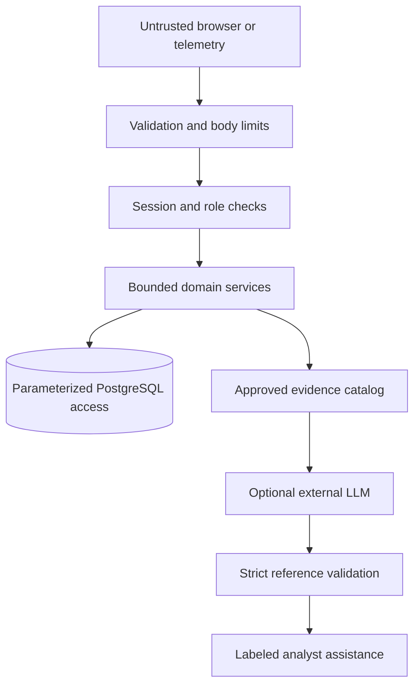

# Security design and threat model

[Architecture](ARCHITECTURE.md) · [Testing](TESTING.md) · [Setup](SETUP.md)

CyberSentinel is a defensive portfolio application. Its controls have focused tests; it is not a certified SIEM, an independently audited production system or a healthcare-compliance product. Do not ingest real patient data for this demonstration.

## Assets, actors and trust boundaries

Protect account/session secrets, original event evidence, rule policy, risk/case integrity, analyst notes, provider credentials and exported reports. Consider anonymous attackers, compromised viewer accounts, overprivileged operators, malicious telemetry/provider text and provider outages. The host/database administrator can bypass application access controls and is a trusted operator; this is not a multi-tenant security boundary.

## Authentication and authorization

- bcrypt hashes passwords at cost 12. Password creation enforces a 12-character minimum, a 72-byte bcrypt limit and no NUL characters; responses never include hashes.
- Signed HS256 access tokens expire (30 minutes by default), with issuer/audience/type validation. The frontend keeps access tokens in memory, not persistent browser storage.
- A refresh token is held in an HttpOnly, SameSite=Strict cookie scoped to `/api/auth`; production uses Secure. Server-side hashed refresh sessions rotate and support revocation/reuse detection.
- Each authenticated request rechecks active user/session state and the database role. A stale token does not preserve revoked access or a former ADMIN role.
- Registration creates VIEWER only. Server dependencies enforce roles; navigation visibility is only presentation.
- Browser auth operations require `X-CSRF-Guard: 1` and validate trusted origins/fetch context. Exact CORS origins are configured; credentials are not paired with a wildcard.
- Login/register/refresh throttling is process-local. `SERVER_WORKERS=1` is enforced until a shared limiter is deliberately implemented.

| Capability | VIEWER | ANALYST | ADMIN |
| --- | --- | --- | --- |
| Read events, findings, risk, cases, rules and stored analysis | Yes | Yes | Yes |
| Ingest, run engines, enrich, generate analysis, query analyst assistant | No | Yes | Yes |
| Assign/comment/change incident status | No | Yes | Yes |
| Export reports | No | Yes, except analyst workload | Yes |
| View analyst workload | No | No | Yes |
| Manage users and rule configuration | No | No | Yes |

## Threats and mitigations

| Threat | Implemented control | Remaining boundary |
| --- | --- | --- |
| Credential guessing / session theft | bcrypt, expiration, rotation/revocation, throttling, HttpOnly refresh | No SSO/MFA; local HTTP demo is not safe transport for remote use |
| CSRF / unauthorized mutation | Custom guard + origin checks on cookie auth, bearer-authorized writes, role dependencies | Host trust/origin configuration must match deployment |
| SQL injection | SQLAlchemy parameter binding, validated sort/filter fields | Trusted CLI/database users retain database authority |
| Stored XSS / spreadsheet injection | React escaped text; CSV formula-prefix neutralization | User exports and external tools remain outside app control |
| Forged / oversized event data | Pydantic types, UTC timestamps, IP/port checks, JSON/body/batch limits, duplicate event IDs | Valid telemetry can still be dishonest; collector authenticity is future work |
| Event tampering or lost detections | Raw-event preservation, transactions, evidence FK/reference checks, fingerprints and processed semantics | Database administrators and absence of immutable storage remain trust limits |
| Case over-correlation | Multiple identity matches, username conflict checks, bounded case window | Heuristics need environment-specific validation |
| Provider SSRF / failure / rate exhaustion | Fixed HTTPS hosts, validated public IPs, no redirects, bounded responses/retries, cooldowns and caches | Third-party accuracy, retention and availability need operational review |
| Prompt injection / invented claims | Server-authored fact/action catalog, strict schema and identity/hash/reference checks, fallback | Semantic quality is not guaranteed; analyst review is still necessary |
| Secret leakage | Environment-only credentials, generated local secrets, redacted validation errors, source scan and ignore rules | Git history and real deployment configuration require owner review |
| Resource exhaustion | Pagination, query/window/batch limits, timeouts, pool bounds, one-worker design | No production capacity or distributed rate-limit claim |

## AI and untrusted content

Detection and risk are deterministic Python, independent of an LLM. Optional analysis sends a minimized evidence catalog rather than full raw logs, passwords, free-form notes or provider prose. Usernames are aliased and local reference details restored by the renderer. The provider is not allowed to choose a URL, execute a tool, submit SQL or perform a response action.

The model chooses fact/action IDs from an allowlist. The server validates schema, incident ID, context hash, stored risk and reference membership before rendering factual sentences. Unsupported references or provider failure lead to deterministic fallback. Recommendations are suggestions for a human, not automatic IP blocks or account changes. Saved mode labels distinguish `AI` from `FALLBACK`; stale context is identified, and generation records history/audit/metrics only. Q&A uses predefined database intents even when an LLM is configured.

Provider requests use time/response limits and bounded retries. `store=false` is supplied to the optional LLM API; that flag alone is not a legal guarantee of provider retention or compliance. Live provider use should be reviewed separately before sending sensitive operational data.

## Secrets, network and operational handling

Keep `.env`, tokens, API keys, database dumps and generated user credentials out of commits/screenshots. `.env.example` contains placeholders only. The initialization script generates secrets locally without printing or overwriting them. Public `VITE_*` settings must never contain secrets.

Default Compose binds web/API to loopback, keeps the database on an internal network, uses non-root web/API containers, drops capabilities and sets read-only filesystems with explicit writable mounts. Nginx applies response-security headers. Production cookie protection requires HTTPS. `API_DOCS_ENABLED` controls Swagger availability. Business reads are authenticated; health/liveness/readiness intentionally remain public and development-only diagnostics are omitted in production.

Audit logs record selected manual runs and workflow/configuration changes, not every raw event. Audit user FKs become null if an account is removed; the audit record survives. They are application records, not a tamper-proof external audit system. Retention policies and encrypted managed backups are not implemented cloud features.

The supplied phase archives contain no Git metadata, so source scanning cannot establish that an existing remote/history is secret-free. Before publishing, inspect `git status`, the staged diff and tracked files locally; rotate any credential ever committed instead of merely deleting it. Do not publish security reports containing real keys or session tokens.

## Reporting and remaining gates

No repository URL or private reporting address is configured. For a public repository, the owner should enable a private vulnerability-reporting route and document it before accepting disclosures. Do not post credentials, exploit details against a live installation or real logs in a public issue.

Outstanding native gates are Docker Desktop startup/restart/outage recovery, native concurrent transaction acceptance and a complete PostgreSQL archive restore into a separate database. See [Testing](TESTING.md) and the dated [Phase 16 report](PHASE16_VALIDATION.md). Phase 18 deployment, public TLS, SSO/MFA, multi-tenancy and automatic remediation are not included.
